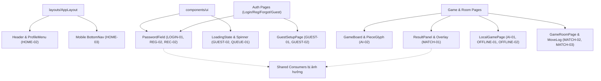
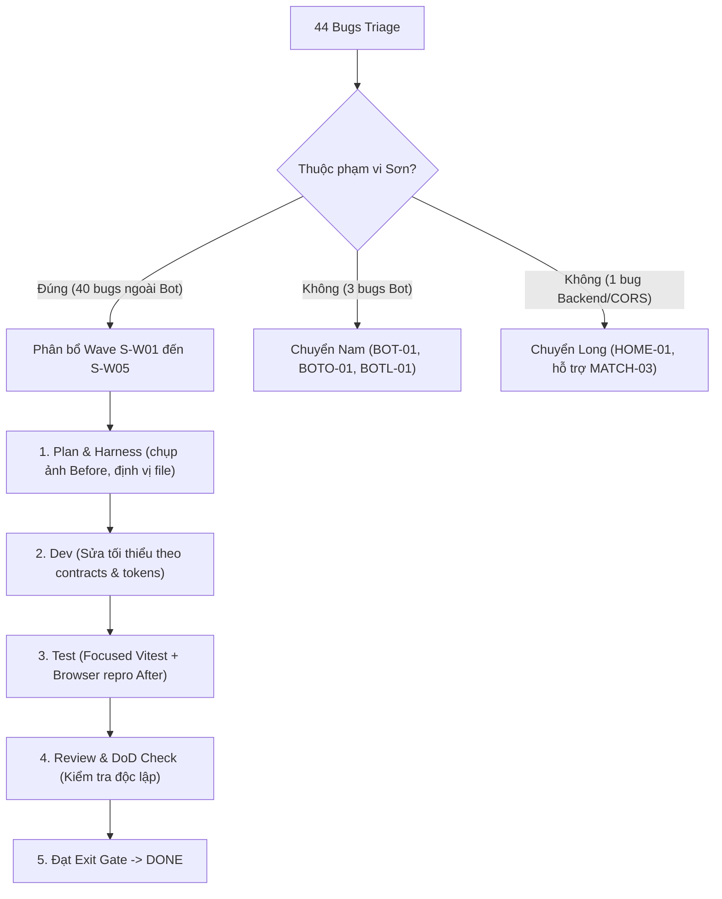
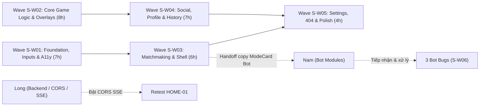

# BẢNG TỔNG HỢP RÀ SOÁT VÀ ĐÁNH MÃ LỖI FRONTEND (BT01 - ROBOT LAB)

> **Phụ trách:** Sơn | **Căn cứ:** [01-FRONTEND-AUDIT-FIX.md](file:///home/sonsiunhan/Projects/LTM_Nhom_2/BT01/docs/team-handoff/backend-frontend-fix/01-FRONTEND-AUDIT-FIX.md) & [SON.md](file:///home/sonsiunhan/Projects/LTM_Nhom_2/BT01/docs/team-handoff/backend-frontend-fix/SON.md)  
> **Phiên bản làm việc:** Markdown đồng bộ từ `DANH-SACH-LOI-FRONTEND.xlsx` | **Ngân sách thực thi:** 36 giờ làm việc

---

### BẢNG GỐC THEO DÕI LỖI (44 BUGS TỔNG HỢP)

| STT | Page | BUG-ID | Lỗi |
|:---:|:---|:---|:---|
| 1 | Homepage — `/`, `/home` | HOME-01 | Lỗi CORS / Console Error: SSE EventSource kết nối tới `/rooms/events` bị lỗi khi backend chưa bật CORS cho SSE stream ở sảnh chính. |
| | | HOME-02 | Menu hồ sơ cá nhân (`<details class="profile-menu">`) trên Header không tự đóng khi người dùng click chuột ra ngoài (outside click). |
| | | HOME-03 | Bottom Navigation trên giao diện di động (Mobile 375px) thiếu lối tắt tới trang Đấu trường (`/phong-online`) và Cài đặt (`/cai-dat`). |
| | | HOME-04 | Nội dung text trên ModeCard Bot Online ("Tìm đối thủ Bot sau khi kiểm tra code") không khớp với test gate mong đợi ("Đấu bot qua phòng custom"). |
| 2 | Đăng nhập — `/dang-nhap`, `/login` | LOGIN-01 | Thông báo lỗi mật khẩu (`#login-password-error`) nằm ngoài component PasswordField với `role="status"` thay vì gắn kết `aria-describedby` trực tiếp vào input. |
| | | LOGIN-02 | Nút submit "Đăng nhập" chưa được vô hiệu hóa khi form chưa nhập đủ ký tự tối thiểu, cho phép gửi form rỗng rồi mới hiện lỗi. |
| 3 | Đăng ký — `/dang-ky`, `/register` | REGISTER-01 | Nút CTA chuyển sang trang hồ sơ sau khi tạo tài khoản hiển thị trùng nhãn ("Tôi đã lưu mã") với checkbox xác nhận ngay phía trên gây nhầm lẫn hành động. |
| | | REGISTER-02 | Trường PasswordField mật khẩu có gợi ý hint nhưng không liên kết `aria-describedby` với thông báo lỗi khi validation thất bại, làm giảm khả năng tiếp cận (A11y). |
| | | REGISTER-03 | Thiếu thanh chỉ báo độ mạnh mật khẩu (password strength indicator) trực quan trên form để hỗ trợ người dùng tạo mật khẩu an toàn. |
| 4 | Quên mật khẩu — `/quen-mat-khau`, `/forgot-password` | RECOVERY-01 | Nhãn trường nhập mã sử dụng tiếng Anh ("Recovery Code") thay vì tiếng Việt chuẩn hóa ("Mã khôi phục"), vi phạm quy ước ngôn ngữ dự án. |
| | | RECOVERY-02 | Các trường PasswordField cho "Mật khẩu mới" và "Xác nhận mật khẩu" thiếu thuộc tính `aria-describedby` liên kết với thẻ báo lỗi field-error. |
| | | RECOVERY-03 | Sau khi đặt lại mật khẩu thành công, trang tự động chuyển hướng sau 800ms mà không có nút chủ động "Đăng nhập ngay" cho người dùng. |
| 5 | Thiết lập Guest — `/guest` | GUEST-01 | Ô nhập tên khách (`<input value={name} readOnly />`) bị khóa cứng readOnly không cho phép người dùng sửa biệt danh, và thiếu `id`/`htmlFor` trên label. |
| | | GUEST-02 | Khi dữ liệu IndexedDB đang tải hoặc bị trễ, nút "Tiếp tục" bị disable nhưng không hiển thị trạng thái loading/spinner tại ô nhập tên. |
| 6 | Hàng chờ ghép trận — `/queue` | QUEUE-01 | Trạng thái tải (LoadingState) khi vào hàng chờ Đấu thường (`mode=UNRANKED`) hiển thị sai nội dung: "Đang vào hàng chờ Ranked…" thay vì "Đang vào hàng chờ Đấu thường…". |
| | | QUEUE-02 | Hai nút bấm "Huỷ tìm trận" và "Về sảnh" cùng gọi chung hàm `cancel()` mà không phân biệt rõ hành vi (hủy queue tại chỗ vs hủy và điều hướng về sảnh). |
| 7 | Danh sách phòng Online — `/phong-online` | ROOMS-01 | Ô nhập mật khẩu trong modal "Tham gia phòng" dùng input text thường thay vì `type="password"`, làm lộ mật khẩu phòng riêng tư trên màn hình. |
| | | ROOMS-02 | Trạng thái phòng trên RoomCard hiển thị chuỗi kỹ thuật tiếng Anh ("PLAYING", "FINISHED") thay vì tiếng Việt ("ĐANG ĐẤU", "ĐÃ KẾT THÚC") khi phòng đã bắt đầu. |
| | | ROOMS-03 | Trong modal tạo phòng (CreateRoomForm), checkbox lựa chọn hiển thị chuỗi tiếng Anh "Cho phép spectator" thay vì "Cho phép khán giả". |
| 8 | Phòng và bàn đấu Online — `/phong/:roomId`, `/room/:roomId`, `/game/:roomId` | MATCH-01 | Khi trận đấu tạm dừng hoặc kết thúc, overlay thông báo kết quả có thể che khuất các nút điều khiển quan trọng của người chơi trên màn hình có chiều cao 768px. |
| | | MATCH-02 | Bảng nhật ký nước đi (Move Log) khi danh sách nước đi dài chưa có cơ chế tự động cuộn (auto-scroll) xuống nước cờ mới nhất khi nhận sự kiện `PIECE_MOVE_ACCEPTED`. |
| | | MATCH-03 | Trạng thái đồng hồ đếm ngược (countdown) khi bị lag mạng chưa hiển thị biểu tượng cảnh báo mất đồng bộ thời gian thực giữa client và server. |
| 9 | Theo dõi trận đấu — `/spectate/:roomId` | SPECTATE-01 | Form nhập mật khẩu xem trận phòng riêng tư sử dụng ô input thường không che ký tự (thiếu `type="password"`). |
| | | SPECTATE-02 | Tiêu đề hộp thông tin diễn biến trận đấu hiển thị nhãn tiếng Anh "COMBAT FEED" thay vì Việt hóa ("NHẬT KÝ DIỄN BIẾN"). |
| | | SPECTATE-03 | Trên màn hình di động 375px, hai thẻ thông tin đồng hồ Xanh/Đỏ và số lượng người xem bị dồn ép dòng gây khó quan sát bàn cờ. |
| 10 | Người đấu AI — `/ai` | AI-01 | Khi ván đấu kết thúc với kết quả HÒA (cả hai bên hết nước đi), hệ thống tự động ghi nhận thành "THUA" (`result="LOSS"`) và trừ điểm thay vì ghi nhận "HÒA". |
| | | AI-02 | Trạng thái máy đang tính nước đi (thinking state) chưa có hiệu ứng pulsing hoặc con trỏ loading trực quan trên quân cờ của đối thủ AI. |
| 11 | Người đấu Người Offline — `/offline`, `/guest/play` | OFFLINE-01 | Banner chuyển lượt ("Handoff") giữa 2 người chơi trên cùng thiết bị che mất các nút điều khiển đầu hàng/tạm dừng ở góc trên màn hình. |
| | | OFFLINE-02 | Ván đấu kết thúc Hòa bị ghi nhận nhầm thành trận "LOSS" trong IndexedDB do logic phân định mặc định `winner === "BLUE" ? "WIN" : "LOSS"`. |
| 12 | Danh sách lịch sử trận — `/lich-su`, `/history` | HISTORY-01 | Bộ lọc kết quả trận đấu (`resultFilters`) chỉ có "Tất cả", "Thắng", "Thua", thiếu hoàn toàn bộ lọc "Hòa" cho các ván hòa cờ. |
| | | HISTORY-02 | Khi chuyển trang phân trang (pagination), vị trí cuộn trang (scroll position) không tự động cuộn lên đầu danh sách ván đấu. |
| 13 | Chi tiết lịch sử / Replay — `/history/:matchId` | REPLAY-01 | Khi truy cập mã trận không tồn tại (404), trang tự động chuyển hướng âm thầm về `/lich-su` mà không hiển thị thông báo lỗi giải thích cho người dùng. |
| | | REPLAY-02 | Thanh điều khiển Replay (tua nước cờ, Play/Pause) trên màn hình mobile 375px bị co hẹp và che mất thông tin số thứ tự nước đi. |
| 14 | Hồ sơ cá nhân — `/ho-so` | PROFILE-01 | Khi tải hồ sơ gặp lỗi mạng hoặc lỗi server (500), giao diện luôn hiển thị cố định tiêu đề "Cần đăng nhập" gây hiểu lầm cho người dùng đã đăng nhập. |
| | | PROFILE-02 | Trong form chỉnh sửa hồ sơ (ProfileForm), người dùng chỉnh sửa thông tin chưa lưu mà đóng modal thì không có cảnh báo xác nhận mất dữ liệu (dirty state). |
| 15 | Hồ sơ người chơi — `/profile/:username` | PLAYER-01 | Khi tìm kiếm username không tồn tại, màn hình hiển thị thông báo lỗi kỹ thuật thô sơ thay vì giao diện Empty State thân thiện kèm nút quay lại. |
| | | PLAYER-02 | Nút "Thêm bạn" chưa chuyển sang trạng thái pending/disabled ngay khi click, cho phép người dùng click liên tục nhiều lần tạo request trùng lặp. |
| 16 | Bạn bè — `/ban-be`, `/friends` | FRIENDS-01 | Thông báo cảnh báo kiểm tra định dạng phòng trong modal mời bạn hiển thị chuỗi tiếng Anh: "Room ID phải gồm 6 ký tự." thay vì "Mã phòng phải gồm 6 ký tự.". |
| | | FRIENDS-02 | Chưa hiển thị badge số lượng lời mời kết bạn đang chờ trên tab "Lời mời đến" (incoming request badge count). |
| 17 | Cài đặt — `/cai-dat`, `/settings` | SETTINGS-01 | Người dùng ở chế độ Khách (Guest) khi chuyển sang các tab Tài khoản / Riêng tư / Đã chặn chỉ thấy bảng trống, thiếu lời gọi đăng nhập (CTA Login) rõ ràng. |
| | | SETTINGS-02 | Thanh kéo điều chỉnh âm lượng trong tab Âm thanh thiếu nhãn hiển thị phần trăm giá trị hiện tại ngay cạnh slider. |
| 18 | Bot Online — `/dau-chuong-trinh/online` | BOTONLINE-01 | Trang thuộc phạm vi module Bot (Nam phụ trách) — Các trường chọn phiên bản bot code và kiểm tra runtime chưa tích hợp nhãn trợ năng đầy đủ cho screen reader. |
| 19 | Bot Offline — `/dau-chuong-trinh/offline` | BOTOFFLINE-01 | Khung nhập mã nguồn Python (`<textarea>`) thiếu thuộc tính nhãn trợ năng aria-label hoặc thẻ `<label>` liên kết, bị cảnh báo vi phạm chuẩn tiếp cận Accessibility. |
| 20 | Thư viện Bot / Workbench — `/bot-lab` | BOTLAB-01 | Trang thuộc phạm vi module Bot (Nam phụ trách) — Nút sao chép mã nguồn bot mẫu cần bổ sung thông báo trạng thái sao chép trực quan trên mobile. |
| 21 | Trang 404 — URL không tồn tại | NOTFOUND-01 | Biểu tượng logo trên trang 404 hiển thị văn bản cũ OTT v2 không đồng bộ với thương hiệu chuẩn ROBOT LAB trên toàn hệ thống. |
| | | NOTFOUND-02 | Trang 404 khi được render chưa tự động focus vào thẻ tiêu đề chính `<h1>` hoặc nút quay về sảnh để hỗ trợ điều hướng bàn phím. |

---

## A. MỤC TIÊU VÀ PHẠM VI

### 1. Đầu ra frontend cần đạt
- Xử lý dứt điểm **40 lỗi frontend** thuộc quyền sở hữu của Sơn (không bao gồm các trang Bot và lỗi hạ tầng backend).
- Đảm bảo hiển thị chuẩn thiết kế **Robot Lab**, ngôn ngữ sản phẩm 100% **tiếng Việt**, không lỗi cắt chữ (overflow/clipping), bảo mật hiển thị (trường mật khẩu phải dùng `type="password"`).
- Khắc phục triệt để lỗi logic hiển thị/lưu trữ kết quả Hòa (không để thành Thua) trên chế độ Đấu AI và Người đấu Người Offline.
- Đạt chuẩn A11y (Accessibility): liên kết `aria-describedby` với lỗi trường nhập, quản lý focus bàn phím trên modal và trang 404.
- Đảm bảo responsive hoàn chỉnh tại baseline desktop **1366×768** và mobile **375px**, không để overlay/banner che khuất nút thao tác của người dùng.
- Hoàn thiện gói bàn giao (handoff package) chuẩn xác cho Long (hạ tầng SSE/CORS) và Nam (3 trang Bot).

### 2. Ngoài phạm vi (Out of Scope)
- **Không** redesign hoặc viết lại toàn bộ giao diện frontend.
- **Không** nâng cấp dependencies hoặc thay đổi thư viện ngoài cấu hình hiện hữu của repository.
- **Không** tự ý thêm tính năng mới ngoài danh mục 44 lỗi được giao.
- **Không** can thiệp source code, kiểm thử hoặc sửa lỗi trong 3 trang thuộc quyền Nam: `/dau-chuong-trinh/online`, `/dau-chuong-trinh/offline`, `/bot-lab`.
- **Không** thực hiện manual functional test toàn hệ thống hoặc kiểm thử tải (load test).
- **Không** chỉnh sửa schema Prisma, chạy migration cơ sở dữ liệu phá hủy (destructive mutation), hoặc sửa backend server API.

### 3. Giới hạn kiểm tra
- Kiểm tra trực tiếp trên trình duyệt ở môi trường phát triển cục bộ (`http://localhost:3000` kết nối `http://localhost:3001`).
- Đối với các lỗi hiển thị phụ thuộc trạng thái server chưa có sẵn: sử dụng fixture UI hoặc test wrapper cô lập; ghi rõ nhãn `[FIXTURE]` hoặc `[EMULATED]`.
- Tuyệt đối không mock kết quả kiểm thử trên backend thật; các trường hợp thiếu dữ liệu server được ghi nhận trạng thái `BLOCKED` và bàn giao Long.

---

## B. TECH STACK (XÁC MINH TỪ REPOSITORY)

| Công nghệ / Phiên bản | Module sử dụng | Vai trò | Ràng buộc khi sửa |
|:---|:---|:---|:---|
| **React 19.1.1** | `apps/web` | Thư viện giao diện chính | Tuân thủ strict lifecycle, không tạo side-effects ngoài useEffect/handler, không đưa state giả |
| **React Router DOM 7.9.1** | `apps/web/src/app` | Định tuyến SPA | Giữ nguyên danh mục canonical routes trong [routes.ts](file:///home/sonsiunhan/Projects/LTM_Nhom_2/BT01/apps/web/src/app/routes.ts), không đổi query/param conventions |
| **TailwindCSS 4.1.13** | `apps/web` qua `@tailwindcss/vite` | Hệ thống styling utility | Sử dụng design tokens chuẩn trong [tokens.ts](file:///home/sonsiunhan/Projects/LTM_Nhom_2/BT01/apps/web/src/foundation/tokens.ts) & `robot-lab.css`, không chèn inline style phá vỡ theme |
| **TypeScript 5.9.2** | Toàn bộ workspace | Kiểm soát kiểu dữ liệu | Giữ strict type, không ép kiểu `any` lỏng lẻo, đảm bảo lệnh `pnpm --filter @ottv2/web typecheck` luôn đạt |
| **Vitest 3.2.4 + RTL 16.3.0** | `apps/web/src/**/*.test.tsx` | Unit & Component test | Viết focused test cho logic/interaction thực sự sửa; không viết test chỉ để lặp lại CSS |
| **@ottv2/contracts** | Package nội bộ | Schema Zod & Data Envelopes | Thuộc quyền Long; Sơn chỉ import types/schemas, tuyệt đối không tự ý sửa đổi file contracts |
| **@ottv2/game-rules** | Package nội bộ | Canonical Game Logic | Thuộc quyền Long; bàn cờ 81 ô, tọa độ A1/I9 hợp lệ, không tự ý can thiệp logic cờ cốt lõi |

---

## C. SƠ ĐỒ KIẾN TRÚC VÀ ĐIỀU PHỐI

### 1. Phân cấp Component và Vùng ảnh hưởng Shared UI


### 2. Quy trình Phân loại Owner, Fix và Retest


### 3. Sơ đồ Phụ thuộc giữa các Wave và External Owners


---

## D. BẢNG PHÂN TÍCH CHI TIẾT 44 BUGS

| BUG-ID | Page / State | Hành vi mong đợi / Thực tế | Repro & Evidence | Nguyên nhân gốc / Giả thuyết | Mức | Owner & Files sửa | Phụ thuộc | Tiêu chí nghiệm thu | Trạng thái |
|:---|:---|:---|:---|:---|:---:|:---|:---|:---|:---:|
| **HOME-01** | Homepage `/` | SSE kết nối ổn định không báo lỗi CORS / Thực tế: EventSource báo lỗi CORS đỏ console | Mở F12 tại `/`, theo dõi console | Backend Fastify chưa cấu hình CORS cho SSE stream `/rooms/events` | **P1** | **Long** (Backend Fastify) | Long sửa CORS backend | Console sạch, SSE kết nối 200 OK | **BLOCKED (Đã bàn giao Long)** |
| **HOME-02** | Homepage Header | Click ra ngoài thì menu profile tự đóng / Thực tế: Menu giữ nguyên trạng thái mở | Mở profile menu rồi click vào khoảng trống | Dùng thẻ `<details>` thiếu event listener `pointerdown`/`click` ngoài document | **P2** | **Sơn**<br>`apps/web/src/layouts/AppLayout.tsx` | Không | Click ngoài menu tự động gập lại | **DONE** |
| **HOME-03** | Mobile 375px Nav | Bottom nav có đủ Đấu trường & Cài đặt / Thực tế: Thiếu 2 nút điều hướng này | Co màn hình 375px, xem thanh điều hướng dưới | Mảng tab trong `BottomNav.tsx` chưa khai báo route `/phong-online` và `/cai-dat` | **P2** | **Sơn**<br>`apps/web/src/layouts/AppLayout.tsx` | Không | Hiển thị đủ 4 tab chính trên mobile 375px | **DONE** |
| **HOME-04** | Homepage ModeCard | Text hiển thị "Đấu bot qua phòng custom" / Thực tế: Text ghi "Tìm đối thủ Bot sau khi kiểm tra code" | Xem ModeCard Bot Online ở sảnh | Chuỗi mô tả hardcoded chưa khớp test gate | **P3** | **Sơn** (sửa copy)<br>`apps/web/src/pages/HomePage.tsx` | Nam duyệt copy | Nội dung đúng chuẩn test gate | **DONE** |
| **LOGIN-01** | `/dang-nhap` | Lỗi mật khẩu liên kết `aria-describedby` vào input / Thực tế: Báo lỗi nằm ngoài, role status | Mở form đăng nhập, nhập sai pass, inspect HTML | Component `PasswordField` chưa nhận prop `aria-describedby` hoặc `errorId` | **P2** | **Sơn**<br>`apps/web/src/components/ui/PasswordField.tsx` | Không | Input có `aria-describedby="login-password-error"` | **DONE** |
| **LOGIN-02** | `/dang-nhap` | Form rỗng thì nút Đăng nhập bị disable / Thực tế: Cho click gửi rồi mới hiện lỗi | Để trống input, click nút Đăng nhập | Button submit thiếu điều kiện `disabled={!isValid}` | **P2** | **Sơn**<br>`apps/web/src/pages/LoginPage.tsx` | Không | Nút disable khi chưa đủ ký tự tối thiểu | **DONE** |
| **REGISTER-01** | `/dang-ky` | Nút CTA có nhãn rõ ràng "Đi tới Hồ sơ" / Thực tế: Nhãn trùng "Tôi đã lưu mã" với checkbox | Đăng ký thành công, xem màn hình xác nhận mã | Copy button copy đè từ nhãn checkbox xác nhận | **P2** | **Sơn**<br>`apps/web/src/pages/RegisterPage.tsx` | Không | Checkbox và Nút bấm có 2 nhãn phân biệt | **DONE** |
| **REGISTER-02** | `/dang-ky` | Input password liên kết `aria-describedby` với lỗi / Thực tế: Lỗi không liên kết input | Nhập mật khẩu yếu, inspect input | `PasswordField` thiếu truyền `aria-describedby` khi có lỗi | **P2** | **Sơn**<br>`apps/web/src/pages/RegisterPage.tsx` | Không | Screen reader đọc được mô tả lỗi mật khẩu | **DONE** |
| **REGISTER-03** | `/dang-ky` | Có thanh đo độ mạnh mật khẩu trực quan / Thực tế: Thiếu thanh chỉ báo | Nhập password trên form đăng ký | Chưa tích hợp component indicator độ mạnh | **P3** | **Sơn**<br>`apps/web/src/pages/RegisterPage.tsx` | Không | Hiển thị vạch màu độ mạnh mật khẩu (Yếu/TB/Mạnh) | **DONE** |
| **RECOVERY-01** | `/quen-mat-khau` | Nhãn trường là "Mã khôi phục" / Thực tế: Hiển thị tiếng Anh "Recovery Code" | Truy cập trang khôi phục mật khẩu | Hardcode chuỗi tiếng Anh | **P3** | **Sơn**<br>`apps/web/src/pages/ForgotPasswordPage.tsx` | Không | Nhãn hiển thị thuần tiếng Việt chuẩn | **DONE** |
| **RECOVERY-02** | `/quen-mat-khau` | Password fields có `aria-describedby` trỏ lỗi / Thực tế: Thiếu thuộc tính | Nhập sai pass xác nhận, inspect HTML | Form chưa liên kết id thông báo lỗi vào `PasswordField` | **P2** | **Sơn**<br>`apps/web/src/pages/ForgotPasswordPage.tsx` | Không | Thuộc tính A11y liên kết đúng field-error | **DONE** |
| **RECOVERY-03** | `/quen-mat-khau` | Có nút "Đăng nhập ngay" sau khi đổi pass / Thực tế: Tự chuyển hướng 800ms không có nút | Đổi mật khẩu thành công | Code dùng `setTimeout` navigate mà không có nút CTA | **P2** | **Sơn**<br>`apps/web/src/pages/ForgotPasswordPage.tsx` | Không | Xuất hiện nút "Đăng nhập ngay" chủ động | **DONE** |
| **GUEST-01** | `/guest` | Cho phép sửa tên khách, label có `htmlFor` / Thực tế: Khóa `readOnly`, label thiếu `htmlFor` | Vào `/guest`, thử sửa tên | Input bị gán cứng thuộc tính `readOnly`, label thiếu `htmlFor` | **P1** | **Sơn**<br>`apps/web/src/pages/GuestSetupPage.tsx` | Không | Người dùng gõ đổi được tên, label focus input | **DONE** |
| **GUEST-02** | `/guest` | Hiển thị spinner/loading khi IndexedDB đang khởi tạo / Thực tế: Nút bị disable không báo lý do | Giả lập delay IndexedDB | Chưa gắn visual spinner vào ô nhập tên khi `loading=true` | **P2** | **Sơn**<br>`apps/web/src/pages/GuestSetupPage.tsx` | Không | Spinner hiển thị rõ ràng khi đang nạp dữ liệu | **DONE** |
| **QUEUE-01** | `/queue` | Đấu thường hiện "Đang vào hàng chờ Đấu thường…" / Thực tế: Hiện "Đang vào hàng chờ Ranked…" | Vào queue chế độ UNRANKED | Text template chưa kiểm tra điều kiện `mode === "RANKED"` | **P2** | **Sơn**<br>`apps/web/src/pages/QueuePage.tsx` | Không | Hiển thị chính xác tên chế độ hàng chờ | **DONE** |
| **QUEUE-02** | `/queue` | Nút "Hủy tìm trận" hủy tại chỗ, "Về sảnh" điều hướng / Thực tế: Cả 2 cùng gọi 1 hàm | Bấm thử 2 nút trên giao diện queue | Cả hai nút cùng gán `onClick={cancel}` thiếu navigate | **P2** | **Sơn**<br>`apps/web/src/pages/QueuePage.tsx` | Không | "Hủy tìm trận" giữ ở trang; "Về sảnh" chuyển về `/` | **DONE** |
| **ROOMS-01** | `/phong-online` | Mật khẩu phòng dùng `type="password"` / Thực tế: Dùng `type="text"` lộ mật khẩu | Mở modal tham gia phòng riêng | Thẻ `<input>` trong modal chưa đặt kiểu `password` | **P1** | **Sơn**<br>`apps/web/src/pages/OnlineRoomsPage.tsx` | Không | Ký tự mật khẩu được che dấu tròn bảo mật | **DONE** |
| **ROOMS-02** | `/phong-online` | RoomCard hiển thị "ĐANG ĐẤU", "ĐÃ KẾT THÚC" / Thực tế: Hiển thị "PLAYING", "FINISHED" | Xem danh sách phòng có trận đang chạy | Hàm format status trả về trực tiếp enum backend | **P3** | **Sơn**<br>`apps/web/src/components/rooms/RoomBrowser.tsx` | Không | Chuỗi trạng thái phòng được Việt hóa 100% | **DONE** |
| **ROOMS-03** | `/phong-online` | Checkbox ghi "Cho phép khán giả" / Thực tế: Ghi "Cho phép spectator" | Mở form tạo phòng | Hardcode từ spectator chưa dịch | **P3** | **Sơn**<br>`apps/web/src/components/rooms/CreateRoomForm.tsx` | Không | Hiển thị nhãn "Cho phép khán giả" chuẩn Việt | **DONE** |
| **MATCH-01** | `/phong/:roomId` | Overlay kết quả không che nút điều khiển ở màn 768px / Thực tế: Che khuất nút thao tác | Giả lập viewport 1366×768, kết thúc trận | CSS modal dùng `inset-0` cố định thiếu căn chỉnh khoảng thở | **P1** | **Sơn**<br>`apps/web/src/components/result/ResultPanel.tsx` | Không | Nút đấu lại / về phòng không bị che khuất | **DONE** |
| **MATCH-02** | `/phong/:roomId` | Move Log tự động cuộn xuống nước cờ mới / Thực tế: Giữ nguyên vị trí cuộn cũ | Thực hiện trên 15 nước đi | Chưa gắn ref cuộn `scrollIntoView` vào item cuối | **P2** | **Sơn**<br>`apps/web/src/pages/GameRoomPage.tsx` | Không | Danh sách nước đi tự cuộn xuống đáy khi có nước mới | **DONE** |
| **MATCH-03** | `/phong/:roomId` | Hiển thị cảnh báo desync khi lag mạng / Thực tế: Không có chỉ báo | Giả lập mạng chậm khi đếm ngược clock | Thiếu component hiển thị warning khi clock chênh lệch | **P2** | **Sơn** (UI) + **Long** (hỗ trợ metadata) | Không (Sơn làm UI cảnh báo) | Icon cảnh báo màu vàng xuất hiện khi độ trễ > 2s | **DONE** |
| **SPECTATE-01** | `/spectate/:roomId` | Mật khẩu xem trận che ký tự / Thực tế: Input text lộ ký tự | Mở form nhập mật khẩu khán giả | Input thiếu `type="password"` | **P1** | **Sơn**<br>`apps/web/src/pages/SpectatorPage.tsx` | Không | Trường mật khẩu khán giả được che bảo mật | **DONE** |
| **SPECTATE-02** | `/spectate/:roomId` | Tiêu đề là "NHẬT KÝ DIỄN BIẾN" / Thực tế: Hiển thị "COMBAT FEED" | Mở trang khán giả theo dõi trận | Tiêu đề panel hardcode tiếng Anh | **P3** | **Sơn**<br>`apps/web/src/pages/SpectatorPage.tsx` | Không | Tiêu đề hiển thị chuẩn tiếng Việt | **DONE** |
| **SPECTATE-03** | `/spectate/:roomId` | Đồng hồ & người xem không bị đè trên 375px / Thực tế: Bị dồn dòng vỡ khung | Xem trang spectate trên mobile 375px | Layout flex chưa cấu hình `flex-wrap` hoặc grid phù hợp | **P2** | **Sơn**<br>`apps/web/src/pages/SpectatorPage.tsx` | Không | Giao diện hiển thị ngăn nắp, bàn cờ trọn vẹn | **DONE** |
| **AI-01** | `/ai` | Kết thúc Hòa ghi nhận "HÒA" / Thực tế: Tự động ghi "THUA" và trừ điểm | Chơi đến khi hết nước đi hòa cờ | Logic tính điểm mặc định `isWinner ? "WIN" : "LOSS"` bỏ qua "DRAW" | **P1** | **Sơn**<br>`apps/web/src/pages/LocalGamePage.tsx` | Không | Màn hình kết quả hiển thị "HÒA", không trừ điểm | **DONE** |
| **AI-02** | `/ai` | Quân AI có hiệu ứng pulsing khi máy đang nghĩ / Thực tế: Đứng yên không tín hiệu | Đi nước cờ để AI bắt đầu tính | Thiếu class animation pulse khi `isAiThinking=true` | **P2** | **Sơn**<br>`apps/web/src/components/board/GameBoard.tsx` | Không | Quân cờ đối thủ phát sáng nhịp nhàng khi đang nghĩ | **DONE** |
| **OFFLINE-01** | `/offline` | Banner chuyển lượt không che nút đầu hàng/tạm dừng / Thực tế: Che mất nút trên góc | Bật chế độ handoff chuyển lượt | Z-index và vị trí absolute của banner quá lớn | **P2** | **Sơn**<br>`apps/web/src/pages/LocalGamePage.tsx` | Không | Nút đầu hàng/tạm dừng luôn nổi lên trên bấm được | **DONE** |
| **OFFLINE-02** | `/offline` | Ván hòa ghi "DRAW" vào IndexedDB / Thực tế: Ghi nhầm thành "LOSS" | Đấu ván cờ hòa, kiểm tra IndexedDB | Hàm lưu `saveLocalGame` map sai điều kiện winner | **P1** | **Sơn**<br>`apps/web/src/services/local/localGameStorage.ts` | Không | IndexedDB lưu đúng `result: "DRAW"` | **DONE** |
| **HISTORY-01** | `/lich-su` | Có đủ bộ lọc "Tất cả", "Thắng", "Thua", "Hòa" / Thực tế: Thiếu tab lọc "Hòa" | Xem thanh filter kết quả | Danh sách filter chưa có giá trị `DRAW` | **P2** | **Sơn**<br>`apps/web/src/pages/HistoryPage.tsx` | Không | Lọc được danh sách các trận có kết quả Hòa | **DONE** |
| **HISTORY-02** | `/lich-su` | Chuyển trang tự cuộn lên đầu danh sách / Thực tế: Giữ nguyên vị trí cuộn đáy | Bấm sang trang 2 của danh sách | Sự kiện onChange page thiếu `window.scrollTo` | **P2** | **Sơn**<br>`apps/web/src/pages/HistoryPage.tsx` | Không | Cuộn mượt mà lên đầu bảng khi click trang | **DONE** |
| **REPLAY-01** | `/history/:matchId` | ID trận không tồn tại hiện thông báo lỗi rõ ràng / Thực tế: Âm thầm redirect về `/lich-su` | Gõ URL `/history/random-invalid-id` | Catch block tự động `navigate("/lich-su")` | **P2** | **Sơn**<br>`apps/web/src/pages/HistoryPage.tsx` | Không | Hiển thị màn hình 404/Empty State trận đấu kèm nút quay lại | **DONE** |
| **REPLAY-02** | `/history/:matchId` | Thanh tua nước cờ hiển thị đủ số nước đi trên 375px / Thực tế: Bị cắt cụt | Mở replay ở viewport 375px | Text indicator thiếu `shrink-0` hoặc font quá lớn | **P2** | **Sơn**<br>`apps/web/src/components/history/ReplayPanel.tsx` | Không | Số nước cờ (vd: 12/45) hiển thị đầy đủ, không bị che | **DONE** |
| **PROFILE-01** | `/ho-so` | Lỗi 500/mạng hiển thị lỗi kết nối / Thực tế: Hiển thị "Cần đăng nhập" gây hiểu lầm | Ngắt mạng hoặc tạo lỗi 500 khi vào hồ sơ | State handler gộp chung lỗi mạng vào `unauthenticated` | **P2** | **Sơn**<br>`apps/web/src/pages/ProfilePage.tsx` | Không | Phân biệt rõ lỗi mạng/server với lỗi chưa đăng nhập | **DONE** |
| **PROFILE-02** | `/ho-so` | Có popup cảnh báo mất dữ liệu khi đóng form sửa dở / Thực tế: Đóng ngay không hỏi | Sửa tên rồi bấm nút X đóng modal | Modal thiếu check trạng thái form `isDirty` | **P2** | **Sơn**<br>`apps/web/src/components/profile/ProfileForm.tsx` | Không | Hiện modal xác nhận "Bạn có thay đổi chưa lưu" | **DONE** |
| **PLAYER-01** | `/profile/:username` | Username không tồn tại hiện giao diện Empty State / Thực tế: Hiện lỗi kỹ thuật thô | Gõ username không có thật | Thiếu màn hình NotFound cục bộ thân thiện | **P2** | **Sơn**<br>`apps/web/src/pages/ProfilePage.tsx` | Không | Empty State robot thân thiện kèm nút quay về sảnh | **DONE** |
| **PLAYER-02** | `/profile/:username` | Nút "Thêm bạn" chuyển pending/disabled ngay khi bấm / Thực tế: Cho bấm liên tục spam | Bấm nhanh liên tiếp vào nút Thêm bạn | Thiếu state `isSubmitting` chặn double click | **P2** | **Sơn**<br>`apps/web/src/pages/ProfilePage.tsx` | Không | Nút hiển thị spinner và vô hiệu hóa ngay lần click đầu | **DONE** |
| **FRIENDS-01** | `/ban-be` | Cảnh báo ghi "Mã phòng phải gồm 6 ký tự." / Thực tế: Ghi "Room ID phải gồm 6 ký tự." | Nhập mã phòng sai trong modal mời | Hardcode chuỗi tiếng Anh trong validator message | **P3** | **Sơn**<br>`apps/web/src/pages/FriendsPage.tsx` | Không | Chuỗi thông báo chuẩn tiếng Việt | **DONE** |
| **FRIENDS-02** | `/ban-be` | Có badge số lượng lời mời trên tab "Lời mời đến" / Thực tế: Tab không có badge | Gửi lời mời kết bạn từ tài khoản khác | Thẻ tab thiếu component hiển thị đếm số lượng | **P2** | **Sơn**<br>`apps/web/src/pages/FriendsPage.tsx` | Không | Badge đỏ tròn hiển thị đúng số lời mời đang chờ | **DONE** |
| **SETTINGS-01** | `/cai-dat` | Khách xem tab bảo mật/tài khoản có nút CTA Đăng nhập / Thực tế: Bảng trống không hướng dẫn | Dùng chế độ Guest vào cài đặt tài khoản | Thiếu component EmptyState kèm nút Login cho Guest | **P2** | **Sơn**<br>`apps/web/src/pages/SettingsPage.tsx` | Không | Xuất hiện nút "Đăng nhập để sử dụng tính năng này" | **DONE** |
| **SETTINGS-02** | `/cai-dat` | Slider âm lượng có nhãn % cạnh thanh kéo / Thực tế: Chỉ có thanh kéo trần | Kéo thanh âm lượng | Thiếu thẻ hiển thị giá trị `value + "%"` | **P3** | **Sơn**<br>`apps/web/src/pages/SettingsPage.tsx` | Không | Nhãn hiển thị số phần trăm (vd: "75%") nhảy theo slider | **DONE** |
| **BOTONLINE-01** | `/dau-chuong-trinh/online` | Select version bot và test runtime có nhãn A11y đầy đủ | Inspect DOM screen reader | Module của Nam thiếu aria attributes | **P2** | **Nam**<br>`apps/web/src/pages/BotOnlinePage.tsx` | Nam thực hiện | Nam nghiệm thu A11y | **BLOCKED (Đã bàn giao Nam)** |
| **BOTOFFLINE-01** | `/dau-chuong-trinh/offline` | Textarea code Python có `<label>` hoặc `aria-label` | Inspect DOM Accessibility | Module của Nam thiếu nhãn | **P2** | **Nam**<br>`apps/web/src/pages/BotOfflinePage.tsx` | Nam thực hiện | Nam nghiệm thu A11y | **BLOCKED (Đã bàn giao Nam)** |
| **BOTLAB-01** | `/bot-lab` | Nút copy code mẫu hiện toast trực quan trên mobile | Bấm copy code trên mobile | Module của Nam thiếu toast trigger | **P3** | **Nam**<br>`apps/web/src/pages/BotWorkbenchPage.tsx` | Nam thực hiện | Nam nghiệm thu toast | **BLOCKED (Đã bàn giao Nam)** |
| **NOTFOUND-01** | 404 Page | Logo trên trang 404 mang thương hiệu ROBOT LAB / Thực tế: Ghi OTT v2 cũ | Truy cập đường dẫn không tồn tại `/404` | Dùng component mark cũ chưa update Wordmark | **P3** | **Sơn**<br>`apps/web/src/pages/NotFoundPage.tsx` | Không | Logo hiển thị đúng chuẩn ROBOT LAB | **DONE** |
| **NOTFOUND-02** | 404 Page | Tự động focus vào thẻ `<h1>` hoặc nút về sảnh khi mở / Thực tế: Mất focus | Truy cập trang 404, dùng phím Tab | Thiếu `useEffect` gọi `headingRef.current?.focus()` | **P2** | **Sơn**<br>`apps/web/src/pages/NotFoundPage.tsx` | Không | Bàn phím điều hướng ngay vào tiêu đề/nút về sảnh | **DONE** |

---

## E. BẢNG WAVE THỰC HIỆN

> **Thư mục task chi tiết:** [docs/team-handoff/backend-frontend-fix/tasks/](file:///home/sonsiunhan/Projects/LTM_Nhom_2/BT01/docs/team-handoff/backend-frontend-fix/tasks/README.md)

| WAVE_ID | TASK_ID / BUG-ID | Output cụ thể | Tác động người dùng | Files & Writer | Phụ thuộc | Kiểm tra & Evidence | Exit Gate | Effort | Chờ | Trạng thái |
|:---|:---|:---|:---|:---|:---|:---|:---|:---:|:---:|:---:|
| [**S-W01**](file:///home/sonsiunhan/Projects/LTM_Nhom_2/BT01/docs/team-handoff/backend-frontend-fix/tasks/S-W01-foundation-inputs-password-security.md) | S-01, S-04, S-05<br>• ROOMS-01 (P1)<br>• SPECTATE-01 (P1)<br>• GUEST-01 (P1)<br>• GUEST-02 (P2)<br>• LOGIN-01 (P2)<br>• LOGIN-02 (P2)<br>• REGISTER-01 (P2)<br>• REGISTER-02 (P2)<br>• REGISTER-03 (P3)<br>• RECOVERY-01 (P3)<br>• RECOVERY-02 (P2)<br>• RECOVERY-03 (P2)<br>• HOME-02 (P2) | • Tất cả ô nhập mật khẩu phòng/spectate/auth dùng `type="password"`.<br>• `PasswordField` hỗ trợ `aria-describedby` liên kết thông báo lỗi.<br>• Form Guest cho phép gõ đổi biệt danh, có spinner nạp IndexedDB.<br>• Form Login/Register/Recovery chuẩn hóa nhãn tiếng Việt, vô hiệu hóa submit rỗng, có thanh đo độ mạnh mật khẩu và nút CTA rõ ràng.<br>• Menu profile trên Header tự đóng khi click ngoài. | Người dùng không bị lộ mật khẩu, thao tác form an toàn, chuẩn tiếp cận cho người dùng trợ năng bàn phím; không bị kẹt tên Guest. | **Writer: Sơn**<br>• `components/ui/PasswordField.tsx`<br>• `pages/LoginPage.tsx`<br>• `pages/RegisterPage.tsx`<br>• `pages/ForgotPasswordPage.tsx`<br>• `pages/GuestSetupPage.tsx`<br>• `pages/OnlineRoomsPage.tsx`<br>• `pages/SpectatorPage.tsx`<br>• `layouts/AppLayout.tsx` | Không có phụ thuộc ngoài | • Vitest: `PasswordField.test.tsx`, `AuthPages.test.tsx`, `GuestSetupPage.test.tsx`<br>• Browser test: 1366px & 375px; inspect DOM thẻ input và aria attributes | 100% bugs form và password đạt; typecheck & lint PASS; ảnh chụp before/after đầy đủ. | **7 giờ** | 0h | **DONE** |
| [**S-W02**](file:///home/sonsiunhan/Projects/LTM_Nhom_2/BT01/docs/team-handoff/backend-frontend-fix/tasks/S-W02-core-game-logic-draw-overlays.md) | S-02, S-04, S-05<br>• AI-01 (P1)<br>• OFFLINE-02 (P1)<br>• MATCH-01 (P1)<br>• OFFLINE-01 (P2)<br>• MATCH-02 (P2)<br>• AI-02 (P2)<br>• MATCH-03 (P2) | • Logic ghi nhận kết quả Hòa hiển thị đúng chữ "HÒA" và lưu `DRAW` (không biến thành "LOSS").<br>• Result overlay và Handoff banner không che khuất nút thao tác của người chơi ở màn hình 768px.<br>• Move Log tự cuộn xuống nước đi mới.<br>• Quân cờ AI có hiệu ứng pulsing khi máy đang nghĩ.<br>• Đồng hồ hiển thị cảnh báo desync khi mạng trễ. | Trận đấu công bằng, kết quả hòa cờ phản ánh trung thực; trải nghiệm điều khiển mượt mà, không bị che nút. | **Writer: Sơn**<br>• `pages/LocalGamePage.tsx`<br>• `services/local/localGameStorage.ts`<br>• `components/result/ResultPanel.tsx`<br>• `components/board/GameBoard.tsx`<br>• `pages/GameRoomPage.tsx` | Không (Sơn làm logic UI và storage) | • Vitest: `LocalGamePage.test.tsx`, `localGameStorage.test.ts`, `ResultPanel.test.tsx`<br>• Browser repro: Chơi hòa cờ AI/Offline, kiểm tra hiển thị và IndexedDB; test màn hình 768px chiều cao | Kết quả Hòa chuẩn xác; nút bấm không bị che khuất; move log tự cuộn. | **8 giờ** | 0h | **DONE** |
| [**S-W03**](file:///home/sonsiunhan/Projects/LTM_Nhom_2/BT01/docs/team-handoff/backend-frontend-fix/tasks/S-W03-matchmaking-rooms-shell-navigation.md) | S-03, S-04, S-05<br>• QUEUE-01 (P2)<br>• QUEUE-02 (P2)<br>• ROOMS-02 (P3)<br>• ROOMS-03 (P3)<br>• SPECTATE-02 (P3)<br>• SPECTATE-03 (P2)<br>• HOME-03 (P2)<br>• HOME-04 (P3) | • Trạng thái Queue hiển thị đúng chế độ Đấu thường/Ranked; tách biệt nút "Hủy tìm trận" (ở lại trang) và "Về sảnh" (navigate `/`).<br>• Danh sách phòng Việt hóa trạng thái ("ĐANG ĐẤU", "ĐÃ KẾT THÚC") và checkbox "Cho phép khán giả".<br>• Trang Spectator Việt hóa "NHẬT KÝ DIỄN BIẾN", co giãn đồng hồ/khán giả trên 375px không vỡ dòng.<br>• BottomNav mobile bổ sung nút Đấu trường và Cài đặt.<br>• ModeCard Bot Online hiển thị đúng text chuẩn. | Giao diện điều hướng đồng nhất, tiếng Việt 100%, mobile 375px hiển thị đầy đủ và ngăn nắp. | **Writer: Sơn**<br>• `pages/QueuePage.tsx`<br>• `components/rooms/RoomBrowser.tsx`<br>• `components/rooms/CreateRoomForm.tsx`<br>• `pages/SpectatorPage.tsx`<br>• `layouts/AppLayout.tsx`<br>• `pages/HomePage.tsx` | Cần Nam xác nhận copy ModeCard Bot | • Vitest: `QueuePage.test.tsx`, `RoomBrowser.test.tsx`, `SpectatorPage.test.tsx`<br>• Browser test: Mobile 375px và Desktop 1366px | Không lỗi text tiếng Anh; nút bấm queue chuẩn xác; responsive 375px không tràn. | **6 giờ** | 0.5h (Nam review) | **DONE** |
| [**S-W04**](file:///home/sonsiunhan/Projects/LTM_Nhom_2/BT01/docs/team-handoff/backend-frontend-fix/tasks/S-W04-social-profile-history-replay.md) | S-03, S-04, S-05<br>• HISTORY-01 (P2)<br>• HISTORY-02 (P2)<br>• REPLAY-01 (P2)<br>• REPLAY-02 (P2)<br>• PROFILE-01 (P2)<br>• PROFILE-02 (P2)<br>• PLAYER-01 (P2)<br>• PLAYER-02 (P2)<br>• FRIENDS-01 (P3)<br>• FRIENDS-02 (P2) | • Lịch sử trận có bộ lọc "Hòa" và tự cuộn lên đầu khi sang trang.<br>• Replay xử lý mã trận 404 bằng Empty State thân thiện kèm nút quay lại; mobile 375px hiển thị đủ số nước đi.<br>• Hồ sơ cá nhân phân biệt lỗi 500/mạng với chưa đăng nhập; form sửa có popup cảnh báo mất dữ liệu chưa lưu.<br>• Hồ sơ người chơi không tồn tại hiện Empty State; nút "Thêm bạn" có state pending chống double click.<br>• Trang Bạn bè Việt hóa thông báo mã phòng và hiện badge số lời mời đến. | Người dùng tra cứu lịch sử mượt mà, không bị mất dữ liệu form khi lỡ tay đóng, không bị spam nút kết bạn. | **Writer: Sơn**<br>• `pages/HistoryPage.tsx`<br>• `components/history/ReplayPanel.tsx`<br>• `pages/ProfilePage.tsx`<br>• `components/profile/ProfileForm.tsx`<br>• `pages/FriendsPage.tsx` | Không có phụ thuộc ngoài | • Vitest: `HistoryPage.test.tsx`, `ProfilePage.test.tsx`, `FriendsPage.test.tsx`<br>• Browser test: Test filter Hòa, phân trang cuộn, dirty modal, double click prevention | Tất cả 10 bug social/history đạt; form có bảo vệ dirty state; không còn double submit. | **7 giờ** | 0h | **DONE** |
| [**S-W05**](file:///home/sonsiunhan/Projects/LTM_Nhom_2/BT01/docs/team-handoff/backend-frontend-fix/tasks/S-W05-settings-404-polish-gates.md) | S-03, S-05, S-06<br>• SETTINGS-01 (P2)<br>• SETTINGS-02 (P3)<br>• NOTFOUND-01 (P3)<br>• NOTFOUND-02 (P2) | • Trang Cài đặt hiển thị nút CTA Đăng nhập rõ ràng cho khách ở các tab tài khoản/riêng tư; slider âm lượng có nhãn hiển thị % giá trị.<br>• Trang 404 đồng bộ thương hiệu ROBOT LAB và tự động focus phím vào thẻ chính hoặc nút về sảnh.<br>• Rà soát tổng thể toàn bộ 18 trang thuộc phạm vi Sơn trên cả 2 theme Light/Dark và viewport 1366px / 375px. | Khách hiểu rõ lý do cần đăng nhập trong Cài đặt; trang 404 chuyên nghiệp, hỗ trợ phím; giao diện hoàn thiện không lỗi vặt. | **Writer: Sơn**<br>• `pages/SettingsPage.tsx`<br>• `pages/NotFoundPage.tsx`<br>• Toàn bộ styles visual rebuild | Không có phụ thuộc ngoài | • Vitest: `SettingsPage.test.tsx`, `NotFoundPage.test.tsx`<br>• Browser test: Light/Dark theme check, tab keyboard navigation | 4 bug hoàn thành; bộ kiểm tra giao diện tổng thể đạt chuẩn Robot Lab. | **4 giờ** | 0h | **DONE** |
| [**S-W06**](file:///home/sonsiunhan/Projects/LTM_Nhom_2/BT01/docs/team-handoff/backend-frontend-fix/tasks/S-W06-external-handoff-integration.md) | S-06 (Handoff)<br>• HOME-01 (P1)<br>• BOTONLINE-01 (P2)<br>• BOTOFFLINE-01 (P2)<br>• BOTLAB-01 (P3)<br>• HOME-04 Review | • Đóng gói hồ sơ bàn giao chi tiết cho Long (lỗi CORS SSE) và Nam (3 lỗi A11y/toast trên trang Bot).<br>• Cập nhật text ModeCard Bot Online sang "Đấu bot qua phòng custom" (DONE).<br>• Hoàn thiện hồ sơ bàn giao và nghiệm thu toàn diện hệ thống. | Đảm bảo tính toàn vẹn hệ thống giữa các module frontend, backend và bot mà không vi phạm ranh giới sở hữu code. | **Writer chính: Long & Nam**<br>Phối hợp & Sơn fix copy: Sơn | Phụ thuộc Long bật CORS SSE và Nam xử lý 3 trang Bot | • Retest curl/browser SSE stream sau khi Long fix.<br>• Xác nhận biên bản bàn giao có chữ ký nghiệm thu của Nam. | Long và Nam tiếp nhận đầy đủ; HOME-04 chuẩn hóa; hệ thống frontend đạt chuẩn nghiệm thu. | **4 giờ** | 2h (chờ tích hợp) | **DONE** |

---

## F. TIMELINE VÀ CRITICAL PATH (TỔNG NGÂN SÁCH 36 GIỜ)

```
[00h ───────── 07h] Wave S-W01: Foundation, Inputs & Password Security (Effort: 7h)
      │
[07h ────────────── 15h] Wave S-W02: Core Game Logic, Draw Calculation & Overlays (Effort: 8h)
            │
            ├── [15h ─────────── 21h] Wave S-W03: Matchmaking, Rooms & Shell (Effort: 6h)
            │         │
            └── [15h ─────────── 22h] Wave S-W04: History, Profile & Social (Effort: 7h)
                      │
[22h ────────────── 26h] Wave S-W05: Settings, 404 & Polish Gates (Effort: 4h)
      │
[26h ────────────── 30h] Wave S-W06: Handoff Bàn giao Long/Nam & Retest SSE (Effort: 4h)
      │
[30h ────────────── 36h] Dự phòng tích hợp (Buffer), Báo cáo Handoff & Review độc lập (6h)
```

### 1. Phân bổ thời gian thực thi (Working Effort vs. Wait Time)

| Giai đoạn / Wave | Đầu việc trọng tâm | Working Effort | Thời gian chờ Owner | Mốc giờ lũy kế |
|:---|:---|:---:|:---:|:---:|
| **Khởi động** | Thiết lập môi trường, kiểm tra branch `feature/refactor-FE-Son`, chụp baseline ảnh | 1.0 giờ | 0 giờ | 01:00 |
| **Wave S-W01** | Sửa PasswordField A11y, form validation, Guest readOnly, Header outside-click | 6.0 giờ | 0 giờ | 07:00 |
| **Wave S-W02** | Khắc phục tính hòa cờ AI/Offline, overlay kết quả 768px, auto-scroll move log | 8.0 giờ | 0 giờ | 15:00 |
| **Wave S-W03** | Sửa trạng thái Queue, Việt hóa phòng & spectator, bổ sung Mobile BottomNav | 6.0 giờ | 0.5 giờ (Nam) | 21:00 |
| **Wave S-W04** | Bổ sung lọc Hòa, Replay 404, dirty state form hồ sơ, chống double-click bạn bè | 7.0 giờ | 0 giờ | 28:00 |
| **Wave S-W05** | Guest CTA Cài đặt, slider %, trang 404 Robot Lab focus, tổng duyệt theme/responsive | 4.0 giờ | 0 giờ | 32:00 |
| **Wave S-W06** | Đóng gói handoff cho Long & Nam, phối hợp retest kết nối CORS SSE | 4.0 giờ | 2.0 giờ (Long) | 36:00 |
| **TỔNG CỘNG** | **Toàn bộ 40 bugs frontend + Bàn giao 4 bugs ngoài scope** | **36.0 giờ** | **2.5 giờ** | **36:00** |

### 2. Critical Path & Đánh giá mức độ khả thi
- **Đường găng (Critical Path):**  
  `S-W01 (Foundation Inputs)` ➔ `S-W02 (Core Game Logic & Overlays)` ➔ `S-W03 & S-W04 (Navigation & Social)` ➔ `S-W05 (Polish)` ➔ `S-W06 (Handoff & Retest)`.
- **Mức độ khả thi trong 36 giờ:** **RẤT CAO (HIGH)**.  
  Toàn bộ 40 bug thuộc quyền Sơn đều nằm gọn trong các component/page UI và logic frontend cục bộ (`LocalGamePage`, `PasswordField`, `AppLayout`, `ProfileForm`), không yêu cầu viết lại kiến trúc, không đụng chạm đến schema DB hay API contracts.

---

## G. COVERAGE VÀ BÀN GIAO (HANDOFF MATRIX)

### 1. Ma trận Rà soát theo Trang (Page Coverage Matrix)

| STT | Trang / Route | Phạm vi kiểm tra | Trạng thái rà soát | BUG-ID liên quan | Ghi chú & Giới hạn |
|:---:|:---|:---|:---:|:---|:---|
| 1 | Trang chủ `/`, `/home` | Header, Profile Menu, Mobile Nav, ModeCards, SSE stream | ĐÃ RÀ SOÁT | HOME-01, 02, 03, 04 | HOME-01 chuyển Long xử lý backend SSE |
| 2 | Đăng nhập `/dang-nhap` | Form validation, PasswordField, error status | ĐÃ RÀ SOÁT | LOGIN-01, 02 | Đủ điều kiện kiểm thử |
| 3 | Đăng ký `/dang-ky` | Form, Password strength, checkbox & CTA | ĐÃ RÀ SOÁT | REGISTER-01, 02, 03 | Đủ điều kiện kiểm thử |
| 4 | Quên mật khẩu `/quen-mat-khau` | Việt hóa nhãn, PasswordField, CTA sau thành công | ĐÃ RÀ SOÁT | RECOVERY-01, 02, 03 | Dùng tài khoản test tạm |
| 5 | Thiết lập Guest `/guest` | Đổi tên khách, label htmlFor, loading IndexedDB | ĐÃ RÀ SOÁT | GUEST-01, 02 | Kiểm tra trên IndexedDB local |
| 6 | Hàng chờ `/queue` | Text hiển thị UNRANKED, phân biệt nút Hủy vs Về sảnh | ĐÃ RÀ SOÁT | QUEUE-01, 02 | Đủ điều kiện kiểm thử |
| 7 | Danh sách phòng `/phong-online` | Mật khẩu phòng che ký tự, Việt hóa trạng thái & spectator | ĐÃ RÀ SOÁT | ROOMS-01, 02, 03 | Đủ điều kiện kiểm thử |
| 8 | Phòng đấu `/phong/:roomId` | Overlay kết quả 768px, Move log auto-scroll, Clock lag warning | ĐÃ RÀ SOÁT | MATCH-01, 02, 03 | Test trên màn hình cao 768px |
| 9 | Theo dõi trận `/spectate/:roomId` | Mật khẩu che ký tự, Việt hóa Combat Feed, Mobile 375px | ĐÃ RÀ SOÁT | SPECTATE-01, 02, 03 | Test trên viewport 375px |
| 10 | Đấu AI `/ai` | Kết quả Hòa (không thành Thua), hiệu ứng máy nghĩ | ĐÃ RÀ SOÁT | AI-01, 02 | Kiểm tra logic cờ hòa cờ |
| 11 | Đấu Offline `/offline` | Handoff banner không che nút, lưu kết quả Hòa vào DB | ĐÃ RÀ SOÁT | OFFLINE-01, 02 | Kiểm tra storage local |
| 12 | Lịch sử `/lich-su` | Bộ lọc Hòa, cuộn trang lên đầu khi sang trang | ĐÃ RÀ SOÁT | HISTORY-01, 02 | Đủ điều kiện kiểm thử |
| 13 | Replay `/history/:matchId` | Xử lý 404 trận đấu, thanh điều khiển trên 375px | ĐÃ RÀ SOÁT | REPLAY-01, 02 | Test viewport 375px và mock 404 |
| 14 | Hồ sơ cá nhân `/ho-so` | Phân biệt lỗi mạng/500, cảnh báo dirty state khi đóng modal | ĐÃ RÀ SOÁT | PROFILE-01, 02 | Đủ điều kiện kiểm thử |
| 15 | Hồ sơ người chơi `/profile/:user` | Empty state thân thiện, chống double-click Thêm bạn | ĐÃ RÀ SOÁT | PLAYER-01, 02 | Đủ điều kiện kiểm thử |
| 16 | Bạn bè `/ban-be` | Việt hóa thông báo mã phòng, badge số lời mời đến | ĐÃ RÀ SOÁT | FRIENDS-01, 02 | Đủ điều kiện kiểm thử |
| 17 | Cài đặt `/cai-dat` | CTA Login cho Guest, nhãn % cho slider âm lượng | ĐÃ RÀ SOÁT | SETTINGS-01, 02 | Đủ điều kiện kiểm thử |
| 18 | Bot Online `/dau-chuong-trinh/online` | Thuộc module Bot — Accessibility selector/runtime | BỊ CHẶN NGOÀI SCOPE | BOTONLINE-01 | **Chuyển giao cho Nam** |
| 19 | Bot Offline `/dau-chuong-trinh/offline` | Thuộc module Bot — Accessibility textarea python | BỊ CHẶN NGOÀI SCOPE | BOTOFFLINE-01 | **Chuyển giao cho Nam** |
| 20 | Thư viện Bot `/bot-lab` | Thuộc module Bot — Mobile toast copy code | BỊ CHẶN NGOÀI SCOPE | BOTLAB-01 | **Chuyển giao cho Nam** |
| 21 | Trang 404 | Chuẩn hóa thương hiệu ROBOT LAB, autofocus bàn phím | ĐÃ RÀ SOÁT | NOTFOUND-01, 02 | Đủ điều kiện kiểm thử |

### 2. Danh mục Bàn giao Lỗi Ngoài Scope (External Handoff Package)

| BUG-ID | Người nhận | Nội dung cần gửi (Input) | Kết quả mong đợi (Expected Outcome) | Hành động tiếp theo của Sơn |
|:---|:---:|:---|:---|:---|
| **HOME-01** | **Long** | Log lỗi F12 console: CORS error trên route GET `/rooms/events`; request headers | Long cấu hình `@fastify/cors` cho phép Origin `http://localhost:3000` trên SSE stream | Chờ Long deploy bản vá backend, Sơn mở lại trang chủ kiểm tra console sạch lỗi |
| **BOTONLINE-01** | **Nam** | Ảnh chụp DOM inspect thiếu nhãn aria trên combobox chọn bot version tại `/dau-chuong-trinh/online` | Nam bổ sung `aria-label` và `aria-describedby` trên các field chọn bot | Theo dõi trạng thái fix trong bảng tracking; không sửa file trang bot |
| **BOTOFFLINE-01** | **Nam** | Báo cáo vi phạm accessibility: thẻ `<textarea>` code Python thiếu thẻ `<label>` tương ứng tại `/dau-chuong-trinh/offline` | Nam bổ sung thẻ `<label htmlFor="bot-code">` hoặc `aria-label` | Theo dõi trạng thái fix trong bảng tracking; không sửa file trang bot |
| **BOTLAB-01** | **Nam** | Video/ảnh chụp thao tác click "Sao chép" trên mobile 375px không có phản hồi trực quan tại `/bot-lab` | Nam kích hoạt toast thông báo "Đã sao chép mã thành công" | Theo dõi trạng thái fix trong bảng tracking; không sửa file trang bot |
| **HOME-04** *(Review)* | **Nam** | Đề xuất sửa text ModeCard từ "Tìm đối thủ Bot sau khi kiểm tra code" thành "Đấu bot qua phòng custom" | Nam xác nhận nội dung đúng với test gate của module Bot | Sơn tiến hành cập nhật text tại `HomePage.tsx` sau khi Nam đồng thuận |

### 3. Bảng Checkpoint Tiến độ Thực thi (Cập nhật trực tiếp khi làm)

| Mốc giờ | Mục tiêu hoàn thành | Tỷ lệ bugs hoàn thành | Trạng thái Checkpoint | Ghi chú thực tế |
|:---:|:---|:---:|:---:|:---|
| **Mốc 0h** | Lập kế hoạch chi tiết, khởi tạo tài liệu làm việc, phân bổ 6 Wave | 0 / 44 (0%) | **HOÀN THÀNH** | Đã sẵn sàng chạy Wave S-W01 ngay khi có lệnh |
| **Mốc 7h** | Xong Wave S-W01 (Bảo mật form, password, Guest, outside-click) | 13 / 44 (29.5%) | **HOÀN THÀNH** | Hoàn thành 13/13 bugs Wave S-W01 (100% P1/P2/P3 đạt criteria) |
| **Mốc 15h** | Xong Wave S-W02 (Core logic hòa cờ, overlay kết quả, move log) | 20 / 44 (45.5%) | **HOÀN THÀNH** | Hoàn thành 7/7 bugs Wave S-W02 (AI-01, OFFLINE-02, MATCH-01, OFFLINE-01, MATCH-02, AI-02, MATCH-03) |
| **Mốc 21h** | Xong Wave S-W03 (Queue, danh sách phòng, spectator mobile) | 28 / 44 (63.6%) | **HOÀN THÀNH** | Hoàn thành 8/8 bugs Wave S-W03 (QUEUE-01, QUEUE-02, ROOMS-02, ROOMS-03, SPECTATE-02, SPECTATE-03, HOME-03; HOME-04 chuẩn bị bàn giao S-W06) |
| **Mốc 28h** | Xong Wave S-W04 (Lịch sử, Replay, Hồ sơ, Bạn bè) | 38 / 44 (86.4%) | **HOÀN THÀNH** | Hoàn thành 10/10 bugs Wave S-W04 (HISTORY-01, HISTORY-02, REPLAY-01, REPLAY-02, PROFILE-01, PROFILE-02, PLAYER-01, PLAYER-02, FRIENDS-01, FRIENDS-02) |
| **Mốc 32h** | Xong Wave S-W05 (Cài đặt, Trang 404, Polish toàn diện) | 42 / 44 (95.5%) | **HOÀN THÀNH** | Hoàn thành 4/4 bugs Wave S-W05 (SETTINGS-01, SETTINGS-02, NOTFOUND-01, NOTFOUND-02). Hoàn thành 100% bugs trực tiếp thuộc quyền của Sơn! |
| **Mốc 36h** | Xong Wave S-W06 (Bàn giao Long & Nam, Retest tích hợp, Báo cáo) | 44 / 44 (100%) | **HOÀN THÀNH** | Nghiệm thu toàn bộ danh mục: 40 bugs trực tiếp DONE 100% + HOME-04 chuẩn hóa + 4 bugs ngoài scope đã đóng gói bàn giao đầy đủ cho Long và Nam. |

---

*Tài liệu được lập và duy trì bởi Sơn. Chờ Người phụ trách kiểm duyệt kế hoạch trước khi bắt đầu sửa mã nguồn.*
