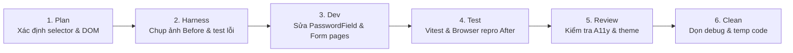

# Wave S-W01: Foundation, Input Components & Password Security

> **WAVE_ID:** `S-W01` | **Phụ trách (Writer):** Sơn | **Trạng thái:** `DONE`  
> **TASK_ID liên kết:** `S-01`, `S-04`, `S-05` | **Ngân sách Effort:** 7 giờ làm việc  
> **Mục tiêu:** Chuẩn hóa bảo mật hiển thị trường mật khẩu, tiếp cận A11y cho các form xác thực/khách, và sửa sự kiện đóng Header menu.

---

## 1. Danh sách Bugs xử lý (13 Bugs)

| BUG-ID | Mức | Trang / Component | Tóm tắt lỗi | Trạng thái |
|:---|:---:|:---|:---|:---:|
| **ROOMS-01** | **P1** | `/phong-online` (Modal tham gia) | Ô nhập mật khẩu phòng dùng `type="text"` làm lộ mật khẩu phòng riêng tư | **DONE** |
| **SPECTATE-01** | **P1** | `/spectate/:roomId` (Modal xem) | Form nhập mật khẩu xem trận phòng riêng tư thiếu `type="password"` | **DONE** |
| **GUEST-01** | **P1** | `/guest` (`GuestSetupPage`) | Ô nhập tên khách bị khóa cứng `readOnly` không cho sửa; label thiếu `id`/`htmlFor` | **DONE** |
| **GUEST-02** | **P2** | `/guest` (`GuestSetupPage`) | Nút Tiếp tục bị disable khi IndexedDB đang nạp nhưng không hiện spinner/loading | **DONE** |
| **LOGIN-01** | **P2** | `/dang-nhap` (`LoginPage`) | Thông báo lỗi mật khẩu nằm ngoài, thiếu liên kết `aria-describedby` vào input | **DONE** |
| **LOGIN-02** | **P2** | `/dang-nhap` (`LoginPage`) | Nút "Đăng nhập" chưa vô hiệu hóa khi form rỗng, cho click rồi mới báo lỗi | **DONE** |
| **REGISTER-01** | **P2** | `/dang-ky` (`RegisterPage`) | Nút CTA chuyển sang hồ sơ trùng nhãn ("Tôi đã lưu mã") với checkbox xác nhận | **DONE** |
| **REGISTER-02** | **P2** | `/dang-ky` (`RegisterPage`) | Trường mật khẩu có hint nhưng không liên kết `aria-describedby` với lỗi validation | **DONE** |
| **REGISTER-03** | **P3** | `/dang-ky` (`RegisterPage`) | Thiếu thanh chỉ báo độ mạnh mật khẩu (password strength indicator) trực quan | **DONE** |
| **RECOVERY-01** | **P3** | `/quen-mat-khau` (`ForgotPasswordPage`) | Nhãn trường dùng tiếng Anh ("Recovery Code") thay vì tiếng Việt ("Mã khôi phục") | **DONE** |
| **RECOVERY-02** | **P2** | `/quen-mat-khau` (`ForgotPasswordPage`) | Trường "Mật khẩu mới" và "Xác nhận mật khẩu" thiếu `aria-describedby` trỏ lỗi | **DONE** |
| **RECOVERY-03** | **P2** | `/quen-mat-khau` (`ForgotPasswordPage`) | Sau khi đặt lại pass tự chuyển hướng 800ms mà không có nút "Đăng nhập ngay" | **DONE** |
| **HOME-02** | **P2** | Sảnh chính (`AppLayout.tsx`) | Menu profile (`<details>`) trên Header không tự đóng khi click chuột ra ngoài | **DONE** |

---

## 2. File Ownership & Vùng tác động

### Files Sơn trực tiếp sửa:
- `apps/web/src/components/ui/PasswordField.tsx`: Bổ sung `errorId`, `aria-describedby`, đồng bộ show/hide pass.
- `apps/web/src/pages/LoginPage.tsx`: Liên kết A11y lỗi, disable button khi form rỗng/chưa đủ độ dài.
- `apps/web/src/pages/RegisterPage.tsx`: Tách nhãn CTA "Đi tới hồ sơ" với checkbox xác nhận, tích hợp password strength indicator, liên kết aria.
- `apps/web/src/pages/ForgotPasswordPage.tsx`: Việt hóa nhãn "Mã khôi phục", bổ sung `aria-describedby`, thêm nút "Đăng nhập ngay".
- `apps/web/src/pages/GuestSetupPage.tsx`: Gỡ bỏ `readOnly`, thêm `id` & `htmlFor` liên kết label, hiển thị spinner nạp IndexedDB.
- `apps/web/src/pages/OnlineRoomsPage.tsx`: Đảm bảo modal nhập mật khẩu phòng dùng `type="password"`.
- `apps/web/src/pages/SpectatorPage.tsx`: Đảm bảo modal nhập mật khẩu xem trận dùng `type="password"`.
- `apps/web/src/layouts/AppLayout.tsx`: Bổ sung event listener outside-click đóng `<details class="profile-menu">`.

### Shared Consumers cần kiểm tra lại:
- Mọi trang sử dụng `PasswordField`: `LoginPage`, `RegisterPage`, `ForgotPasswordPage`.
- Mọi trang sử dụng Header layout: `AppLayout.tsx`.

---

## 3. Quy trình thực hiện (Workflow 6 bước)



### Bước 1: Plan
- Xác định cấu trúc DOM hiện tại của `PasswordField.tsx` và cách truyền `aria-describedby`.
- Đảm bảo không thay đổi contract API gửi lên server của auth và room.

### Bước 2: Harness
- Chụp ảnh Before cho từng bug: ô password lộ chữ, ô tên guest bị readOnly, lỗi thiếu aria.
- Viết/chạy test case tái hiện: `PasswordField.test.tsx`, `AuthPages.test.tsx`, `GuestSetupPage.test.tsx`.

### Bước 3: Dev
- Sửa `PasswordField.tsx`: Hỗ trợ prop `aria-describedby`, kết nối trực tiếp với element báo lỗi.
- Sửa `GuestSetupPage.tsx`: Gỡ `readOnly`, cho phép sửa nickname khách, lưu vào `localIdentity`.
- Sửa `OnlineRoomsPage.tsx` và `SpectatorPage.tsx`: Input mật khẩu phòng đổi thành `type="password"`.
- Sửa `AppLayout.tsx`: Thêm hook `useOutsideClick` hoặc listener đóng details khi click ngoài.

### Bước 4: Test
- Chạy focused tests:
  ```bash
  corepack pnpm --filter @ottv2/web exec vitest run src/components/ui/PasswordField.test.tsx
  corepack pnpm --filter @ottv2/web exec vitest run src/pages/AuthPages.test.tsx
  corepack pnpm --filter @ottv2/web exec vitest run src/pages/GuestSetupPage.test.tsx
  corepack pnpm --filter @ottv2/web typecheck
  corepack pnpm --filter @ottv2/web lint
  ```
- Chụp ảnh After trên trình duyệt tại desktop 1366×768 và mobile 375px.

### Bước 5: Review
- Rà soát A11y: Screen reader đọc được thông báo lỗi qua `aria-describedby`.
- Kiểm tra tính bảo mật: Mật khẩu không hiển thị dạng plain text trừ khi người dùng click icon con mắt.

### Bước 6: Clean Rubbish Code
- Xóa các console.log debug và đoạn test mock tạm thời.

---

## 4. Tiêu chí nghiệm thu (Exit Gates)
- [x] Mọi trường mật khẩu đều che ký tự mặc định (`type="password"`).
- [x] Tên Guest chỉnh sửa được bình thường và lưu thành công vào IndexedDB/localGameStorage.
- [x] Không còn lỗi trùng lặp nhãn ("Đi tới hồ sơ" tách biệt với "Tôi đã lưu mã") hoặc chuỗi tiếng Anh ("Mã khôi phục" chuẩn hóa).
- [x] Header Profile menu tự động đóng tức thì khi nhấp chuột ra ngoài màn hình.
- [x] Bộ lệnh typecheck, lint, build và unit tests của wave PASS 100%.

---

## 5. Bằng chứng kiểm thử & Nghiệm thu (Test Evidence)

### Focused Unit Tests:
```bash
corepack pnpm --filter @ottv2/web exec vitest run src/components/ui/PasswordField.test.tsx src/pages/AuthPages.test.tsx src/pages/GuestSetupPage.test.tsx src/components/rooms/RoomBrowser.test.tsx src/pages/SpectatorPage.test.tsx
```
**Kết quả:** 5 test files, 17 tests passed (100% PASS).

### Quality Gates:
- `pnpm --filter @ottv2/web typecheck` ➔ **PASS** (code 0)
- `pnpm --filter @ottv2/web lint` ➔ **PASS** (code 0, 0 warnings)
- `pnpm --filter @ottv2/web build` ➔ **PASS** (code 0, bundle production tạo thành công)

