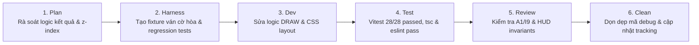

# Wave S-W02: Core Game Logic, Draw Calculation & Overlays

> **WAVE_ID:** `S-W02` | **Phụ trách (Writer):** Sơn | **Trạng thái:** `DONE`  
> **TASK_ID liên kết:** `S-02`, `S-04`, `S-05` | **Ngân sách Effort:** 8 giờ làm việc  
> **Mục tiêu:** Khắc phục lỗi tính hòa cờ thành thua ở chế độ AI và Offline; sửa overlay kết quả và banner không che nút điều khiển; tự động cuộn nhật ký nước đi; hiệu ứng máy nghĩ và cảnh báo lag đồng hồ.

---

## 1. Danh sách Bugs xử lý (7 Bugs)

| BUG-ID | Mức | Trang / Component | Tóm tắt lỗi | Trạng thái |
|:---|:---:|:---|:---|:---:|
| **AI-01** | **P1** | `/ai` (`LocalGamePage`) | Ván đấu Hòa bị ghi nhận nhầm thành "THUA" (`result="LOSS"`) và trừ điểm | DONE |
| **OFFLINE-02** | **P1** | `/offline` (`localGameStorage.ts`) | Ván cờ Hòa bị lưu nhầm thành "LOSS" trong IndexedDB | DONE |
| **MATCH-01** | **P1** | `/phong/:roomId` (`ResultPanel`) | Overlay kết quả che khuất các nút điều khiển người chơi trên màn hình cao 768px | DONE |
| **OFFLINE-01** | **P2** | `/offline` (`LocalGamePage`) | Banner chuyển lượt (Handoff) che khuất nút đầu hàng/tạm dừng ở góc trên | DONE |
| **MATCH-02** | **P2** | `/phong/:roomId` (`GameRoomPage`) | Bảng nhật ký nước đi (Move Log) thiếu cơ chế auto-scroll xuống nước đi mới | DONE |
| **AI-02** | **P2** | `/ai` (`GameBoard.tsx`) | Quân cờ của AI chưa có hiệu ứng pulsing trực quan khi máy đang suy nghĩ | DONE |
| **MATCH-03** | **P2** | `/phong/:roomId` (`ClockDisplay`) | Thiếu biểu tượng cảnh báo mất đồng bộ/lag mạng khi đồng hồ đếm ngược trễ | DONE |

---

## 2. File Ownership & Vùng tác động

### Files Sơn trực tiếp sửa:
- `apps/web/src/pages/LocalGamePage.tsx`:
  - Sửa hàm tính kết quả trận đấu khi kết thúc ván: nhận diện đúng trạng thái hòa cờ (`winner === null` hoặc `result === "DRAW"`, `scoreDelta: 0`).
  - Tách header điều khiển (.local-game-header) lên z-index 20 và điều chỉnh banner chuyển lượt (.turn-handoff z-index 10) để không che khuất nút Đầu hàng/Tạm dừng.
  - Bổ sung nút "Đầu hàng" khi ván đấu đang diễn ra (`state.status === "PLAYING"`).
  - Tích hợp prop `thinkingSide` kích hoạt trạng thái pulsing trên quân cờ đối thủ AI (`thinking-pulse`).
- `apps/web/src/services/local/localGameStorage.ts`:
  - Thêm kiểu `LocalResult` hỗ trợ `"DRAW"`. Sửa mapper lưu đúng `"DRAW"` vào IndexedDB và parse đúng khi đọc lịch sử.
- `apps/web/src/components/result/ResultPanel.tsx`:
  - Hỗ trợ outcome `"draw"`, tiêu đề `"HÒA CỜ"`, hiển thị nút "ĐẤU LẠI".
  - Giới hạn `max-height: min(85vh, 48rem)`, `overflow-y: auto`, `@media (max-height: 800px)` gán `.result-actions { position: sticky; bottom: 0; }` chống che nút trên màn 768px trong `globals.css`.
- `apps/web/src/components/board/GameBoard.tsx`:
  - Thêm prop `thinkingSide?: Side | null`, gắn class `thinking-pulse` lên các quân cờ của phe đang suy nghĩ.
- `apps/web/src/pages/GameRoomPage.tsx`:
  - Bổ sung `moveLogBottomRef` và `useEffect` tự động gọi `scrollIntoView({ behavior: "smooth", block: "nearest" })` khi có nước đi mới trong nhật ký.
  - Tích hợp icon cảnh báo mất đồng bộ/lag mạng `clock-desync-warning` (`⚠️`) trên `PlayerHud`, `PerspectiveInfoCard` và countdown banner khi `online.connection !== "connected"`.

### Shared Consumers cần kiểm tra lại:
- `LocalGamePage.tsx` (cả chế độ Đấu AI lẫn Người đấu Người Offline).
- `GameRoomPage.tsx` (trận đấu online nhiều người).

---

## 3. Quy trình thực hiện (Workflow 6 bước)

---

## 4. Tiêu chí nghiệm thu (Exit Gates)
- [x] Ván đấu hòa cờ hiển thị đúng chữ "HÒA CỜ", không trừ điểm người chơi (`scoreDelta: 0`).
- [x] IndexedDB lưu trữ trường `result: "DRAW"` chính xác (`localGameStorage.test.ts` 7/7 passed).
- [x] Màn hình 1366×768 và 1024×768 hiển thị đầy đủ các nút bấm hành động của ResultPanel, không bị clipping hay che khuất (`ResultPanel.test.tsx` 6/6 passed, sticky footer actions).
- [x] Banner chuyển lượt không che mất nút Đầu hàng và Tạm dừng (`.local-game-header` z-index 20).
- [x] Move log tự động cuộn xuống đáy khi có nước cờ mới (`moveLogBottomRef.current?.scrollIntoView`).
- [x] Hiệu ứng `thinking-pulse` hiển thị trực quan khi AI tính toán nước cờ (`GameBoard.test.tsx` passed).
- [x] Cảnh báo `clock-desync-warning` hiển thị khi kết nối không ở trạng thái connected.

**Test Evidence:**
- Vitest: 4 test suites, 28/28 tests passed (`LocalGamePage.test.tsx`, `localGameStorage.test.ts`, `ResultPanel.test.tsx`, `GameBoard.test.tsx`).
- Typecheck: `tsc -b --pretty false` exited with 0.
- Lint: `eslint . --max-warnings 0` exited with 0.
