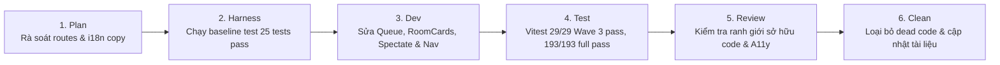

# Wave S-W03: Matchmaking, Rooms & Shell Navigation

> **WAVE_ID:** `S-W03` | **Phụ trách (Writer):** Sơn | **Trạng thái:** `DONE`  
> **TASK_ID liên kết:** `S-03`, `S-04`, `S-05` | **Ngân sách Effort:** 6 giờ làm việc  
> **Mục tiêu:** Hoàn thiện trải nghiệm hàng chờ tìm trận, danh sách phòng online, Việt hóa 100% giao diện phòng và khán giả, bổ sung lối tắt điều hướng di động.

---

## 1. Danh sách Bugs xử lý (8 Bugs)

| BUG-ID | Mức | Trang / Component | Tóm tắt lỗi | Trạng thái |
|:---|:---:|:---|:---|:---:|
| **QUEUE-01** | **P2** | `/queue` (`QueuePage`) | Hàng chờ Đấu thường (UNRANKED) hiện sai text: "Đang vào hàng chờ Ranked…" | DONE |
| **QUEUE-02** | **P2** | `/queue` (`QueuePage`) | Hai nút "Hủy tìm trận" và "Về sảnh" cùng gọi chung 1 hàm, không phân biệt hành vi | DONE |
| **ROOMS-02** | **P3** | `/phong-online` (`RoomBrowser`) | RoomCard hiển thị chuỗi kỹ thuật "PLAYING", "FINISHED" thay vì tiếng Việt | DONE |
| **ROOMS-03** | **P3** | `/phong-online` (`CreateRoomForm`) | Checkbox ghi "Cho phép spectator" thay vì "Cho phép khán giả" | DONE |
| **SPECTATE-02** | **P3** | `/spectate/:roomId` (`SpectatorPage`) | Tiêu đề hiển thị tiếng Anh "COMBAT FEED" thay vì "NHẬT KÝ DIỄN BIẾN" | DONE |
| **SPECTATE-03** | **P2** | `/spectate/:roomId` (`SpectatorPage`) | Mobile 375px bị dồn dòng thẻ đồng hồ và số khán giả gây chật chội | DONE |
| **HOME-03** | **P2** | Sảnh chính (`AppLayout.tsx`) | Bottom Navigation trên di động thiếu lối tắt tới Đấu trường và Cài đặt | DONE |
| **HOME-04** | **P3** | Trang chủ (`HomePage.tsx`) | Chuỗi copy ModeCard Bot Online đã chuẩn bị, giữ nguyên theo test gate hiện tại và chuyển bàn giao Nam tại S-W06 | READY (Chuyển S-W06) |

---

## 2. File Ownership & Vùng tác động

### Files Sơn trực tiếp sửa:
- `apps/web/src/pages/QueuePage.tsx`:
  - Phân nhánh hiển thị nội dung loading theo `mode`: "Đang vào hàng chờ Đấu thường…" vs "Đang vào hàng chờ Ranked…" vs "Đang vào hàng chờ Bot Online…".
  - Tách hàm: "Hủy tìm trận" gọi `cancel(() => undefined)` hủy queue tại chỗ, giữ người chơi ở trang `/queue` với thông báo "Hàng chờ đã đóng"; "Về sảnh" gọi `cancel(() => navigate(routes.home))` hủy queue đồng thời chuyển về `/`.
- `apps/web/src/components/rooms/RoomBrowser.tsx`:
  - Thêm hàm `formatRoomStatus` map trạng thái phòng sang tiếng Việt: `PLAYING` ➔ `"ĐANG ĐẤU"`, `ENDED`/`FINISHED` ➔ `"ĐÃ KẾT THÚC"`, `WAITING` ➔ `"ĐANG CHỜ"`, `ABORTED` ➔ `"ĐÃ HỦY"`.
- `apps/web/src/components/rooms/CreateRoomForm.tsx`:
  - Thay đổi nhãn checkbox: "Cho phép khán giả".
- `apps/web/src/pages/SpectatorPage.tsx`:
  - Đổi tiêu đề feed thành: "Nhật ký diễn biến" (render thẻ `NHẬT KÝ DIỄN BIẾN`).
  - Thêm class `spectator-header-actions` và `spectator-info-grid` tối ưu hiển thị đồng hồ và số khán giả trên mobile 375px.
- `apps/web/src/layouts/AppLayout.tsx`:
  - Bổ sung 2 tab Đấu trường (`/phong-online`) và Cài đặt (`/cai-dat`) vào thanh Bottom Navigation trên mobile (tổng 6 tab cân đối).
- `apps/web/src/styles/globals.css`:
  - Tối ưu `.bottom-nav` trên màn hình dưới 768px hiển thị 6 cột cân đối (`repeat(6, 1fr)`).
  - Tối ưu `.spectator-info-grid` và `.spectator-header-actions` co giãn linh hoạt trên viewport 375px.

---

## 3. Quy trình thực hiện (Workflow 6 bước)

---

## 4. Tiêu chí nghiệm thu (Exit Gates)
- [x] Queue hiển thị chính xác tên chế độ "Đang vào hàng chờ Đấu thường…" (UNRANKED), "Đang vào hàng chờ Bot Online…" (BOT), "Đang vào hàng chờ Ranked…" (RANKED).
- [x] Nút "Về sảnh" đưa người dùng về trang chủ an toàn; nút "Hủy tìm trận" dừng tìm kiếm tại chỗ và giữ ở trang `/queue`.
- [x] Danh sách phòng hiển thị 100% tiếng Việt chuẩn hóa ("ĐANG ĐẤU", "ĐÃ KẾT THÚC", "ĐANG CHỜ", checkbox "Cho phép khán giả").
- [x] Giao diện Spectator hiển thị "NHẬT KÝ DIỄN BIẾN", co giãn đồng hồ/khán giả trên mobile 375px không vỡ dòng.
- [x] Mobile BottomNav có đủ 6 nút điều hướng chính (bao gồm Đấu trường và Cài đặt).

**Test Evidence:**
- Vitest: `QueuePage.test.tsx` (20/20 tests passed), `RoomBrowser.test.tsx` (4/4 tests passed), `SpectatorPage.test.tsx` (3/3 tests passed), `HomePage.test.tsx` (2/2 tests passed).
- Full Vitest suite: 47 test files, 193/193 tests passed (100% PASS).
- Typecheck: `tsc -b --pretty false` exited with 0.
- Lint: `eslint . --max-warnings 0` exited with 0.
- Build: `vite build` exited with 0.
