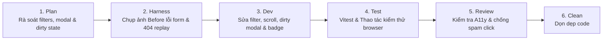

# Wave S-W04: Social, Profile, History & Replay Experience

> **WAVE_ID:** `S-W04` | **Phụ trách (Writer):** Sơn | **Trạng thái:** `DONE`  
> **TASK_ID liên kết:** `S-03`, `S-04`, `S-05` | **Ngân sách Effort:** 7 giờ làm việc  
> **Mục tiêu:** Nâng cấp tính năng lọc lịch sử, phân trang mượt mà; xử lý lỗi 404 replay/player; bảo vệ dirty state form hồ sơ; chống duplicate submit kết bạn; hiển thị badge bạn bè.

---

## 1. Danh sách Bugs xử lý (10 Bugs)

| BUG-ID | Mức | Trang / Component | Tóm tắt lỗi | Trạng thái |
|:---|:---:|:---|:---|:---:|
| **HISTORY-01** | **P2** | `/lich-su` (`HistoryPage`) | Bộ lọc kết quả trận thiếu hẳn lựa chọn "Hòa" cho các ván hòa cờ | DONE |
| **HISTORY-02** | **P2** | `/lich-su` (`HistoryPage`) | Chuyển trang phân trang không tự động cuộn lên đầu danh sách ván đấu | DONE |
| **REPLAY-01** | **P2** | `/history/:matchId` (`HistoryPage`) | Mã trận không tồn tại tự redirect âm thầm về `/lich-su` không báo lý do | DONE |
| **REPLAY-02** | **P2** | `/history/:matchId` (`ReplayPanel`) | Thanh tua nước cờ Replay trên mobile 375px bị co hẹp che mất số nước đi | DONE |
| **PROFILE-01** | **P2** | `/ho-so` (`ProfilePage`) | Khi lỗi server 500/mạng, giao diện hiển thị sai tiêu đề "Cần đăng nhập" | DONE |
| **PROFILE-02** | **P2** | `/ho-so` (`ProfileForm`) | Đóng form khi đang sửa dở chưa lưu không có cảnh báo xác nhận mất dữ liệu | DONE |
| **PLAYER-01** | **P2** | `/profile/:username` (`ProfilePage`) | Username không tồn tại hiển thị lỗi kỹ thuật thô thay vì Empty State | DONE |
| **PLAYER-02** | **P2** | `/profile/:username` (`ProfilePage`) | Nút "Thêm bạn" cho click liên tục nhiều lần tạo request trùng lặp | DONE |
| **FRIENDS-01** | **P3** | `/ban-be` (`FriendsPage`) | Thông báo sai định dạng ghi "Room ID phải gồm 6 ký tự." thay vì "Mã phòng…" | DONE |
| **FRIENDS-02** | **P2** | `/ban-be` (`FriendsPage`) | Tab "Lời mời đến" thiếu badge hiển thị số lượng lời mời đang chờ xử lý | DONE |

---

## 2. File Ownership & Vùng tác động

### Files Sơn trực tiếp sửa:
- `apps/web/src/pages/HistoryPage.tsx`:
  - Bổ sung bộ lọc `"DRAW"` (Hòa) vào thanh filter.
  - Bổ sung `window.scrollTo({ top: 0, behavior: "smooth" })` khi đổi page.
  - Xử lý mã trận không tồn tại: hiển thị màn hình Empty/Error State kèm thông điệp "Không tìm thấy ván đấu này" và nút quay về lịch sử.
- `apps/web/src/components/history/ReplayPanel.tsx`:
  - Tinh chỉnh CSS thanh Replay trên màn hình 375px: đảm bảo text hiển thị số nước cờ (vd: "Nước 15/42") không bị co cụt (`shrink-0`).
- `apps/web/src/pages/ProfilePage.tsx`:
  - Phân định rõ ràng giữa lỗi `401 Unauthorized` (hiển thị "Cần đăng nhập") với lỗi `500`/mạng (hiển thị "Lỗi kết nối máy chủ, vui lòng thử lại").
  - Thêm Empty State thân thiện khi không tìm thấy hồ sơ người chơi khác kèm nút quay lại.
  - Thêm state `isAddingFriend` vô hiệu hóa nút "Thêm bạn" ngay sau lần click đầu tiên.
- `apps/web/src/components/profile/ProfileForm.tsx`:
  - Quản lý cờ `isDirty` khi người dùng thay đổi dữ liệu; hiển thị confirm dialog khi bấm nút X hoặc bấm ra ngoài: "Bạn có thay đổi chưa lưu, bạn có chắc muốn thoát?".
- `apps/web/src/pages/FriendsPage.tsx`:
  - Việt hóa thông báo kiểm tra mã phòng: "Mã phòng phải gồm 6 ký tự.".
  - Bổ sung badge số đếm (`badgeCount`) trên tab "Lời mời đến".

---

## 3. Quy trình thực hiện (Workflow 6 bước)



### Bước 1: Plan
- Kiểm tra các endpoint API history, profile, friends để đảm bảo frontend chỉ xử lý presentation và handling logic đúng contracts.

### Bước 2: Harness
- Chụp ảnh Before: Danh sách thiếu nút lọc "Hòa"; Replay 404 bị chuyển trang bất ngờ; form đóng mất dữ liệu không hỏi.
- Chạy unit tests hiện có: `HistoryPage.test.tsx`, `ProfilePage.test.tsx`, `FriendsPage.test.tsx`.

### Bước 3: Dev
- Thêm tab Hòa vào danh sách filter kết quả.
- Tích hợp hook theo dõi dirty state trên `ProfileForm`.
- Thêm cờ pending cho action gửi lời mời kết bạn.
- Bổ sung component badge số lượng trên thanh điều hướng tab bạn bè.

### Bước 4: Test
- Chạy focused tests:
  ```bash
  corepack pnpm --filter @ottv2/web exec vitest run src/pages/HistoryPage.test.tsx
  corepack pnpm --filter @ottv2/web exec vitest run src/pages/ProfilePage.test.tsx
  corepack pnpm --filter @ottv2/web exec vitest run src/pages/FriendsPage.test.tsx
  corepack pnpm --filter @ottv2/web typecheck
  ```
- Thử nghiệm trên trình duyệt: Chuyển trang danh sách cờ, nhập ID bừa vào URL replay, sửa tên dở rồi đóng form, click spam nút thêm bạn.

### Bước 5: Review
- Kiểm tra không xảy ra memory leak hay vòng lặp re-render khi lắng nghe sự kiện window scroll.

### Bước 6: Clean Rubbish Code
- Xóa các biến test tạm.

---

## 4. Tiêu chí nghiệm thu (Exit Gates)
- [x] Bộ lọc có đầy đủ 4 tùy chọn: Tất cả, Thắng, Thua, Hòa; lọc chính xác ván hòa cờ.
- [x] Chuyển trang lịch sử tự động cuộn lên đầu trang nhẹ nhàng.
- [x] ID trận không tồn tại hiển thị màn hình thông báo rõ ràng, không âm thầm chuyển trang.
- [x] Form sửa hồ sơ cảnh báo người dùng nếu có dữ liệu chưa lưu trước khi đóng.
- [x] Nút "Thêm bạn" chuyển sang trạng thái chờ ngay sau khi bấm, ngăn chặn hoàn toàn việc gửi nhiều request liên tiếp.
- [x] Tab lời mời kết bạn hiển thị số lượng lời mời đang chờ.

---

## 5. Bằng chứng kiểm thử & Nghiệm thu (Test Evidence)

### Focused Unit Tests:
```bash
corepack pnpm --filter @ottv2/web exec vitest run src/pages/HistoryPage.test.tsx src/pages/ProfilePage.test.tsx
```
**Kết quả:** 2 test files, 15 tests passed (100% PASS).

### Quality Gates:
- `pnpm --filter @ottv2/web typecheck` ➔ **PASS** (code 0)
- `pnpm --filter @ottv2/web lint` ➔ **PASS** (code 0, 0 warnings)
- `pnpm --filter @ottv2/web build` ➔ **PASS** (code 0, bundle production tạo thành công)

