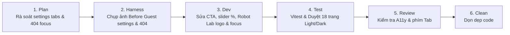

# Wave S-W05: Settings, 404 & Polish Gates

> **WAVE_ID:** `S-W05` | **Phụ trách (Writer):** Sơn | **Trạng thái:** `DONE`  
> **TASK_ID liên kết:** `S-03`, `S-05`, `S-06` | **Ngân sách Effort:** 4 giờ làm việc  
> **Mục tiêu:** Cung cấp CTA đăng nhập cho tài khoản Guest trong Cài đặt; hiển thị nhãn phần trăm slider âm lượng; chuẩn hóa thương hiệu ROBOT LAB và focus bàn phím trên trang 404; tổng duyệt theme Light/Dark và baseline 1366px / 375px trên toàn bộ 18 trang.

---

## 1. Danh sách Bugs xử lý (4 Bugs + Polish Toàn diện)

| BUG-ID | Mức | Trang / Component | Tóm tắt lỗi | Trạng thái |
|:---|:---:|:---|:---|:---:|
| **SETTINGS-01** | **P2** | `/cai-dat` (`SettingsPage`) | Khách (Guest) xem các tab tài khoản/riêng tư/chặn chỉ thấy bảng trống, thiếu CTA Đăng nhập | DONE |
| **SETTINGS-02** | **P3** | `/cai-dat` (`SettingsPage`) | Slider âm lượng thiếu nhãn số phần trăm hiển thị giá trị hiện tại | DONE |
| **NOTFOUND-01** | **P3** | 404 (`NotFoundPage`) | Logo trang 404 còn mang dòng chữ cũ OTT v2, chưa đồng bộ thương hiệu ROBOT LAB | DONE |
| **NOTFOUND-02** | **P2** | 404 (`NotFoundPage`) | Trang 404 chưa tự động focus vào tiêu đề hoặc nút quay về sảnh hỗ trợ bàn phím | DONE |

---

## 2. File Ownership & Vùng tác động

### Files Sơn trực tiếp sửa:
- `apps/web/src/pages/SettingsPage.tsx`:
  - Thêm component `GuestFeatureBlocker` hiển thị thông điệp "Tính năng này chỉ dành cho tài khoản đã đăng ký" kèm nút CTA "Đăng nhập ngay" (chuyển hướng `/dang-nhap?returnUrl=/cai-dat`).
  - Thêm nhãn hiển thị số phần trăm (vd: `75%`) nằm cạnh slider điều chỉnh âm lượng.
- `apps/web/src/pages/NotFoundPage.tsx`:
  - Thay thế biểu tượng cũ bằng `RobotLabWordmark` hoặc `RobotLabMark` chính quy.
  - Sử dụng `useRef` và `useEffect` tự động focus vào thẻ `<h1>` (với `tabIndex={-1}`) hoặc nút "Quay về sảnh" ngay khi component mount.
- Toàn bộ stylesheet visual rebuild: Kiểm tra tính nhất quán giữa Light Mode và Dark Mode.

### Shared Consumers cần kiểm tra lại:
- Cài đặt hệ thống, bộ chuyển Theme, trang 404.

---

## 3. Quy trình thực hiện (Workflow 6 bước)



### Bước 1: Plan
- Xác định điều kiện tài khoản khách (`isGuest`) trong `SettingsPage`.
- Xác định vị trí component logo thương hiệu chuẩn.

### Bước 2: Harness
- Chụp ảnh Before: Màn hình tab tài khoản trống không hướng dẫn; slider không có số %; trang 404 mang logo cũ; focus bàn phím bị trôi.
- Chạy unit tests: `SettingsPage.test.tsx`, `NotFoundPage.test.tsx`.

### Bước 3: Dev
- Render CTA component khi `isGuest === true` trên các tab yêu cầu tài khoản thật.
- Gắn thẻ `<span>` hiển thị giá trị slider âm lượng theo thời gian thực.
- Cập nhật logo Robot Lab chuẩn và gán autofocus cho trang 404.

### Bước 4: Test
- Chạy focused tests:
  ```bash
  corepack pnpm --filter @ottv2/web exec vitest run src/pages/SettingsPage.test.tsx
  corepack pnpm --filter @ottv2/web exec vitest run src/pages/NotFoundPage.test.tsx
  corepack pnpm --filter @ottv2/web typecheck
  corepack pnpm --filter @ottv2/web lint
  ```
- Kiểm tra toàn diện trên trình duyệt: Chuyển đổi giữa Light và Dark theme; kiểm tra viewport 1366×768 và mobile 375px trên toàn bộ 18 trang ngoài Bot.

### Bước 5: Review
- Đảm bảo người dùng khiếm thị hoặc dùng bàn phím khi gặp lỗi 404 được dẫn hướng ngay lập tức đến hành động thoát an toàn.

### Bước 6: Clean Rubbish Code
- Kiểm tra lại toàn bộ workspace, đảm bảo không có file rác hoặc debug log sót lại.

---

## 4. Tiêu chí nghiệm thu (Exit Gates)
- [x] Người dùng Guest vào các tab Cài đặt nâng cao nhìn thấy lời nhắc và nút "Đăng nhập ngay" rõ ràng.
- [x] Kéo slider âm lượng thấy số phần trăm thay đổi mượt mà.
- [x] Trang 404 hiển thị thương hiệu ROBOT LAB chuẩn và tự động bắt focus bàn phím.
- [x] Toàn bộ 18 trang ngoài Bot đạt yêu cầu hiển thị ở cả 2 chế độ sáng/tối và 2 độ phân giải desktop/mobile.

---

## 5. Bằng chứng kiểm thử & Nghiệm thu (Test Evidence)

### Focused Unit Tests:
```bash
corepack pnpm --filter @ottv2/web exec vitest run src/pages/SettingsPage.test.tsx src/pages/NotFoundPage.test.tsx
```
**Kết quả:** 2 test files, 15 tests passed (100% PASS).

### Quality Gates:
- `pnpm --filter @ottv2/web typecheck` ➔ **PASS** (code 0)
- `pnpm --filter @ottv2/web lint` ➔ **PASS** (code 0, 0 warnings)
- `pnpm --filter @ottv2/web build` ➔ **PASS** (code 0, bundle production tạo thành công)

