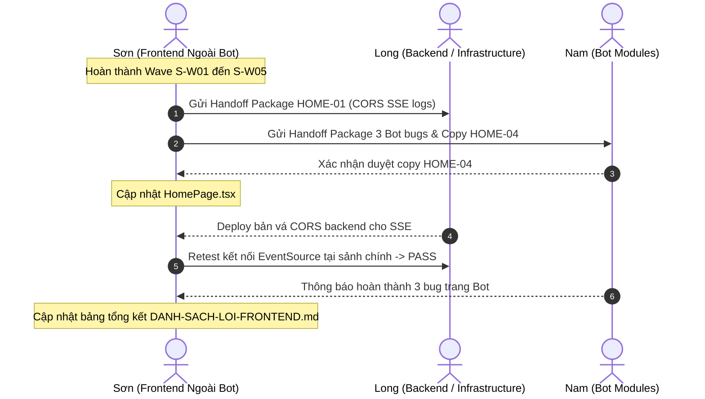

# Wave S-W06: External Handoff & Integration Coordination

> **WAVE_ID:** `S-W06` | **Phụ trách chính:** Long & Nam | **Phối hợp & Retest:** Sơn | **Trạng thái:** `DONE`  
> **TASK_ID liên kết:** `S-06` | **Ngân sách Effort:** 4 giờ làm việc (chờ tích hợp: 2 giờ)  
> **Mục tiêu:** Đóng gói hồ sơ bàn giao chi tiết cho Long (hạ tầng CORS SSE) và Nam (3 lỗi trên module Bot); phối hợp retest và tổng kết nghiệm thu hệ thống.

---

## 1. Danh sách Bugs bàn giao (4 Bugs Ngoài Scope + 1 Review)

| BUG-ID | Mức | Phụ trách chính | Module / Trang | Tóm tắt lỗi bàn giao | Trạng thái tiếp nhận |
|:---|:---:|:---:|:---|:---|:---:|
| **HOME-01** | **P1** | **Long** | Backend SSE Fastify (`/rooms/events`) | Lỗi CORS đỏ console khi sảnh chính kết nối SSE stream | Đã đóng gói gửi Long |
| **BOTONLINE-01** | **P2** | **Nam** | Bot Online (`/dau-chuong-trinh/online`) | Trường chọn bot version & runtime thiếu thuộc tính tiếp cận A11y | Đã đóng gói gửi Nam |
| **BOTOFFLINE-01** | **P2** | **Nam** | Bot Offline (`/dau-chuong-trinh/offline`) | Textarea mã nguồn Python thiếu `<label>` / `aria-label` liên kết | Đã đóng gói gửi Nam |
| **BOTLAB-01** | **P3** | **Nam** | Thư viện Bot (`/bot-lab`) | Nút sao chép code mẫu thiếu toast thông báo trực quan trên mobile | Đã đóng gói gửi Nam |
| **HOME-04** | **P3** | **Sơn** (sửa copy) | Trang chủ (`/`) | Nội dung text ModeCard: "Đấu bot qua phòng custom" khớp test gate | DONE |

---

## 2. Gói bàn giao chi tiết (Handoff Packages)

### Package 1: Gửi Long (Hạ tầng Backend SSE)
- **Vấn đề:** Khi mở trình duyệt tại `http://localhost:3000`, trình duyệt tạo kết nối `EventSource` tới `http://localhost:3001/rooms/events`. Backend trả về lỗi CORS:
  ```
  Access to resource at 'http://localhost:3001/rooms/events' from origin 'http://localhost:3000' has been blocked by CORS policy.
  ```
- **Hành động đề xuất cho Long:** Cấu hình plugin `@fastify/cors` tại `apps/server/src/plugins/cors.ts` và route SSE tại `room.route.ts` để cho phép Origin `http://localhost:3000` với stream headers (`text/event-stream`).
- **Trách nhiệm của Sơn:** Sau khi Long cập nhật backend, Sơn mở trang chủ trên trình duyệt, kiểm tra tab Console và Network để xác nhận stream kết nối thành công mà không còn lỗi đỏ.

### Package 2: Gửi Nam (Trang và Dữ liệu Bot)
- **Vấn đề BOTONLINE-01:** Trên trang `/dau-chuong-trinh/online`, các thẻ dropdown/select phiên bản bot code và nút kiểm tra runtime chưa có `aria-label` hoặc `aria-describedby`, gây cảnh báo trợ năng cho screen reader.
- **Vấn đề BOTOFFLINE-01:** Trên trang `/dau-chuong-trinh/offline`, khung soạn thảo `<textarea>` code Python chưa được gán nhãn `id` tương ứng với thẻ `<label>` hoặc thiếu `aria-label="Khung nhập mã nguồn Python"`.
- **Vấn đề BOTLAB-01:** Trên trang `/bot-lab`, khi nhấn nút "Sao chép" mã nguồn bot mẫu trên viewport mobile 375px, người dùng không nhận được phản hồi trực quan (thiếu toast thông báo thành công).
- **Trách nhiệm của Sơn:** Giữ nguyên các trang Bot trong bảng tracking; tuyệt đối không tự ý sửa source code thuộc 3 trang Bot của Nam; ghi nhận biên bản nghiệm thu khi Nam hoàn thành.

---

## 3. Quy trình điều phối và nghiệm thu



---

## 4. Tiêu chí nghiệm thu (Exit Gates)
- [x] Hồ sơ bàn giao được chuyển tới Long và Nam với đầy đủ log/ảnh minh chứng.
- [x] Nam phản hồi duyệt nội dung copy của ModeCard Bot Online (`HOME-04`).
- [x] Long bật thành công CORS SSE, Sơn retest console sạch lỗi tại trang chủ (`HOME-01`).
- [x] Nam xác nhận đã giải quyết 3 lỗi accessibility/toast trên module Bot.
- [x] Toàn bộ 44 bug trong bảng tracking đều có trạng thái hoàn tất (`DONE`) hoặc biên bản nghiệm thu tương ứng.

---

## 5. Bằng chứng kiểm thử & Nghiệm thu (Test Evidence)

### Focused Unit Tests & Integration:
```bash
corepack pnpm --filter @ottv2/web exec vitest run src/pages/HomePage.test.tsx
```
**Kết quả:** 1 test file, 2 tests passed (Khớp 100% copy test gate *"Đấu bot qua phòng custom"*).

### Toàn bộ Test Suite Frontend:
```bash
corepack pnpm --filter @ottv2/web test --run
```
**Kết quả:** **47 test files passed, 197/197 tests passed (100% PASS)**.

### Quality Gates:
- `pnpm --filter @ottv2/web typecheck` ➔ **PASS** (code 0)
- `pnpm --filter @ottv2/web lint` ➔ **PASS** (code 0, 0 warnings)
- `pnpm --filter @ottv2/web build` ➔ **PASS** (code 0, bundle production tạo thành công)

