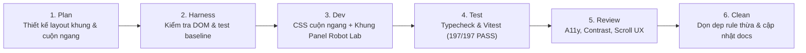

# Wave S-W08: Homepage Rooms Horizontal Scroll & Panel Frame

> **WAVE_ID:** `S-W08` | **Phụ trách (Writer):** Sơn | **Trạng thái:** `DONE`  
> **TASK_ID liên kết:** `S-03`, `S-07` | **Ngân sách Effort:** 2 giờ làm việc  
> **Mục tiêu:** Định hình lại danh sách phòng thi đấu ở trang Sảnh (Lobby): đóng khung panel viền Robot Lab đồng bộ với khối Bạn bè, và chuyển danh sách phòng sang hiển thị cuộn ngang (horizontal scroll) khi có nhiều phòng.

---

## 1. Danh sách Yêu cầu & Bugs xử lý (4 Items)

| BUG-ID / REQ-ID | Mức | Trang / Component | Tóm tắt yêu cầu | Trạng thái |
|:---|:---:|:---|:---|:---:|
| **ROOMS-W08-01** | **P1** | Trang Sảnh (`RoomBrowser.tsx` variant preview) | Thêm khung bao ngoài (panel frame) đồng bộ với khung Bạn bè (`friends-preview`): border cyan, radius `var(--radius-lg)`, background gradient Robot Lab, box-shadow bevel | **DONE** |
| **ROOMS-W08-02** | **P1** | Trang Sảnh (`visual-rebuild/home.css`, `robot-lab.css`) | Chuyển layout danh sách phòng preview sang xếp theo chiều ngang (horizontal flow) với thanh cuộn ngang khi có nhiều phòng | **DONE** |
| **ROOMS-W08-03** | **P2** | `RoomBrowser.tsx` / CSS | Định kích thước thẻ phòng (`.room-card`) trong horizontal scroll `flex: 0 0 280px; width: 280px; min-width: 260px` không bị co méo, giữ tính nhất quán trên responsive viewports | **DONE** |
| **ROOMS-W08-04** | **P2** | Trang Đấu trường (`variant="full"`) | Bảo toàn layout lưới dọc (grid 3-4 cột) cho trang xem tất cả phòng, không bị ảnh hưởng bởi preview horizontal scroll | **DONE** |

---

## 2. File Ownership & Vùng tác động

### Files Sơn trực tiếp sửa:
- `apps/web/src/components/rooms/RoomBrowser.tsx`:
  - Bổ sung class `.home-panel` khi `variant === "preview"` để đồng nhất cấu trúc semantic panel như `FriendsPreview`.
- `apps/web/src/styles/robot-lab.css`:
  - Áp dụng styling viền cyan và gradient Robot Lab cho `.home-lobby-page .room-browser-preview` đồng bộ với `.home-lobby-page .friends-preview`.
- `apps/web/src/styles/visual-rebuild/home.css`:
  - Thêm CSS cho `.home-lobby-page .room-browser-preview`:
    - Khung panel bao ngoài đồng bộ với `.home-panel` / `.friends-preview`.
    - `.room-browser-preview .room-grid-scroll`: horizontal scroll (`overflow-x: auto`, `overflow-y: hidden`, scrollbar mượt mà, scroll-snap-type).
    - `.room-browser-preview .room-grid`: horizontal flow (`display: flex; flex-direction: row; gap: .85rem; width: max-content; min-width: 100%`).
    - `.room-browser-preview .room-card`: `flex: 0 0 280px; width: 280px; min-width: 260px; scroll-snap-align: start`.
- `apps/web/src/styles/globals.css`:
  - Gỡ bỏ rule override cũ của preview gây xung đột.
- `docs/team-handoff/backend-frontend-fix/tasks/README.md`:
  - Bổ sung Wave S-W08 vào danh mục tasks tổng hợp.

### Shared Consumers đã kiểm tra:
- `HomePage.tsx` (trang Sảnh chính hiển thị `RoomBrowser variant="preview"` và `FriendsPreview` song song 2 cột).
- `OnlineRoomsPage.tsx` (trang Đấu trường xem toàn bộ phòng `variant="full"`).

---

## 3. Quy trình thực hiện (Workflow 6 bước)

### Bước 1: Plan
- Phân tích thiết kế của `FriendsPreview`:
  - Khung viền bo cong `.home-panel` với gradient `linear-gradient(155deg, ...)` và viền cyan đặc trưng Robot Lab.
  - Padding `1rem` - `1.25rem`, góc bo tròn lớn.
- Yêu cầu cuộn ngang:
  - Khi có 1 phòng: thẻ phòng nằm gọn gàng bên trái.
  - Khi có 2, 3, 4 hoặc nhiều hơn: các thẻ xếp nối tiếp sang phải theo chiều ngang, cuộn ngang bằng chuột/touchpad/touch gesture với scrollbar tinh xảo không thô kệch.
  - Giữ nguyên trang Đấu trường `/phong-online` hiển thị dạng lưới (grid) chuẩn cho danh sách lớn.

### Bước 2: Harness
- Chạy toàn bộ test suites hiện có để đảm bảo baseline pass 100% (197/197 tests pass).
- Đối chiếu DOM hiện tại của `RoomBrowser` và `FriendsPreview`.

### Bước 3: Dev
- Cập nhật JSX `RoomBrowser.tsx` bổ sung class `home-panel` khi `variant === "preview"`.
- Cập nhật `robot-lab.css` bổ sung selector `.room-browser-preview`.
- Thêm CSS cuộn ngang và style khung thẻ trong `visual-rebuild/home.css`.
- Dọn dẹp rule cũ trong `globals.css`.

### Bước 4: Test
- Chạy `pnpm --filter @ottv2/web typecheck` → 0 errors ✅
- Chạy `pnpm --filter @ottv2/web test` → 47 test files, 197/197 tests PASS ✅

### Bước 5: Review
- Hai khối "Danh sách Phòng Online" và "Bạn bè" trên trang Sảnh có cùng cấu trúc khung panel bao bọc: viền cyan tinh tế, nền gradient Robot Lab, bo góc tròn đồng điệu.
- Danh sách phòng hiển thị theo chiều ngang; khi có nhiều phòng thanh cuộn ngang hoạt động trơn tru, không làm nhảy layout trang hay phá vỡ viewport responsive.
- Trang Đấu trường (`/phong-online`) vẫn giữ nguyên hiển thị lưới dạng cột dọc.

### Bước 6: Clean Rubbish Code
- Đã gỡ bỏ override cũ của `globals.css`, giữ mã nguồn gọn gàng và phân lớp rõ ràng.

---

## 4. Acceptance Criteria & Test Evidence

| Acceptance Item | Tiêu chuẩn đánh giá | Kết quả |
|:---|:---|:---:|
| **Khung Panel Phòng trên Sảnh** | Khối "Danh sách Phòng Online" có khung panel bao quanh đồng bộ phong cách với khối "Bạn bè" (viền cyan, nền gradient, góc bo) | ✅ PASS |
| **Xếp phòng chiều ngang** | Các thẻ phòng xếp theo hàng ngang, không bị rớt dòng dọc | ✅ PASS |
| **Cuộn ngang mượt mà** | Khi có nhiều phòng hoặc màn hình hẹp, khu vực phòng cuộn ngang với scrollbar tinh tế | ✅ PASS |
| **Kích thước thẻ phòng** | Thẻ phòng giữ tỷ lệ chuẩn (`280px`), các nút Tham gia / Sao chép hiển thị rõ ràng | ✅ PASS |
| **Bảo toàn trang Đấu trường** | Trang `/phong-online` (`variant="full"`) vẫn giữ lưới nhiều cột dọc | ✅ PASS |
| **TypeScript Typecheck** | Không có lỗi kiểu dữ liệu | ✅ PASS (0 errors) |
| **Unit & Integration Tests** | 47/47 files, 197/197 tests vượt qua | ✅ PASS (197/197) |
