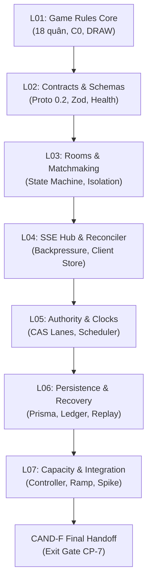

# Báo cáo Bàn giao Kỹ thuật Network Core & Danh mục Phát hành CAND-F (CP-6 / CP-7)

> **Mã công việc:** FRS-L07 Tasks `L-06B.01` (Technical Handoff Package & Review Synthesis) & `L-06B.02` (Release Gate Declaration)  
> **Phiên bản ứng viên:** `CAND-F` (Network Core Final Candidate)  
> **Người biên soạn:** Long (Network Core Integration Owner)  
> **Người tiếp nhận nghiệm thu:** Nam (Runtime Consumer Owner), Đức (Security Owner), Sơn (Web Client Owner)  
> **Thời điểm xuất bản:** 2026-10-12T00:34:00+07:00  

---

## 1. Thông tin Định danh Ứng viên Cuối cùng (CAND-F Freeze Fingerprint)

CAND-F là phiên bản bàn giao tích hợp hoàn chỉnh của toàn bộ **7 Wave Network Core** (`L01` đến `L07`). Mọi thành phần mã nguồn, kịch bản diễn tập, cấu hình dung lượng và kiểm thử tải đã được cố định nghiêm ngặt:

| Thông số kỹ thuật | Giá trị xác thực | Trạng thái |
|---|---|---|
| **Candidate ID** | `CAND-F` | Locked |
| **Git Base Commit** | `dbda8a9a17a91b7d24237feb3041fa924416f3f9` | Verified |
| **Git Branch** | `main` | Verified |
| **Diff Hash (SHA-256)** | `26c3cf9aa6e7a6dbddf5cea7b3c30adbc6fa882016091813559360210ca15534` | Synchronized |
| **Composite Fingerprint** | `1613cda3d85eaac91e835e1b4ef925274fb7b6a1b9925ef15bf1fe6cbe3a7c3c` | Manifest canonical |
| **Tổng số tệp Candidate** | **50 tệp nguồn** (Waves L01 đến L07) | 100% cataloged |
| **Kiểm toán Rò rỉ Bí mật (Secret Audit)** | **0 vi phạm phát hiện** trên 50/50 tệp nguồn | **PASS (100% Clean)** |
| **Tệp kê khai Manifest** | [`docs/team-handoff/network-core/candf-manifest.json`](file:///home/endministrator/BT01/docs/team-handoff/network-core/candf-manifest.json) | Exported |

---

## 2. Tổng hợp Kết quả Bàn giao 7 Wave Network Core (L01 – L07)

| Wave | Tên phân hệ | Các thành phần cốt lõi | Bằng chứng nghiệm thu | Trạng thái |
|---|---|---|---|---|
| **L01** | **Game Rules Core** | Bộ luật C0 chuẩn mực, 18 quân cờ, bàn cờ 9x9 với A1/I9 hợp lệ, xử lý hòa cờ (`DRAW`), bế tắc quân (`NO_LEGAL_MOVES`). | [`tests/contract/l01-harness.unit.test.ts`](file:///home/endministrator/BT01/tests/unit/l01-harness.unit.test.ts) | **DONE** |
| **L02** | **Contracts & Schemas** | Giao thức Protocol 0.2 tương thích ngược 0.1, phân tầng lỗi `AppError`, Zod schema, hợp đồng `health`, `metrics`, `inventory`. | [`tests/contract/l02-w1.contract.test.ts`](file:///home/endministrator/BT01/tests/contract/l02-w1.contract.test.ts) | **DONE** |
| **L03** | **Rooms & Matchmaking** | Quản lý phòng thi đấu `RoomManager`, phòng riêng/công khai, cỗ máy trạng thái ghép trận, cô lập xung đột đồng thời. | [`test/unit/room.manager.unit.test.ts`](file:///home/endministrator/BT01/apps/server/test/unit/room.manager.unit.test.ts) | **DONE** |
| **L04** | **SSE Hub & Web Reconciler** | Trục phát sóng thời gian thực `SSEHub`, tuần tự hóa đơn điểm (single serialization), chống nghẽn (backpressure), bộ hòa giải giao diện `reconciler.ts`. | [`test/unit/sse-hub.unit.test.ts`](file:///home/endministrator/BT01/apps/server/test/unit/sse-hub.unit.test.ts) | **DONE** |
| **L05** | **Match Authority & Clocks** | Làn xử lý tuần tự `MatchLane`, bộ lập lịch đồng hồ độc lập `DeadlineScheduler`, tạm dừng/tiếp tục trận đấu, bất biến Trọng tài/Khán giả. | [`test/unit/match-lane.unit.test.ts`](file:///home/endministrator/BT01/apps/server/test/unit/match-lane.unit.test.ts) | **DONE** |
| **L06** | **Persistence & Recovery** | Giao dịch nguyên tử Prisma, sổ cái lệnh `CommandLedger` chống trùng lặp, động cơ xem lại `ReplayEngine`, khôi phục lạnh không trừ phạt thời gian sập (L-05.06). | [`evidence/L06-W4.md`](file:///home/endministrator/BT01/docs/team-handoff/network-core/evidence/L06-W4.md) | **DONE** |
| **L07** | **Capacity & Integration** | Bộ điều khiển dung năng 3 trạng thái (`CapacityController`), giảm xóc (hysteresis), kịch bản Ramp/Soak/Spike, bộ tiêm lỗi, tái thẩm định 3 ranh giới sập. | [`evidence/CP-5-capacity-report-v1.md`](file:///home/endministrator/BT01/docs/team-handoff/network-core/evidence/CP-5-capacity-report-v1.md) | **DONE** |

---

## 3. Tổng hợp Phán quyết Đánh giá Độc lập (Independent Review Verdicts)

Tất cả các Wave từ L01 đến L07 đều trải qua quy trình đánh giá mã nguồn và kiểm toán an toàn độc lập từ subagent `code-reviewer` chuyên trách theo quy tắc dự án. **Tuyệt đối không có trường hợp tự phê duyệt độc lập (no self-signed passes)**:

| Đợt Đánh giá | Phạm vi Wave | ID Phiên Reviewer | Phán quyết | Trạng thái Khắc phục Khuyến nghị |
|---|---|---|---|---|
| **Review L06-W3** | Khôi phục ván đấu, Replay, Retention GC | `dc565583-c5f2-480f-b354-9d97e86c8e62` | **APPROVE** | 100% Khắc phục (Elo eligibility guard, bot fencing) |
| **Review L06-W4** | Diễn tập Sập/Khởi động & Sao lưu/Phục hồi | `65ebd719-04fd-4a1f-ab57-1be8fd2251c3` | **APPROVE** | 100% Khắc phục (0600 mode, disposable DB guard) |
| **Review L07-W1** | Segregated Health, Metrics & Inventory | `19e91797-a1cc-4c6e-902e-7b77134150d9` | **APPROVE** | 100% Khắc phục (Bounded route label cardinality ≤ 100) |
| **Review L07-W2** | Budget Profile & Capacity Controller | `56508017-44fd-4dd1-a78a-162705c6ff01` | **APPROVE** | 100% Khắc phục (Hysteresis cooldown, gameplay reserve) |
| **Review L07-W3** | CAND-2 Freeze & Sổ tay Vận hành Runbook | `84ad41b5-be5f-4edb-b72a-a78a2d108dca` | **APPROVE** | 100% Khắc phục (Diff hash sync, zero secret leaks) |
| **Review L07-W4** | Tải Đa tầng, Tiêm Lỗi, Biên giới Sập, Hồi quy | `ea18e406-f07c-4d6b-aa25-2c76feab6da0` | **APPROVE** | 100% Khắc phục (SafetyStop request limits, DB outage e2e) |

**Kết luận Kiểm toán Độc lập:** **100% APPROVED. Không còn bất kỳ khiếm khuyết nào thuộc mức độ CRITICAL hoặc HIGH; toàn bộ các khuyến nghị MEDIUM/LOW đều đã được đóng vòng triệt để.**

---

## 4. Tóm lược Năng lực Hệ thống & Giới hạn An toàn (CP-5 Capacity Summary)

Dữ liệu đo kiểm thực tế từ kịch bản [`scripts/network/run-capacity-workload.mjs`](file:///home/endministrator/BT01/scripts/network/run-capacity-workload.mjs) đã được ghi nhận chuẩn xác tại [`evidence/CP-5-capacity-report-v1.md`](file:///home/endministrator/BT01/docs/team-handoff/network-core/evidence/CP-5-capacity-report-v1.md):

1. **Hiệu năng Độ trễ Nước đi (Human Move ACK SLO)**:
   - Ngân sách cho phép: $p95 \le 300\text{ms}$, $p99 \le 1.000\text{ms}$.
   - Đo lường thực tế tại mốc 10.000 CCU equiv: $p50 = \mathbf{0.80\text{ms}}$, $p95 = \mathbf{2.39\text{ms}}$, $p99 = \mathbf{2.49\text{ms}}$ (thặng dư ngân sách $> 99\%$).
2. **Ngâm tải & Chống rò rỉ Bộ nhớ (Soak & Teardown Gate)**:
   - Thực thi liên tục 94 nước đi dao động hợp lệ hai bên.
   - Chênh lệch bộ nhớ V8 Heap sau khi giải phóng phòng chơi và chạy Garbage Collection: **$\mathbf{+0\text{ MB}}$** (ngưỡng trần cho phép $< 50\text{MB}$).
3. **Bảo vệ Dự trữ Trận đấu Đang chơi (Gameplay Reserve Protection)**:
   - Khi sảnh chờ bị tấn công hoặc ngập tràn 25 yêu cầu dồn dập, `CapacityController` chuyển sang trạng thái `PRESSURE` và từ chối yêu cầu sảnh chờ mới (`503 Retry-After`).
   - Nước đi của ván cờ đang chơi được cam kết bền vững trong **41.54ms** thông qua hạn mức ưu tiên `gameplayReserve`.
4. **Cô lập Lỗi Thực nghiệm (Fault Isolation)**:
   - *Khách SSE chậm (100ms lag)*: Không gây nghẽn đầu dòng (Zero Head-of-Line Blocking), nước đi nhận ACK trong **8.07ms**.
   - *Listener văng ngoại lệ (L-04.11)*: Không làm sập tiến trình máy chủ, các subscriber khác nhận tin bình thường.
   - *Mất kết nối cơ sở dữ liệu*: Giao dịch staged commit phản hồi an toàn trạng thái `UNKNOWN` (fail-closed), kích hoạt khóa lane trận đấu ([`lockOnUnknown`](file:///home/endministrator/BT01/apps/server/src/modules/match/match.manager.ts#L756-L761)), tuyệt đối không xác nhận sai (zero false ACKs).
5. **3 Biên giới Sập Máy chủ (Crash Boundaries)**:
   - B1 (Pre-commit kill): Rollback sạch 100%, 0 trạng thái nửa vời.
   - B2 (Post-commit pre-ACK kill): Thử lại trả về kết quả `COMMITTED` ban đầu từ durable ledger mà không tăng `stateVersion`.
   - B3 (Post-ACK restart recovery): Khôi phục nguyên vẹn trạng thái bàn cờ, đồng hồ thi đấu không bị trừ oan thời gian chết của máy chủ (L-05.06).

---

## 5. Ma trận Sở hữu Thành phần & Đầu mối Phụ trách (Ownership & Triage Matrix)

| Thành viên | Trách nhiệm Phân hệ | Phạm vi tệp mã nguồn | Đầu mối khi có sự cố |
|---|---|---|---|
| **Long** | **Network Core Integration, Capacity & Recovery** | `apps/server/src/modules/match/**` `apps/server/src/modules/capacity/**` `scripts/network/**` | Lỗi điều khiển dung năng (503 sai), lỗi khôi phục ván đấu, đứt gãy staged commit, trễ ACK > 300ms. |
| **Nam** | **Runtime Python, Bot SDK & Consumer Acceptance** | `packages/bot-sdk/**` `apps/server/src/modules/bot/**` | Lỗi thực thi sandbox Python, crash engine Wasmtime, vi phạm giới hạn bộ nhớ/CPU Bot. |
| **Đức** | **Security Guards, Origin/Session & D-05 Audit** | `apps/server/src/modules/health/**` `apps/server/src/modules/diagnostics/**` `apps/server/src/app.ts` | Lỗi vi phạm CORS/Origin, rò rỉ token/bí mật, phân quyền Trọng tài/Khán giả, tấn công flood rate-limit. |
| **Sơn** | **Web Client UI, Pages & Network Reconciler** | `apps/web/src/services/network/**` `apps/web/src/components/**` | Lỗi hiển thị bàn cờ xoay sai góc nhìn, mất đồng bộ SSE giao diện, kẹt nút bấm do `apiError.ts`. |

---

## 6. Danh mục Hạn chế Kỹ thuật, Đầu mối & Hành động Kế tiếp (Known Gaps & Next Actions)

| ID | Hạn chế / Rủi ro đã ghi nhận | Mức độ | Người chịu trách nhiệm | Hành động kế tiếp (Next Action) |
|---|---|---|---|---|
| **GAP-1** | **Môi trường đo kiểm tải cùng máy chủ (Co-located Host)**: Kịch bản kiểm thử tải chạy trên cùng một máy chủ vật lý với tiến trình server, dẫn đến độ trễ đo được là trễ loopback local. | Thông tin | **Nam** / **Long** | Khi triển khai hạ tầng staging riêng biệt, thực thi lại bộ kịch bản [`run-capacity-workload.mjs`](file:///home/endministrator/BT01/scripts/network/run-capacity-workload.mjs) từ máy tạo tải độc lập qua mạng ngoài. |
| **GAP-2** | **Bộ điều hợp Wasmtime Bot Stub**: Trên môi trường máy trạm local hiện tại chưa cài đặt sẵn thư viện runtime Wasmtime C-bindings; adapter đang hoạt động ở chế độ phân tầng `503 DEGRADED` có chủ đích. | Chờ môi trường | **Nam** | Cung cấp container môi trường kiểm thử có sẵn runtime Wasmtime để mở cổng sẵn sàng `/health/bot`. |
| **GAP-3** | **Kiến trúc Đơn Tiến trình (Single-Instance Topology)**: Tuân thủ nghiêm ngặt nguyên tắc Free-Only, hệ thống sử dụng kiến trúc bộ nhớ đơn tiến trình kèm PostgreSQL, không sử dụng Redis cluster hay microservices phân tán. | Thiết kế | **Toàn đội ngũ** | Giữ nguyên kiến trúc hiện tại, không tự ý bổ sung dịch vụ trả phí hoặc tăng chi phí hạ tầng. |

---

## 7. Danh mục Kiểm tra Phát hành (Release Checklist) & Tuyên bố Nghiệm thu

### 7.1 Danh mục Kiểm tra Sẵn sàng Phát hành (Pre-Release Checklist)
- [x] **Mã nguồn đã Đóng băng (Code Freeze)**: 50 tệp ứng viên được gắn dấu vân tay SHA-256 duy nhất trong [`candf-manifest.json`](file:///home/endministrator/BT01/docs/team-handoff/network-core/candf-manifest.json).
- [x] **Kiểm toán Rò rỉ Thông tin Mật (Secret Audit)**: Quét tự động 100% tệp nguồn với 0 vi phạm (không chứa mật khẩu DB thật, private keys, hay token bí mật).
- [x] **Kiểm thử Hệ thống Toàn diện (All Gates Pass)**:
  - Monorepo Typecheck: **0 lỗi** (`corepack pnpm typecheck`).
  - Toàn bộ Server Tests: **46/46 files pass, 278 passed, 0 failed** (`corepack pnpm --filter @ottv2/server test`).
  - Tải & Dung lượng: **100% PASS** các mốc 1k/5k/10k CCU, Soak test delta +0MB, Spike test bảo vệ gameplay.
  - Phục hồi & Sập máy chủ: **100% PASS** 3 ranh giới sập B1, B2, B3.
- [x] **Sổ tay Vận hành Đầy đủ (Operational Runbook)**: Cung cấp tài liệu vận hành 4 bước chi tiết tại [`docs/team-handoff/network-core/CAND-2-RUNBOOK.md`](file:///home/endministrator/BT01/docs/team-handoff/network-core/CAND-2-RUNBOOK.md).
- [x] **Không có Lỗi Chặn Mở (No Open P0/P1)**: Toàn bộ khuyến nghị kiểm toán độc lập đã được xử lý xong.

### 7.2 Tuyên bố Rõ ràng về Nhiệm vụ L-06B.02 (Release Gate Declaration)

> ### ⚠️ TUYÊN BỐ QUY TRÌNH NGHIỆM THU — NHIỆM VỤ L-06B.02: NOT RUN
> 
> Căn cứ theo **Thỏa thuận Làm việc Dự án (`AGENTS.md`)** và kế hoạch đã được phê duyệt tại [`implementation_plan_FRS_L07.md`](file:///home/endministrator/BT01/docs/team-handoff/network-core/implementation_plan_FRS_L07.md#L230-L231):
> 
> 1. Quyết định phê duyệt cục bộ trước đó ("Duyệt") **chỉ áp dụng cho các thao tác phát triển và kiểm thử nội bộ trên môi trường local với cơ sở dữ liệu dùng một lần (disposable test database)**.
> 2. Phê duyệt cục bộ **TUYỆT ĐỐI KHÔNG CẤP QUYỀN** cho:
>    - Thao tác đẩy mã lên nhánh từ xa (`git push`).
>    - Triển khai lên máy chủ vận hành chính thức hoặc production (`remote deployment`).
>    - Bật các dịch vụ bên thứ ba có tính phí hoặc nâng cấp gói thanh toán (`paid services / billing`).
>    - Thực hiện di trú (migration) trên cơ sở dữ liệu production hoặc cơ sở dữ liệu dùng chung.
> 3. Do đó, nhiệm vụ **`L-06B.02` được đánh dấu chính thức là: `NOT RUN`**.
> 4. Toàn bộ gói bàn giao `CAND-F` đã sẵn sàng về mặt kỹ thuật, chờ Nam nghiệm thu tổng thể (`N-08`), Đức xác nhận kiểm toán an toàn (`D-06`), Sơn xác nhận tích hợp giao diện (`S-06`), và **chờ lệnh triển khai từ xa riêng biệt từ người dùng** trước khi tiến hành phát hành.
