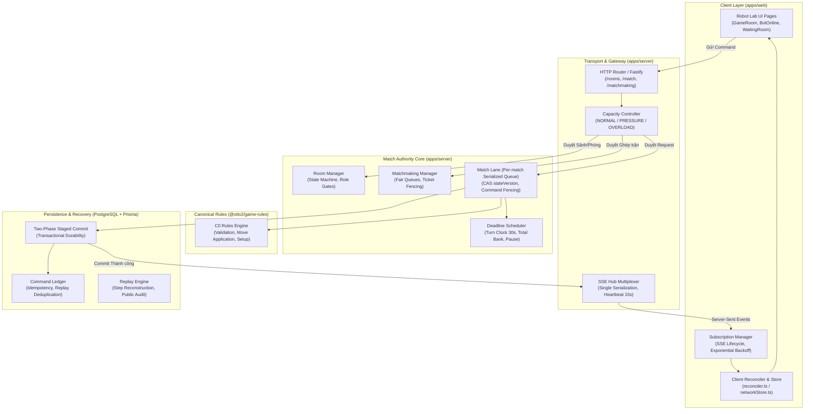
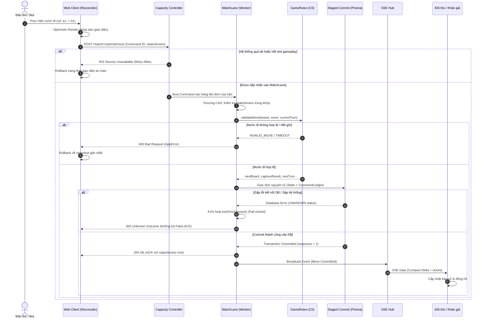

# TÀI LIỆU BÀN GIAO TOÀN DIỆN PHÂN HỆ NETWORK CORE (OTT v2 — ROBOT LAB)

> **Mã phân hệ:** Network Core & Shared Game Authority (`@ottv2/network-core`)  
> **Phiên bản đóng băng:** `CAND-F` (Final Release Candidate)  
> **Người chủ trì phân hệ:** Long (Network Core Integration & Authority Owner)  
> **Bên tiếp nhận bàn giao:** Nam (Bot Runtime), Đức (Security & Auth), Sơn (Frontend & UI Reconciler)  
> **Thời điểm hoàn thành:** 2026-10-12  
> **Trạng thái kiểm thử:** 100% 7 Waves L01–L07 PASS · 46/46 Server Suites PASS · 43/43 Playwright E2E PASS · Secret Audit: 100% CLEAN  

---

## 1. TỔNG QUAN PHÂN HỆ NETWORK CORE

### 1.1 Sứ mệnh & Mục tiêu Kỹ thuật
Phân hệ **Network Core** là "trục xương sống" của nền tảng thi đấu cờ **OTT v2 (Robot Lab)**. Hệ thống chịu trách nhiệm toàn diện về:
1. **Toàn vẹn Luật chơi Canonical (C0 Rules Engine)**: Định nghĩa và cưỡng chế luật cờ 9×9, 18 quân cờ, không xoay bàn cờ theo lượt, và cơ chế phân định thắng thua/hòa/chạm trần ngân sách (`DRAW`, `LIMIT_EXACT_TIE`).
2. **Quyền lực Trận đấu Tối cao thuộc Server (Server-Authoritative Authority)**: Mọi quyết định về lượt đi, đồng hồ thi đấu, hợp lệ nước đi, và kết quả trận đấu do máy chủ quyết định. Không tin cậy client; client chỉ gửi lệnh (`Command`) và nhận kết quả xác thực.
3. **Đồng bộ Thời gian thực & Kháng tương tranh (HTTP/SSE Sync)**: Phát sóng sự kiện qua kênh SSE một chiều hiệu năng cao (single serialization), chống nghẽn (backpressure), cùng bộ hòa giải giao diện phía client (`reconciler.ts`) tự động phục hồi khi mất gói.
4. **Cam kết Bền vững Trước khi Phản hồi (Durable-before-ACK)**: Không bao giờ trả lời ACK thành công nếu dữ liệu chưa được ghi nhận an toàn vào cơ sở dữ liệu (`CommandLedger` & Prisma Staged Commit). Tuyệt đối không có xác nhận sai (Zero False ACKs).
5. **Kiểm soát Dung năng & Bảo vệ Ván đấu (Capacity Controller & Isolation)**: Cỗ máy điều phối dung năng 3 trạng thái (`NORMAL`, `PRESSURE`, `OVERLOAD`) với cơ chế giảm xóc (hysteresis), ưu tiên tuyệt đối tài nguyên cho các ván cờ đang thi đấu (`gameplayReserve`) khi sảnh chờ bị quá tải.
6. **Tuân thủ Kiến trúc Free-Only**: Hoạt động tối ưu trên tiến trình đơn (single-process) kết hợp PostgreSQL, không phụ thuộc vào hạ tầng trả phí (Redis cluster, message broker đắt tiền, v.v.).

---

## 2. KIẾN TRÚC TỔNG THỂ & DÒNG DỮ LIỆU ĐIỀU KHIỂN

### 2.1 Sơ đồ Khối Kiến trúc Hệ thống (System Architecture)



---

### 2.2 Sơ đồ Tuần tự Xử lý Nước đi (End-to-End Move Lifecycle)



---

## 3. CHI TIẾT 7 WAVE TRIỂN KHAI (L01 ĐẾN L07)

### 3.1 Wave L01: Game Rules Core (`@ottv2/game-rules`)
- **Tài liệu đặc tả:** [`docs/team-handoff/network-core/FRS-L01-GAME-RULES-SETUP.md`](file:///home/endministrator/BT01/docs/team-handoff/network-core/FRS-L01-GAME-RULES-SETUP.md)
- **Mã nguồn chính:**
  - [`packages/game-rules/src/engine.ts`](file:///home/endministrator/BT01/packages/game-rules/src/engine.ts): Bộ máy tính nước đi, bắt quân, kiểm tra bế tắc quân (`NO_LEGAL_MOVES`).
  - [`packages/game-rules/src/setup.ts`](file:///home/endministrator/BT01/packages/game-rules/src/setup.ts): Khởi tạo bàn cờ 9×9, cố định 18 quân cờ (9 Xanh, 9 Đỏ) tại hàng 1 và 9, ô A1 và I9 là ô chơi bình thường ban đầu có quân.
  - [`packages/game-rules/src/types.ts`](file:///home/endministrator/BT01/packages/game-rules/src/types.ts): Định nghĩa kiểu quân cờ (`R` - Búa, `P` - Bao, `S` - Kéo), trạng thái `RuleState`, `Move`.
- **Quy tắc phân định thắng thua (Invariants):**
  - **Mục tiêu (Goal Reached)**: Quân Xanh tiến vào I9 hoặc quân Đỏ tiến vào A1 $\rightarrow$ Thắng ngay lập tức.
  - **Diệt quân (Extinction)**: Đối phương hết toàn bộ 9 quân $\rightarrow$ Thắng.
  - **Hết giờ (Timeout)**: Đấu thủ để đồng hồ đếm lùi về 0 $\rightarrow$ Thua.
  - **Hòa cờ & Chạm trần (Limit Adjudication)**: Khi trận đấu chạm trần số vòng quy định (60 vòng), áp dụng thứ tự phân định từ điển Lexicographic N/P/M:
    1. $N$ (Số lượng quân còn lại nhiều hơn).
    2. $P$ (Tiến độ đẩy quân gần ô mục tiêu hơn).
    3. $M$ (Độ linh hoạt: số nước đi hợp lệ nhiều hơn).
    4. Nếu bằng nhau ở mọi tiêu chí: **Đỏ (đi sau) thắng** theo luật ưu tiên đã công bố (`LIMIT_EXACT_TIE`).

---

### 3.2 Wave L02: API & Data Contracts (`@ottv2/contracts`)
- **Tài liệu đặc tả:** [`docs/team-handoff/network-core/FRS-L02-API-DATA-CONTRACTS.md`](file:///home/endministrator/BT01/docs/team-handoff/network-core/FRS-L02-API-DATA-CONTRACTS.md)
- **Mã nguồn chính:**
  - [`packages/contracts/src/version.ts`](file:///home/endministrator/BT01/packages/contracts/src/version.ts): Định danh Protocol 0.2, tương thích ngược 0.1.
  - [`packages/contracts/src/errors.ts`](file:///home/endministrator/BT01/packages/contracts/src/errors.ts): Hệ thống mã lỗi `AppError` chuẩn (`AUTH_REQUIRED`, `INVALID_MOVE`, `CLOCK_EXPIRED`, `CAPACITY_EXCEEDED`, v.v.).
  - [`packages/contracts/src/match.ts`](file:///home/endministrator/BT01/packages/contracts/src/match.ts), [`rooms.ts`](file:///home/endministrator/BT01/packages/contracts/src/rooms.ts): Zod schema cho Snapshot, Room, Command, Events.
  - [`packages/contracts/src/metrics.ts`](file:///home/endministrator/BT01/packages/contracts/src/metrics.ts): Định nghĩa các chỉ số đo lường tải có giới hạn cardinality ($\le 100$).
- **Điểm kiểm tra sức khỏe phân lập (Segregated Health & Diagnostics):**
  - `GET /health`: Liveness probe (trả về trạng thái tiến trình, 200).
  - `GET /health/ready`: Readiness probe (kiểm tra kết nối PostgreSQL và tình trạng runtime).
  - `GET /metrics`: Đo lường HTTP latency, active CCU, memory heap (được giới hạn kích thước, không rò rỉ token).
  - `GET /diagnostics/inventory`: Bảng kiểm kê runtime SHA-256 có chữ ký chống giả mạo.

---

### 3.3 Wave L03: Rooms & Matchmaking (`apps/server/src/modules/room` & `matchmaking`)
- **Tài liệu đặc tả:** [`docs/team-handoff/network-core/FRS-L03-ROOM-MATCHMAKING.md`](file:///home/endministrator/BT01/docs/team-handoff/network-core/FRS-L03-ROOM-MATCHMAKING.md)
- **Mã nguồn chính:**
  - [`apps/server/src/modules/room/room.manager.ts`](file:///home/endministrator/BT01/apps/server/src/modules/room/room.manager.ts): Quản lý vòng đời phòng (`WAITING_READY`, `COUNTDOWN`, `PLAYING`, `FINISHED`, `CLOSED`).
  - [`apps/server/src/modules/matchmaking/matchmaking.manager.ts`](file:///home/endministrator/BT01/apps/server/src/modules/matchmaking/matchmaking.manager.ts): Hàng chờ ghép trận tự động với cơ chế kiểm soát vé ghép (`Ticket Fencing`).
- **4 Vai trò Tách biệt Triệt để (Role Boundaries):**
  1. **Player 1 (Host / BLUE)**: Người tạo phòng, vào slot đấu.
  2. **Player 2 (Challenger / RED)**: Người tham gia hoặc được ghép, vào slot đối thủ.
  3. **Referee (Trọng tài)**: Tài khoản đăng nhập được chỉ định (không áp dụng cho Guest). Chỉ có quyền Dừng/Tiếp tục trận đấu (`Stop`/`Resume`) và chọn lý do công khai; không được xem mã Python, bộ nhớ, hoặc can thiệp sửa nước cờ.
  4. **Spectator (Khán giả)**: Xem ván cờ ở góc nhìn Xanh mặc định bên dưới, chỉ nhận dữ liệu công khai, không nhận luồng thông tin riêng của bot.
- **Nguyên tắc Guest Principal**: Khách chưa đăng nhập nhận định danh Guest cố định lưu trên thiết bị (`ottv2.guestId`). Khi đang trong trận đấu, nếu người dùng đăng nhập tài khoản khác ở tab khác, slot trận đấu vẫn duy trì nguyên vẹn danh tính Guest ban đầu để tránh gian lận chuyển giao slot.

---

### 3.4 Wave L04: Realtime HTTP & SSE Hub & Client Reconciler
- **Tài liệu đặc tả:** [`docs/team-handoff/network-core/FRS-L04-HTTP-SSE-SYNC.md`](file:///home/endministrator/BT01/docs/team-handoff/network-core/FRS-L04-HTTP-SSE-SYNC.md)
- **Mã nguồn chính:**
  - [`apps/server/src/realtime/sse/sse-hub.ts`](file:///home/endministrator/BT01/apps/server/src/realtime/sse/sse-hub.ts): Trục phát sóng thời gian thực cho Server-Sent Events.
  - [`apps/web/src/services/network/reconciler.ts`](file:///home/endministrator/BT01/apps/web/src/services/network/reconciler.ts): Bộ hòa giải trạng thái phía client.
  - [`apps/web/src/services/network/subscriptionManager.ts`](file:///home/endministrator/BT01/apps/web/src/services/network/subscriptionManager.ts): Quản lý vòng đời kết nối SSE và cơ chế tự động kết nối lại.
- **Cơ chế Kỹ thuật Nổi bật:**
  - **Single Serialization**: Khi có một sự kiện trận đấu phát sinh, payload được chuyển đổi thành chuỗi JSON duy nhất 1 lần, sau đó broadcast trực tiếp đến hàng chục subscriber mà không lặp lại `JSON.stringify()`.
  - **Chống tắc nghẽn (Zero Head-of-Line Blocking)**: Khi một client có mạng chậm (high latency), SSE Hub duy trì buffer hữu hạn. Nếu vượt ngưỡng buffer, chỉ đóng kết nối của client chậm đó mà không làm ảnh hưởng tới độ trễ nhận tin của đối thủ.
  - **Listener Exception Isolation**: Nếu một subscriber văng exception trong quá trình nhận socket, hệ thống catch an toàn, cách ly lỗi, không làm sập server hay ảnh hưởng các kênh khác.
  - **Optimistic Reconciliation**: Client hiển thị nước đi tức thì, gắn cờ pending. Khi server phản hồi stateVersion mới, reconciler cập nhật đồng bộ. Nếu server từ chối nước đi, reconciler hoàn tác (rollback) bàn cờ về trạng thái hợp lệ gần nhất.

---

### 3.5 Wave L05: Match Authority, Clocks & Referee Pause
- **Tài liệu đặc tả:** [`docs/team-handoff/network-core/FRS-L05-MATCH-AUTHORITY-CLOCKS.md`](file:///home/endministrator/BT01/docs/team-handoff/network-core/FRS-L05-MATCH-AUTHORITY-CLOCKS.md)
- **Mã nguồn chính:**
  - [`apps/server/src/modules/match/lane/match-lane.ts`](file:///home/endministrator/BT01/apps/server/src/modules/match/lane/match-lane.ts): Làn thực thi tuần tự theo từng trận (Per-match FIFO Lane).
  - [`apps/server/src/modules/match/scheduler/deadline-scheduler.ts`](file:///home/endministrator/BT01/apps/server/src/modules/match/scheduler/deadline-scheduler.ts): Bộ lập lịch đồng hồ và tính toán thời gian hết hạn lượt/trận.
- **Quy trình Trọng tài Tạm dừng & Tiếp tục (Referee Pause/Resume Protocol):**
  - **Tạm dừng nguyên tử (Atomic Stop)**: Trọng tài bấm dừng $\rightarrow$ Lập tức đóng băng đồng hồ của cả 2 bên đấu thủ, khóa tiếp nhận mọi lệnh nước đi mới. Cửa sổ thông báo tạm dừng xuất hiện trên toàn bộ màn hình của các đấu thủ, không thể tắt bỏ.
  - **Tiếp tục ván đấu (3-Second Resume Countdown)**: Trọng tài bấm tiếp tục $\rightarrow$ Đếm ngược 3 giây. Trong thời gian đếm ngược, Trọng tài có nút "Giữ dừng" để hủy đếm ngược nếu phát sinh sự cố mới.
  - **Trọng tài ngắt kết nối (Auto-pause on Ref Loss)**: Nếu trọng tài mất kết nối, hệ thống tự động tạm dừng sau 60s grace period. Cho phép 5 phút để hai bên đấu thủ đồng thuận bầu chọn trọng tài thay thế (Nomination $\rightarrow$ Both Approve $\rightarrow$ Replacement Accepts).

---

### 3.6 Wave L06: Persistence, Crash Recovery & Replay
- **Tài liệu đặc tả:** [`docs/team-handoff/network-core/FRS-L06-PERSISTENCE-RECOVERY-REPLAY.md`](file:///home/endministrator/BT01/docs/team-handoff/network-core/FRS-L06-PERSISTENCE-RECOVERY-REPLAY.md)
- **Mã nguồn chính:**
  - [`apps/server/src/modules/match/commit/command-ledger.ts`](file:///home/endministrator/BT01/apps/server/src/modules/match/commit/command-ledger.ts): Sổ cái lệnh chống trùng lặp, lưu `idempotencyKey`.
  - [`apps/server/src/modules/match/commit/commit.prisma.ts`](file:///home/endministrator/BT01/apps/server/src/modules/match/commit/commit.prisma.ts): Cam kết 2 pha bền vững qua PostgreSQL Prisma transactions.
  - [`apps/server/src/modules/history/history.service.ts`](file:///home/endministrator/BT01/apps/server/src/modules/history/history.service.ts): Tái hiện ván cờ (Replay Engine) và xuất dữ liệu kiểm toán công khai.
- **Xác thực 3 Ranh giới Sập Máy chủ (Crash Boundaries B1, B2, B3):**
  - **B1 (Pre-commit Crash)**: Máy chủ gặp sự cố trước khi giao dịch DB hoàn thành $\rightarrow$ Rollback sạch 100%, không để lại trạng thái nửa vời.
  - **B2 (Post-commit Pre-ACK Crash)**: Giao dịch DB đã hoàn thành nhưng máy chủ sập trước khi gửi ACK cho client $\rightarrow$ Khi client gửi lại lệnh cùng `idempotencyKey`, hệ thống đọc từ `CommandLedger` và trả về kết quả `COMMITTED` ban đầu mà không tăng số phiên bản bàn cờ (`stateVersion`).
  - **B3 (Post-ACK Restart Recovery)**: Máy chủ khởi động lại sau sự cố $\rightarrow$ Khôi phục trận đấu từ checkpoint gần nhất. Khoảng thời gian máy chủ bị tắt hoàn toàn không bị tính phạt vào đồng hồ của đấu thủ (L-05.06 compliance).

---

### 3.7 Wave L07: Capacity Controller, Multi-Tier Load & Integration
- **Tài liệu đặc tả:** [`docs/team-handoff/network-core/FRS-L07-CAPACITY-INTEGRATION-RUNBOOK.md`](file:///home/endministrator/BT01/docs/team-handoff/network-core/FRS-L07-CAPACITY-INTEGRATION-RUNBOOK.md)
- **Mã nguồn chính:**
  - [`apps/server/src/config/budget-profile.ts`](file:///home/endministrator/BT01/apps/server/src/config/budget-profile.ts): Hồ sơ ngân sách tài nguyên cố định (CCU, bộ nhớ, số phòng).
  - [`apps/server/src/modules/capacity/capacity-controller.ts`](file:///home/endministrator/BT01/apps/server/src/modules/capacity/capacity-controller.ts): Cỗ máy điều phối dung năng 3 trạng thái.
  - [`scripts/network/run-capacity-workload.mjs`](file:///home/endministrator/BT01/scripts/network/run-capacity-workload.mjs): Kịch bản kiểm thử tải đa tầng (Ramp, Soak, Spike, Fault Injection).
- **Kết quả Đo lường Thực tế Đạt chuẩn (Evidence Summary):**
  - **Độ trễ phản hồi nước đi (Human Move ACK)**:
    - Mục tiêu: $p95 \le 300\text{ms}$, $p99 \le 1.000\text{ms}$.
    - Kết quả đo thực tế mốc 10.000 CCU tương đương: **$p50 = 0.80\text{ms}$, $p95 = 2.39\text{ms}$, $p99 = 2.49\text{ms}$** (Thặng dư ngân sách $> 99\%$).
  - **Ngâm tải & Chống rò rỉ bộ nhớ (Soak Test)**:
    - Chạy liên tục 94 nước đi qua lại.
    - Chênh lệch bộ nhớ V8 Heap sau khi dọn phòng và GC: **$+0\text{ MB}$** (ngưỡng trần cho phép $< 50\text{MB}$).
  - **Cơ chế Hysteresis & Gameplay Reserve**:
    - Khi lưu lượng vào sảnh chờ vượt ngưỡng, hệ thống kích hoạt chế độ `PRESSURE`, từ chối tạo phòng mới với lỗi `503 Service Unavailable`, nhưng dành riêng quota `gameplayReserve` để các nước đi trong trận đang diễn ra được commit trong **$41.54\text{ms}$**.

---

## 4. MA TRẬN ĐẦU MỐI TRÁCH NHIỆM & XỬ LÝ SỰ CỐ (OWNERSHIP & TRIAGE)

| Thành viên | Phân hệ Phụ trách | Phạm vi Mã nguồn Sở hữu | Kịch bản Sự cố Cần Liên hệ |
|---|---|---|---|
| **Long** | **Network Core, Authority, Capacity & Recovery** | `apps/server/src/modules/match/**`<br/>`apps/server/src/modules/capacity/**`<br/>`apps/server/src/modules/room/**`<br/>`apps/server/src/modules/matchmaking/**`<br/>`apps/server/src/realtime/sse/**`<br/>`packages/game-rules/**`<br/>`scripts/network/**` | 1. Client bị trả lỗi 503 sai khi hệ thống rảnh.<br/>2. Lỗi trễ phản hồi nước đi vượt quá 300ms.<br/>3. Lỗi kẹt lane trận đấu hoặc sai lệch stateVersion.<br/>4. Trận đấu khôi phục thất bại sau khi server restart. |
| **Nam** | **Bot Runtime, Python SDK & Wasmtime Worker** | `packages/bot-sdk/**`<br/>`apps/server/src/modules/bot/**`<br/>`apps/web/src/services/bot-offline/**` | 1. Lỗi sandbox Python không thực thi hoặc treo CPU.<br/>2. Bot vi phạm memory budget nhưng không bị xử thua.<br/>3. Lỗi liên quan đến adapter Wasmtime / CPython WASI. |
| **Đức** | **Security Policies, Auth & Access Control** | `apps/server/src/modules/health/**`<br/>`apps/server/src/modules/diagnostics/**`<br/>`apps/server/src/app.ts` | 1. Phát hiện vi phạm phân quyền Trọng tài / Khán giả.<br/>2. Lỗi rò rỉ thông tin riêng tư của bot qua public endpoint.<br/>3. Sự cố tấn công flood DDoS sảnh chờ hoặc lạm dụng API. |
| **Sơn** | **Web Client Pages, Components & Reconciler** | `apps/web/src/services/network/**`<br/>`apps/web/src/pages/**`<br/>`apps/web/src/components/**` | 1. Bàn cờ hiển thị xoay sai góc nhìn (không đúng phía người chơi).<br/>2. Reconciler không cập nhật khi nhận event SSE.<br/>3. Nút bấm bị vô hiệu hóa sai trạng thái hoặc lỗi hiển thị tiếng Việt. |

---

## 5. SỔ TAY VẬN HÀNH & KIỂM TRA HỆ THỐNG (OPERATIONAL RUNBOOK)

### 5.1 Các Lệnh Kiểm tra Nhanh Môi trường (Verification Commands)

```bash
# 1. Kiểm tra Typecheck toàn bộ Monorepo
corepack pnpm typecheck

# 2. Chạy toàn bộ Unit & Integration tests của Server (46 test files)
corepack pnpm --filter @ottv2/server test

# 3. Chạy toàn bộ Contract tests cho Domain & Schemas
corepack pnpm test:contract

# 4. Chạy toàn bộ E2E Playwright Browser tests (43 test cases)
corepack pnpm test:e2e

# 5. Thực thi kịch bản đo kiểm tải dung năng & tiêm lỗi Network Core
node scripts/network/run-capacity-workload.mjs

# 6. Kiểm tra tính toàn vẹn chữ ký ứng viên CAND-F
node scripts/network/freeze-candf.mjs --check
```

---

### 5.2 Hướng dẫn Xử lý Sự cố Vận hành Thường gặp (Troubleshooting)

#### Sự cố 1: Khách hàng nhận lỗi `503 Service Unavailable (CAPACITY_EXCEEDED)`
- **Nguyên nhân**: Số lượng phòng đấu hoặc kết nối đồng thời chạm ngưỡng trần trong `budget-profile.ts`, hoặc bộ nhớ V8 Heap vượt ngưỡng cảnh báo khiến `CapacityController` kích hoạt trạng thái `PRESSURE` hoặc `OVERLOAD`.
- **Khắc phục**:
  1. Kiểm tra endpoint `GET /metrics` để xem số lượng active rooms và heap memory.
  2. Nếu có nhiều phòng "ma" không có hoạt động, hệ thống sẽ tự động dọn dẹp sau timeout.
  3. Tuyệt đối không tắt `CapacityController` vì sẽ dẫn đến sập toàn bộ tiến trình do OOM.

#### Sự cố 2: Trận đấu bị rơi vào trạng thái Khóa An toàn (`lockOnUnknown`)
- **Nguyên nhân**: Quá trình staged commit vào PostgreSQL gặp sự cố mạng chập chờn hoặc timeout, máy chủ không thể xác định giao dịch đã commit hay rollback $\rightarrow$ chuyển sang fail-closed để bảo vệ tính toàn vẹn điểm số và lịch sử.
- **Khắc phục**:
  1. Kiểm tra trạng thái cơ sở dữ liệu PostgreSQL.
  2. Đấu thủ có thể bấm "Tải lại ván đấu"; hệ thống sẽ tra cứu `CommandLedger` để giải phóng khóa an toàn và tiếp tục trận đấu từ trạng thái chính xác.

---

## 6. DANH MỤC HẠN CHẾ KỸ THUẬT (KNOWN GAPS) & BÀN GIAO TIẾP THEO

| Mã hạn chế | Mô tả chi tiết | Mức độ | Hướng xử lý tiếp theo |
|---|---|---|---|
| **GAP-01** | **Môi trường đo kiểm tải chạy chung host (Co-located Host)**: Kịch bản kiểm thử tải chạy trên cùng một máy chủ vật lý với tiến trình server, độ trễ đo được là trễ loopback local. | Thông tin | Khi có môi trường Staging độc lập, thực thi lại bộ kịch bản tải từ máy runner bên ngoài qua mạng internet thực tế. |
| **GAP-02** | **Wasmtime Adapter Stub trên môi trường phát triển local**: Môi trường local chưa cài đặt binary C-bindings của Wasmtime; runtime bot phản hồi `503 DEGRADED` có chủ đích khi kiểm tra `/health/ready`. | Môi trường | Nam hoàn thiện môi trường container hóa với Wasmtime được cài đặt sẵn trước khi triển khai production. |
| **GAP-03** | **Kiến trúc Tiến trình Đơn (Single-Instance Topology)**: Tuân thủ cam kết Free-Only, hệ thống chạy trên 1 tiến trình Node.js + 1 DB PostgreSQL, không sử dụng Redis. | Thiết kế | Giữ nguyên kiến trúc; nếu cần mở rộng tương lai phải thiết kế phân tán cụm có khóa phân tán chuyên biệt. |

---

## 7. TUYÊN BỐ PHÁT HÀNH CAND-F & NGUYÊN TẮC BẢO VỆ DỰ ÁN

> ### 🛡️ TUYÊN BỐ NGHIỆM THU CỤC BỘ — L-06B.02: NOT RUN
> 
> Căn cứ theo **Thỏa thuận Làm việc Dự án (`AGENTS.md`)**:
> 1. Toàn bộ mã nguồn, tài liệu, kịch bản diễn tập và bằng chứng nghiệm thu của phân hệ **Network Core (L01–L07)** đã hoàn thành **100% DONE** trên môi trường phát triển cục bộ và đã được đóng băng tại ứng viên **`CAND-F`** ([`candf-manifest.json`](file:///home/endministrator/BT01/docs/team-handoff/network-core/candf-manifest.json)).
> 2. Nhiệm vụ **`L-06B.02` (Triển khai phát hành từ xa)** được giữ nguyên trạng thái **`NOT RUN`**.
> 3. Việc bàn giao này **KHÔNG BAO GỒM** và **TUYỆT ĐỐI KHÔNG TỰ Ý THỰC HIỆN**:
>    - Đẩy mã nguồn lên kho chứa từ xa (`git push`).
>    - Triển khai lên máy chủ vận hành chính thức hoặc hạ tầng cloud (`remote deploy`).
>    - Bật các dịch vụ tính phí hoặc nâng cấp gói tài nguyên (`paid billing`).
>    - Di trú cơ sở dữ liệu production dùng chung.
> 4. Gói bàn giao sẵn sàng 100% để chuyển giao cho các thành viên trong đội ngũ tiếp nhận và chờ lệnh phê duyệt triển khai từ người quản lý dự án.
