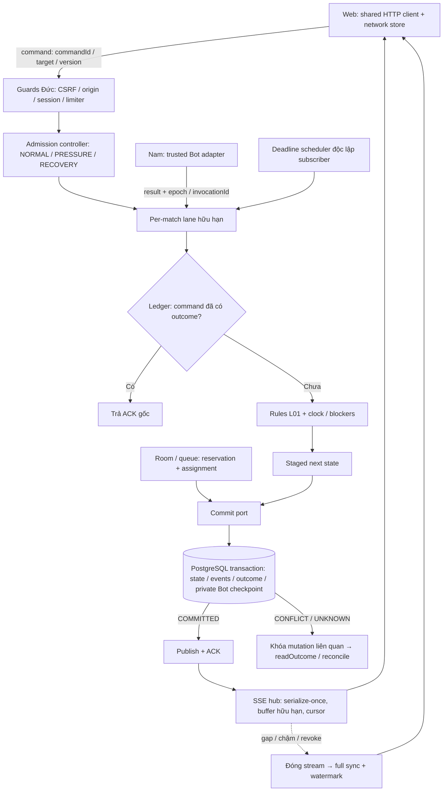
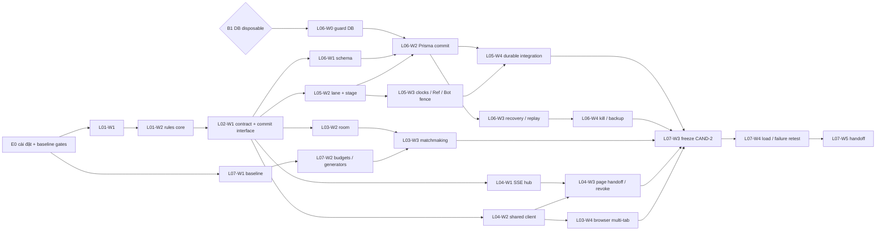
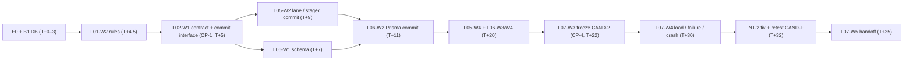

# Implementation Plan - FRS-L04

*Note: This is a split from the master implementation plan.*

# Network Core — Implementation plan FRS-L01…L07

| Mục | Giá trị |
|---|---|
| Owner | Long — toàn bộ code tích hợp chung LD-01…LD-06 |
| Phạm vi | L-01, L-02, L-03 (ROOM + SYNC), L-04, L-05, L-06A, L-07, L-06B |
| Trạng thái plan | **CHỜ DUYỆT** — chưa sửa application code, chưa commit/push/deploy |
| Implementation / test | NOT STARTED / NOT RUN cho toàn bộ wave |
| Source đối chiếu | `main` @ `dbda8a9`; worktree có `.agents/` untracked (giữ nguyên) |
| Cửa sổ lịch | 36 giờ lịch cho toàn bộ nhiệm vụ của Long, tính từ lúc duyệt (T0). Ví dụ duyệt 23:00 10/10 → T+36 = 11:00 12/10 (UTC+7) |
| Không được phép trong plan | Push, deploy, migrate DB dùng chung/production, bật dịch vụ trả phí, mutation bằng `DATABASE_URL` mặc định, chạy Python người chơi ngoài sandbox |

## 0. Quy ước trạng thái và mức candidate

| Trạng thái wave | Nghĩa |
|---|---|
| NOT STARTED | Chưa bắt đầu; còn dependency chưa đạt |
| READY | Đủ dependency, ownership, môi trường và gate; bắt đầu ngay khi plan được duyệt |
| IN PROGRESS / IN REVIEW | Đang làm / có candidate + evidence chờ reviewer |
| BLOCKED | Có vướng mắc cụ thể, ghi rõ chờ ai/điều gì |
| DONE | Đủ AC/DoD, evidence đúng candidate, review bắt buộc đã có verdict thật |

Test chỉ dùng PASS / FAIL / NOT RUN / BLOCKED. Build xanh, mock, fixture hoặc tài liệu cũ không thay evidence.

| Mức | Định nghĩa | Được dùng để |
|---|---|---|
| C0 — Interface candidate | Schema/type/port đã khóa + examples + contract tests | Consumer và lane khác phát triển song song |
| C1 — Implementation candidate | Code + unit/race test trên adapter in-memory | Tích hợp sớm, Đức bắt đầu retest |
| C2 — Integrated candidate | Chạy server thật + DB disposable + runtime thật của Nam + browser thật | Load/recovery/security retest |
| A — Nghiệm thu FRS | Mọi AC có evidence trên candidate đã freeze, review Đức/Nam/Sơn có verdict | Mới được ghi DONE cho FRS/TASK_ID |

Evidence tương lai ghi tại `docs/team-handoff/network-core/evidence/<WAVE_ID>.md` theo mẫu: TASK/AC → candidate SHA hoặc dirty-diff hash → môi trường/DB identifier không credentials → lệnh/workload → expected/actual → artifact → verdict → reviewer/limitations.

## 1. Mục tiêu và output sau khi hoàn thành

| Đối tượng | Output nhận được | Cách nghiệm thu |
|---|---|---|
| Người chơi | Ván mới có 18 quân/bên, random đối xứng, khác ván ngay trước; refresh/reconnect giữ đúng trận, bên, đồng hồ | Golden seeds + hai browser refresh/reconnect cùng board/version |
| Người chơi | Nước đã được xác nhận không mất, không nhân đôi khi retry, mất mạng hoặc server restart | Kill trước commit / sau commit trước ACK / sau ACK trên DB disposable |
| Người chơi | Bị khóa nước kết thúc đúng lý do “Bị khóa nước”; Stop khóa trận, đồng hồ đóng băng; Bot trả muộn không đổi trận | Fixture khóa nước, race move-vs-Stop, late Bot output |
| Người chơi | Hủy tìm trận có kết quả authoritative; nếu đã ghép thì vào đúng trận | Race cancel-vs-match qua HTTP thật + browser |
| Người chơi | Banner trạng thái mạng rõ: đang đồng bộ / mất kết nối / chỉ xem / cần đăng nhập lại | Browser E2E với ngắt stream, gap, revoke |
| Hệ thống | Một authority theo trận: lane tuần tự, staged state, durable-before-ACK, scheduler độc lập subscriber | Race report + zero-subscriber clock test |
| Hệ thống | SSE có backpressure, buffer hữu hạn; stream chậm chỉ tự đóng chính nó | Slow-reader test + resource report |
| Hệ thống | Admission NORMAL/PRESSURE/RECOVERY theo budget đo được; lobby/history không chiếm ngân sách trận đang chạy | Fault-isolation report |
| Team | Contract catalog 0.2, compatibility table, runbook đã rehearsal, capacity report trung thực từng mốc | Người khác làm theo runbook trên môi trường test |

Không cam kết đạt 1.000/5.000/10.000 CCU hay mức tiết kiệm tài nguyên trước khi đo. Mỗi mốc ghi PASS/FAIL/NOT RUN theo số đo thật.

## 2. Tech stack xác minh từ repo

### 2.1 Thành phần hiện có

| Thành phần | Phiên bản (nguồn) | Vai trò | Module liên quan |
|---|---|---|---|
| Node.js | v24.21.0 (máy local); `engines >=24` | Runtime server/test | toàn repo |
| pnpm qua corepack | 12.6.0 (`packageManager`) | Workspace `apps/*`, `packages/*` | `pnpm-workspace.yaml` |
| TypeScript | 5.9.3 (lockfile) | Type system | mọi package |
| Fastify / @fastify/cors | 5.12.5 / ^10.0.1 | HTTP server, SSE qua `reply.raw` | `apps/server/src/app.ts`, `modules/*/*.route.ts` |
| Zod | 4.6.5 | Schema runtime cho contracts/env | `packages/contracts/src/**`, `config/env.ts` |
| Prisma + PostgreSQL | 6.19.3, provider `postgresql`, 18 migrations | Auth, history, rating, social, Bot library; models `Match/MatchMove/MatchCheckpoint/MatchEvent` | `prisma/**`, `plugins/prisma.ts` |
| React / React Router / Vite | 19.3.0 / 7.18.4 / 7.3.6 | Web client | `apps/web/src/**` |
| Vitest / Playwright | 3.2.7 / 1.63.0 | Unit/contract/integration / browser E2E | `tests/**`, `apps/*/test` |
| k6 | v2.3.0 (binary local) | HTTP load | `tests/load/smoke.js` (1 VU `/health`) |
| Bot runtime (Nam) | Wasmtime + CPython-WASI (Online), Pyodide 0.27.3 (Offline) | Sandbox Python | `modules/bot-online/**`, `packages/bot-sdk/**` |
| Render | `render.yaml`, `PORT=10000` | Hosting hiện tại | không đổi topology |

### 2.2 Hiện trạng source liên quan scope

| Khu vực | Hiện có (đọc source, chưa chạy test) | Khoảng trống so với FRS |
|---|---|---|
| Rules | `createInitialState()` không tham số, setup cố định 9 quân/bên; result reason chỉ `EXTINCTION/GOAL_REACHED` | L01: version/seed/rank, 18 quân, `NO_LEGAL_MOVES`, legacy adapter |
| Contracts | `PROTOCOL_VERSION = "0.1"`; chưa có `commandId`, ACK, cursor, pulse riêng | L02: protocol 0.2 + compatibility 0.1 |
| Authority | `MatchManager` (1.020 dòng) sửa state tại chỗ rồi gọi persistence **đồng bộ**; checkpoint chứa toàn bộ moves | L05/L06: staged state + async commit port + ledger |
| Scheduler | `setInterval` 1s mỗi trận, vòng đời gắn với subscriber gọi `startScheduler` từ route SSE | L05: deadline scheduler độc lập subscriber |
| Persistence | `InMemoryMatchPersistence`; `FileMatchPersistence` khi có `MATCH_PERSISTENCE_DIR`; Bot state dùng file persistence riêng | L06: transaction PostgreSQL cho state/events/outcome/private checkpoint |
| Room/queue | `Map` in-memory, idempotency in-memory | L03/L06: durable membership/assignment, lease |
| SSE | `raw.write` trực tiếp, không theo dõi `drain`/bytes; heartbeat theo từng route | L04: hub có backpressure, serialize-once, cursor |
| Realtime adapter | `REALTIME_ADAPTER=disabled` mặc định; PlayHTML skeleton | Giữ HTTP/SSE; capability phản ánh adapter thật |
| Web client | `services/http/httpClient.ts` chưa gắn `X-OTT-Request`; `EventSource` nằm trong 5 service và `SpectatorPage.tsx` | L04: shared client/store; page handoff theo writer |
| Evidence cũ | Robot Lab plan dẫn tới `docs/r4-platform-evidence.md` … nhưng các file này **không có trong repo** | Không suy trạng thái từ đó; baseline đo lại ở L07-W1 |

### 2.3 Môi trường tại thời điểm lập plan

| ID | Điều kiện | Ảnh hưởng |
|---|---|---|
| E0 | `node_modules` chưa cài; `pnpm-lock.yaml` có hai header `lockfileVersion` (dòng 2 và 159) | Phải `corepack pnpm install --frozen-lockfile` và xác minh lockfile trước mọi gate |
| E1 | Không có PostgreSQL, Docker hay `.env` trên máy | Không có DB disposable → chặn L06 và mọi AC durable (Blocker B1) |
| E2 | Một host 8 CPU / 11,6 GB RAM | Generator và server cùng máy → chỉ là rehearsal, không phải capacity Render |
| E3 | Server test suite có `test/integration/auth.integration.test.ts` dùng `.env` | Chỉ chạy integration qua guard `TEST_DATABASE_URL` đã xác minh |

### 2.4 Đề xuất bổ sung (chưa có trong repo)

| Đề xuất | Lý do | Ràng buộc |
|---|---|---|
| Commit port + Prisma adapter + command ledger | Durable-before-ACK, idempotency | Migration expand-only, source-only cho môi trường dùng chung |
| SSE hub dùng chung | Backpressure, cursor, cleanup một lần | Giữ routes/HTTP-SSE hiện có |
| Budget profile + capacity controller | Admission theo số đo | Giá trị chỉ điền từ baseline; chưa đo ghi `UNMEASURED` |
| Network store/reconciler phía web | Tách network logic khỏi page | Page owner tích hợp |
| Generator SSE/gameplay bằng script Node | k6 core không giữ SSE | Không thêm dependency trả phí |
| Guard DB disposable (`scripts/network/disposable-db.mjs`) | Chặn mutation nhầm DB | Từ chối nếu trùng `DATABASE_URL` hoặc thiếu marker disposable |
| Playwright config cho server thật (`playwright.network.config.ts`) | Config hiện chỉ chạy web dev với API mock | Chạy với server test + DB disposable |

## 3. Kiến trúc, data flow và dependency

### 3.1 Data flow mục tiêu

### 3.2 Dependency giữa các wave

Authority (L05) và persistence (L06) cùng phát triển theo commit interface khóa ở L02-W1; L05 DONE cần evidence durable của L06, L06 không chờ L05 DONE.

## 4. Ownership

### 4.1 Lane thực thi của Long

Mỗi lane là một worker (Long hoặc agent do Long giám sát), khai báo wave và file trước khi viết. Long chịu trách nhiệm tích hợp; một file chỉ có một writer tại một thời điểm.

| Lane | Wave | Writer duy nhất cho |
|---|---|---|
| A1 Rules | L01-W1…W3 | `packages/game-rules/src/**`; `tests/unit/game-rules*.unit.test.ts`, `tests/unit/l01-*.unit.test.ts` |
| A2 Contracts | L02-W1…W3 | `packages/contracts/src/**` (kể cả `bot-online.ts`, `bot-library.ts` — Nam gửi yêu cầu); `tests/contract/**` |
| B Persistence | L06-W0…W4 | `prisma/schema.prisma`, `prisma/migrations/<mới>/**`; `apps/server/src/modules/match/commit/commit.prisma.ts`, `modules/match/recovery/**`, `modules/history/**`, `modules/rating/**`; `scripts/network/disposable-db.mjs`; `apps/server/test/integration/network/**` |
| C Authority | L05-W1…W4 | `apps/server/src/modules/match/match.manager.ts`, `match.route.ts`, `match.persistence.ts`, `modules/match/commit/{commit.port,commit.memory,command-ledger}.ts`, `modules/match/lane/**`, `modules/match/scheduler/**`; tests `match.*`, `referee.route.*` |
| D Room + Sync server | L03-W1…W3, L04-W1 | `apps/server/src/modules/room/**`, `modules/matchmaking/**`, `apps/server/src/realtime/**` (gồm `realtime/sse/**` mới); tests `room.*`, `matchmaking.*`, `spectator-authorization.*`, `realtime.*` |
| E Web client | L04-W2…W3, L03-W4 | `apps/web/src/services/{http,rooms,matchmaking,history,health}/**`, `apps/web/src/services/network/**` (mới); `tests/e2e/network/**`, `playwright.network.config.ts` |
| F Capacity + Integration | L07-W1…W5 | `apps/server/src/app.ts`, `config/env.ts`, `config/budget-profile.ts` (mới), `plugins/{cors,error-handler,prisma,web-app}.ts`, `modules/health/**`, `modules/diagnostics/{metrics,metrics.route}.ts`, `modules/capacity/**` (mới); `tests/load/**`, `scripts/network/**` (trừ guard DB), root `package.json`, `render.yaml`; `docs/team-handoff/network-core/**` |

### 4.2 Ranh giới với thành viên khác

| Owner | File/thư mục | Long làm gì |
|---|---|---|
| Đức | `apps/server/src/modules/auth/**`, `modules/guest/**`, security plugin mới (đề xuất `apps/server/src/plugins/security/**`), `tests/security/**` | Lane F đăng ký guard trong `app.ts` theo thứ tự Đức chốt; không sửa logic auth |
| Nam | `apps/server/src/modules/bot-online/**`, `bot-library/**`, `diagnostics/r3-provider.route.ts`, `packages/bot-sdk/**`, `apps/web/src/services/bot-*/**`, Bot pages | Cung cấp commit port, private checkpoint port, rule API; Nam viết adapter/codec |
| Sơn | Router, `apps/web/src/pages/**` ngoài Bot (`GameRoomPage`, `SpectatorPage`, `QueuePage`, `HomePage`, `OnlineRoomsPage`, `HistoryPage`), components, styles | Bàn giao store/service API + examples; Sơn tích hợp page |
| Chưa chốt | `apps/web/src/services/local/**` (lưu phiên Offline/AI) | Nam phân writer; Long cung cấp descriptor/validation cho L-05.11 và RULE-AC03 local |
| Ngoài scope | `modules/social/**`, `modules/profile/**` | Không sửa |

### 4.3 Shared file và cửa sổ ghi

| File chung | Writer | Quy tắc |
|---|---|---|
| `packages/contracts/src/**` | A2 | Sau CP-1 chỉ đổi theo contract change protocol: đề xuất → sửa contract → consumer review → cập nhật provider/consumer |
| `prisma/schema.prisma` | B | Migration expand-only; không chạy trên DB không phải disposable |
| `match.manager.ts`, `match.route.ts` | C | D/E gửi yêu cầu, không sửa trực tiếp |
| `apps/server/src/app.ts`, `config/env.ts` | F | Chỉ merge trong cửa sổ tích hợp T+11–12, T+20–22, T+30–32 |
| `apps/web/src/services/http/httpClient.ts` | E | Header/retry theo policy Đức |

## 5. Gate chung cho mọi wave

| Bước | Output bắt buộc | Không đạt khi |
|---|---|---|
| Plan | Khai báo wave, file sở hữu, AC, trạng thái lỗi/quyền, dependency | Còn mâu thuẫn chưa chốt hoặc file trùng writer |
| Harness | Test tái hiện fail trước sửa (race/regression/security/perf baseline), ghi môi trường | Chỉ có mock cho yêu cầu cần runtime/DB thật |
| Dev | Chỉ phạm vi wave; rules ở `@ottv2/game-rules`, payload ở `@ottv2/contracts`, quyền/clock/kết quả ở server | UI tự quyết state/clock |
| Test | Focused tests + typecheck/lint/build phù hợp; DB test chỉ qua guard disposable | Zero tests, skipped, hoặc DB chưa xác minh |
| Review | Actor/race/copy/privacy/failure path; reviewer thật ghi verdict | Tự ký independent PASS |
| Clean Rubbish Code | Xóa code chết sau khi liệt kê consumer và giữ reader dữ liệu cũ | Xóa user work, evidence cũ, `.worktrees/`, `.agents/` |

## Bảng wave cho FRS-L04

### 6.4 FRS-L04 — L-03.SYNC

| WAVE_ID | FRS/TASK_ID/AC | Output | Tác động hệ thống | Scope/files | Dependency | Test/evidence | Exit gate | Effort | Chờ | Trạng thái |
|---|---|---|---|---|---|---|---|---|---|---|
| L04-W1 | SYNC-02,04,05,06 (server) | SSE hub: subscribe + full sync không khoảng hở, cursor `scope:generation:sequence`, buffer bytes/age, `drain`, serialize-once theo nhóm quyền, listener isolation, cleanup một lần; pulse tách domain sequence | Client chậm không kéo cả trận; không mất event giữa snapshot/subscribe | `apps/server/src/realtime/sse/**`; route dùng hub (lane C/D theo file) | L02-W1 | Inject event giữa snapshot/subscribe; slow reader; listener throw; heap/buffer đo | C1 hub; slow-client report | 3,5h | 0 | NOT STARTED |
| L04-W2 | SYNC-01,03,06 (client) | Shared HTTP client (`X-OTT-Request: 1`, JSON, commandId giữ khi retry, map lỗi/retryable), subscription manager, reconciler, network store 5 trạng thái, reconnect backoff+jitter | Hai client hội tụ; 403 không logout, 401 FATAL_SESSION mới yêu cầu đăng nhập | `apps/web/src/services/{http,network,rooms,matchmaking}/**` | L02-W1; policy header Đức (LD-01) | Unit duplicate/reorder/gap/stale ACK/pulse; error-row fixtures | C1 client + API/store examples (**CP-3**) | 4h | Đức policy | NOT STARTED |
| L04-W3 | SYNC-07,08,09 | Revocation đóng stream + xóa cache riêng; page adapter bàn giao; resource regression bytes/event, streams, event-loop lag | Thu hồi quyền có hiệu lực ngay; page không tự tạo EventSource | `services/network/**`, `tests/e2e/network/**` | L04-W1/W2; hooks revoke Đức; Sơn/Nam tích hợp page | Revoke giữa stream; browser pause/terminal/rematch; resource report so baseline | C2 sync evidence; page integration của Sơn/Nam ghi riêng | 2h | Sơn/Nam page writer | NOT STARTED |

## Mapping yêu cầu cho FRS-L04

### 7.4 FRS-L04 (L-03.SYNC)

| TASK | Dev | Kiểm chứng | LD | Ngoài Long |
|---|---|---|---|---|
| SYNC-01 | L04-W2 | L04-W2, L02-W3 | LD-01 | Đức CSRF guard |
| SYNC-02 | L04-W1 | L04-W1 | LD-05 | — |
| SYNC-03 | L04-W2 | L04-W2, L03-W4 | — | — |
| SYNC-04 | L04-W1 | L04-W1, L07-W4 | LD-03 | — |
| SYNC-05 | L04-W1 | L04-W1 | LD-02/05 | Đức canaries |
| SYNC-06 | L04-W1, W2 | L04-W1, W3 | LD-02/03 | — |
| SYNC-07 | L04-W3 | L04-W3 | LD-02 | Đức revoke hooks |
| SYNC-08 | L04-W3 | L04-W3 | LD-01 | Sơn/Nam page |
| SYNC-09 | L04-W3 | L04-W3, L07-W4 | LD-03 | — |

Section → task: §2 → 01,02,04,05,06 · §3 → 03 · §4 → 01,06,07,08.

## 8. Timeline 36 giờ

### 8.1 Lịch theo lane

| Khung (T+h) | A1 Rules | A2 Contracts | B Persistence | C Authority | D Room/Sync | E Web client | F Capacity/INT |
|---|---|---|---|---|---|---|---|
| 0–1 | E0 + CP-0 | CP-0 | L06-W0 (chờ B1) | L05-W1 | L03-W1 | — | E0 gates, L07-W1 |
| 1–5 | L01-W1→W2 | L02-W1 | L06-W0 | L05-W1 xong | L03-W1 xong | — | L07-W1 |
| 5–9 | — | review CP-1; L02-W2 | L06-W1→W2 | L05-W2 | L04-W1 | L04-W2 | L07-W2 |
| 9–12 | L01-W3 | L02-W2 | L06-W2 | L05-W3 | L03-W2 | L04-W2 | Tích hợp CAND-1 (T+11–12) |
| 12–16 | — | hỗ trợ consumer | L06-W3 | L05-W3 | L03-W3 | L04-W3 (CP-3 tại T+14) | Đức retest CAND-1 |
| 16–20 | — | L02-W3 | L06-W4 | L05-W4 | INT-1 | L03-W4 | INT-1 |
| 20–22 | — | — | — | — | — | — | L07-W3 freeze CAND-2 |
| 22–30 | — | fix | fix | fix | fix | fix | L07-W4 (chạy dài trong khung nghỉ) |
| 30–32 | INT-2 | INT-2 | INT-2 | INT-2 | INT-2 | INT-2 | CAND-F |
| 32–36 | — | — | — | — | — | — | INT-3, L07-W5, dự phòng 1h |

Long cần hai khối nghỉ ~3 giờ: N1 tại T+7–10 (lane chạy Dev theo interface đã khóa, không merge shared file) và N2 tại T+26–29 (soak/ramp có safety stop chạy không giám sát).

### 8.2 Critical path

Độ trễ của B1 cộng thẳng vào critical path: B1 chưa xong ở T+3 thì CAND-2 trượt tương ứng và mọi AC durable giữ BLOCKED.

### 8.3 Checkpoint bàn giao

| CP | T+ | Long bàn giao | Nhận từ Đức | Nhận từ Nam | Nhận từ Sơn |
|---|---|---|---|---|---|
| CP-0 | 1 | Lane/file ownership, nhu cầu interface | Guard order/signature (LD-01), revoke hook (LD-02), limiter signature (LD-03) | Shape private checkpoint, trusted invocation/result | — |
| CP-1 | 5 | Contract 0.2-rc1, rules C0, commit/restore interface, consumer list | Review actor/error/visibility (≤2h) | Review Bot ABI/port (≤2h) | Nhận examples |
| CP-2 | 12 | CAND-1 server (authority, room/queue, SSE hub; Prisma nếu B1 kịp) | Bắt đầu retest LD-01/02/03 | Nối adapter vào commit port | — |
| CP-3 | 14 | Network store/service API + page adapter examples | — | Tích hợp Bot pages | Tích hợp `GameRoomPage`/`SpectatorPage`/`QueuePage` |
| CP-4 | 22 | CAND-2 integrated + config + runbook nháp (L-06A.02) | D-05 audit, D-04 race/crash | Runtime consumer report | Page integration evidence |
| CP-5 | 30 | Load/failure/recovery report v1 | Retest spam/attack workload | Python workload thật | — |
| CP-6 | 32 | CAND-F + findings đã sửa | Retest LD-06, scoped verdict | N-08 input | S-06 evidence |
| CP-7 | 35 | Handoff L-06B.01; L-06B.02 NOT RUN nếu chưa có lệnh | — | Quyết định nghiệm thu | — |

Nếu deadline chung 00:00 12/10 vẫn áp dụng (≈ T+25 khi duyệt lúc 23:00), tại mốc đó chỉ có CAND-2 và một phần L07-W4; các AC phụ thuộc load/recovery retest vẫn NOT RUN.

### 8.4 Mức khả thi

| Phạm vi | Đánh giá trong 36 giờ | Điều kiện |
|---|---|---|
| C1 cho L01–L06 + harness L07 | Khả thi có điều kiện | Đủ lane song song; CP-0/CP-1 đúng giờ |
| C2 integrated candidate | Khả thi có điều kiện | B1 giải quyết trước T+3; adapter Nam trước T+12; guard Đức trước T+12 |
| DONE L01, L02, L03, L04, L05, L06 | Có thể đạt từng phần | Review Đức/Nam/Sơn kịp; RULE-AC15, L-05.11 phụ thuộc consumer/writer khác |
| DONE L07 | Không khả thi trung thực | 1k/5k/10k cần generator tách và test target được phép; host local chỉ là rehearsal; L-06B.02 cần lệnh riêng |

## 9. Rủi ro, blocker và next action

### 9.1 Blocker và rủi ro

| ID | Mô tả | Mức | Owner xử lý | Ứng phó |
|---|---|---|---|---|
| B1 | Không có PostgreSQL disposable trên máy | Blocker critical path | Người dùng/Nam quyết định | Xem phương án trong chat; trong lúc chờ, L05/L06 dev trên adapter in-memory, AC durable giữ BLOCKED |
| B2 | Guard/hook của Đức (LD-01/02/03) chưa có trong repo | Cao | Đức | Long tích hợp theo signature CP-0; test dùng stub chỉ trong test, không ship stub |
| B3 | Writer `services/local/**` chưa chốt | Trung bình | Nam | Long bàn giao descriptor/validation; RULE-AC03/08 local, L-05.11 BLOCKED đến khi có writer |
| B4 | Chưa có test target được phép cho load provider | Cao cho L07 | Nam | Local chỉ rehearsal; mốc vượt safe envelope ghi NOT RUN/FAIL |
| R1 | Refactor `MatchManager` (sửa tại chỗ, persistence đồng bộ) sang staged async | Cao | Long (lane C) | Harness L05-W1 trước; giữ test cũ; feature seam qua port, không đổi API route |
| R2 | Protocol 0.1 → 0.2 làm vỡ consumer | Trung bình | Long (A2) | Adapter 0.1, 409 cho version không hỗ trợ, compatibility tests |
| R3 | E0: dependency chưa cài, lockfile hai header | Trung bình | Long (F) | `--frozen-lockfile`; lỗi thì báo, không tự tái tạo lockfile |
| R4 | Generator cùng host làm méo số đo | Cao | Long (F) | Ghi CPU generator; dừng khi generator nghẽn; không kết luận Render |
| R5 | Runtime Python thật trên Linux local chưa xác minh | Trung bình | Nam | Probe `probe:r3:provider` tại môi trường test; thiếu thì Python workload BLOCKED |
| R6 | Page owner chưa kịp tích hợp store | Trung bình | Sơn/Nam | Store API + examples tại CP-3; SYNC-08/ROOM-09 chờ page |
| R7 | Mâu thuẫn cửa sổ 36h với deadline chung 00:00 12/10 | Trung bình | Nam | Câu hỏi trong chat; plan giữ CAND-2 trước 00:00 12/10 |
| R8 | Evidence R-wave dẫn chiếu không có trong repo | Thấp | Long | Đo lại baseline; không kế thừa PASS |

### 9.2 Next action sau khi duyệt

1. F: E0 — cài dependency, chạy gate an toàn (`test:unit`, `test:contract`, server `test/unit`, web test, typecheck, lint, build); ghi baseline PASS/FAIL thật.
2. CP-0: gửi Đức/Nam yêu cầu signature/port; chốt phương án B1.
3. Khởi động song song các wave READY: L01-W1, L02-W1, L03-W1, L05-W1, L07-W1.
4. B: L06-W0 ngay khi B1 có phương án.

## 10. Áp dụng ECC skills

| Skill | Tình trạng | Áp dụng trong plan | Không áp dụng / lý do |
|---|---|---|---|
| blueprint | Chỉ có bản trong npm cache cục bộ (`ecc-universal`), chưa cài làm skill/plugin hoạt động | Chia wave cỡ một candidate, dependency graph, lane song song không chung file, exit gate và rollback (giữ adapter cũ đến khi xác minh consumer); review đối kháng bản nháp | Không tạo `plans/`, branch/PR (chỉ một file output, không push) |
| contract-first | Như trên | `@ottv2/contracts` (Zod) là artifact canonical duy nhất; consumer jobs → examples; provider responses validate tại boundary (L02-W3); contract change protocol sau CP-1 | Không thêm OpenAPI/AsyncAPI: mọi consumer TS dùng chung build; Bot ABI do Nam ánh xạ trong SDK |
| api-design | Như trên | Status code đúng ngữ nghĩa, cursor pagination cho history/replay, `Retry-After`/`retryAfterMs`, không lộ stack | Không đổi tên routes hiện có (FRS giữ HTTP/SSE/routes); error envelope theo FRS-L02 |
| backend-patterns | Như trên | Repository/port + adapter, transaction boundary, retry backoff+jitter, queue hữu hạn, structured log bounded | Không dùng Redis/cache ngoài (free-only, giữ topology) |
| database-migrations | Như trên | Mọi thay đổi qua migration, expand-only, tách schema/data, cột mới nullable/default, reader cũ giữ nguyên | “Test trên bản sao production” không thực hiện (không có quyền dữ liệu production) — thay bằng fixture legacy tổng hợp; không migrate DB dùng chung |
| benchmark | Như trên | Baseline trước tối ưu, p50/p95/p99, so before/after cùng workload | Không đo Core Web Vitals (ngoài scope Long); baseline lưu trong evidence của repo thay vì `.ecc/benchmarks/` |
| e2e-testing | Có tại `.agents/skills/e2e-testing` | Playwright với server thật, trace/screenshot khi fail, quarantine flaky có ghi nhận, report template | Không dùng retry để che flaky trong evidence nghiệm thu |
