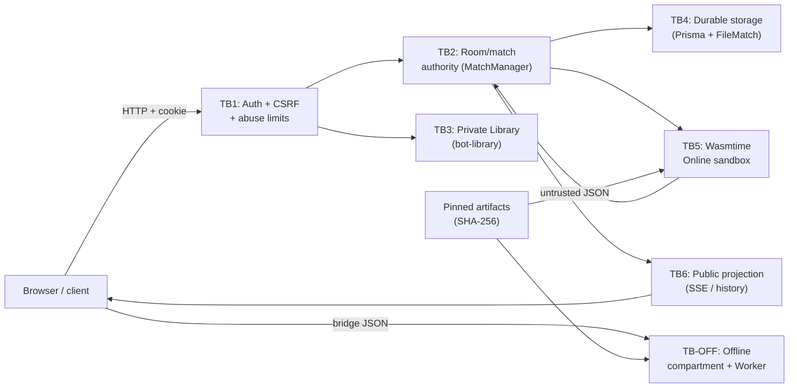

# FRS-D01 — Threat Model & Security Policy: Implementation Plan

| Thuộc tính | Giá trị |
|---|---|
| **TASK_ID** | D-01 |
| **FRS** | [FRS-D01-THREAT-MODEL-POLICY.md](FRS-D01-THREAT-MODEL-POLICY.md) |
| **Owner chính** | Đức |
| **Trạng thái** | DONE |
| **Deadline** | 00:00 12/10/2026 UTC+7 (~36h) |

> **CHỜ DUYỆT.** File này là plan; không sửa application code, không commit/push/deploy.

---

## 1. Objective / Security Outcome

Xác lập toàn bộ threat model, asset inventory, trust boundary, abuse case và risk/control matrix phục vụ D-02…D-07. Đây là **foundation duy nhất** — nếu D-01 thiếu hoặc sai thì các FRS sau thiếu đầu vào policy.

**Người dùng hợp lệ thấy gì:** Không thay đổi UX; policy được phân phối dưới dạng module/fixtures cho Long/Nam/Sơn dùng.

**Tấn công bị chặn:** Tất cả — D-01 định nghĩa *cái gì* cần chặn; control thực thi thuộc D-02…D-06.

---

## 2. AC / DoD

| TASK_ID | Acceptance Criteria |
|---|---|
| D-01.01 | Inventory đủ 6 boundary (Browser→API, Server→DB, App→Sandbox, Renderer→Offline, Private→Public, Build/Ops/Cache); private/public và điểm kiểm tra quyền/quota rõ |
| D-01.02 | Matrix R01…R14 có: attack path, severity + lý do, control, owner, test, dependency, trạng thái |
| D-01.03 | Policy handoff: Nam/Long/Sơn nhận control + expected behavior cụ thể; shared file chỉ một writer; dependency thiếu ghi rõ |
| D-01.04 | Convention evidence/finding: một matrix chung nối risk → control → owner → test → artifact; finding có repro/impact/fix/retest |
| D-01.05 | Review coverage: không sót actor/boundary; gaps có owner; không nới gate vì deadline |

**DoD:** D-01 DONE khi matrix đủ để D-02…D-07 triển khai; completion D-01 không chứng nhận implementation/runtime an toàn.

---

## 3. Risk và Control

### 6 Trust Boundaries (từ source thực tế)



### Risk Matrix R01–R14 (từ FRS-D01)

| Risk ID | Attack path | Severity | Control | Owner | Test | Trạng thái |
|---|---|---|---|---|---|---|
| R01 | Session giả / phiên hết hạn / revoked | P1 | Opaque token + DB revocation | Đức (auth); Long (stream cleanup) | D-02.01 | NOT RUN |
| R02 | Cross-room ACL; tự nhận referee/host | P1 | Object ACL server-side; role từ DB | Đức policy; Long/Nam integrate | D-02.04 | NOT RUN |
| R03 | CSRF; brute-force login/recovery | P1 | Origin allowlist + `X-OTT-Request`; throttle | Đức | D-02.03, D-02.06 | NOT RUN |
| R04 | Python thoát sandbox: network/secrets/fs | P0 | Wasmtime WASI caps (`network:false` v.v.) | Nam (runtime); Đức test | D-03.ON-02 | NOT RUN |
| R05 | Offline Python đọc DOM/storage/gọi network | P1 | Opaque iframe + CSP + bridge schema | Nam (compartment); Đức test | D-03.OFF-02 | NOT RUN |
| R06 | Loop/OOM/output flood/upload spam | P1 | Manifest quotas + watchdog + bounded API | Nam (quotas); Đức + Long (limits) | D-03.ON-03, D-02.08 | NOT RUN |
| R07 | Sửa board/seed/side/clock/winner | P1 | Server authority; versioned checkpoint | Long; Nam Bot integration | D-04.01, D-04.02 | NOT RUN |
| R08 | Duplicate/stale commands; race Stop/Resume | P1 | Idempotency + serialized lane + epoch fence | Long | D-04.03, D-04.05 | NOT RUN |
| R09 | Source/memory/log lọt SSE/snapshot/replay | P1 | DTO allowlist; owner ACL; redaction | Long + Nam; Đức review | D-04.08 | NOT RUN |
| R10 | Markup/script injection qua tên/log/error | P2 | Safe rendering; bounded input; CSP | Sơn UI; Nam Bot page; Đức policy | D-01.R10 | NOT RUN |
| R11 | Asset bị thay; secrets trong bundle/log/cache | P1 | SHA-256 pin; secret hygiene; cache isolation | Nam/Long/Sơn theo module | D-05.01, D-05.04 | NOT RUN |
| R12 | Export/delete trái quyền; restart hồi quyền cũ | P1 | Ownership guards; revocation-aware recovery | Long + Nam; Đức policy | D-05.05 | NOT RUN |
| R13 | Auto-click/multi-account phòng/nước/stream | P1 | Layered rate/concurrency/resource caps | Đức policy; Long integrate; Nam preflight | D-02.08, D-02.09 | NOT RUN |
| R14 | SQL/command injection qua field/URL/filename | P1 | Strict schemas; parameterized queries | Owner từng module; Đức audit | D-01.R14 | NOT RUN |

---

## 4. Ownership

| Phạm vi | Owner | Đức làm |
|---|---|---|
| Threat matrix, policy document, evidence convention | **Đức** | Soạn R01–R14; phân phối control/test cho owner |
| Boundary inventory từ source | **Đức** | Đọc source (DONE); ghi 6 boundary + điểm kiểm tra |
| Policy handoff → Long | Long nhận | Đức giao CSRF interface, limiter spec, ACL matrix |
| Policy handoff → Nam | Nam nhận | Đức giao sandbox gate spec, private projection policy |
| Policy handoff → Sơn | Sơn nhận | Đức giao safe-rendering finding khi có |

---

## 5. Waves

### D01-W1 — Asset inventory + threat matrix draft
*T+0 → T+3h*

**Output:** File `security/threat-matrix.md` có đủ R01–R14 với severity/control/owner/test; 6 boundary; data flow diagram.

**Files Đức sở hữu:** `docs/team-handoff/security/threat-matrix.md` (mới)

**Dependency:** Source đã đọc (DONE); FRS-D01…D07 đã đọc (DONE)

**Exit gate:** Matrix có đủ cột; không sót actor (outsider, Guest, player, host, referee, spectator, Bot, website ngoài, artifact bị thay)

**Trạng thái:** DONE

---

### D01-W2 — Policy handoff + review coverage
*T+3h → T+6h*

**Output:** Policy giao cho Long (CSRF interface, limiter spec), Nam (sandbox gate), Sơn (rendering policy); gaps có owner.

**Files Đức sở hữu:** `docs/team-handoff/security/policy-handoff.md` (mới)

**Dependency:** D01-W1 matrix draft DONE

**Exit gate:** D-01.03 và D-01.05 AC đạt; Long/Nam/Sơn xác nhận nhận policy

**Trạng thái:** DONE

---

## 6. Output từng Wave

| Wave | Artifact cụ thể |
|---|---|
| D01-W1 | `threat-matrix.md`: bảng R01–R14 + severity + control + owner + test + trạng thái; data flow Mermaid |
| D01-W2 | `policy-handoff.md`: machine-checkable contract (TypeScript/Zod schema) cho CSRF interface (Đức → Long), sandbox gate (Đức → Nam), rendering policy (Đức → Sơn) |

---

## 7. Files / Owner / Dependency

| File | Owner | Dependency |
|---|---|---|
| `security/threat-matrix.md` | Đức (tạo mới) | FRS-D01 source đã đọc |
| `security/policy-handoff.md` | Đức (tạo mới) | D01-W1 DONE |
| `apps/server/src/app.ts` | Long (wiring sau) | Đức cung cấp interface; chờ D-W1 FRS-D02 |
| Không sửa app code nào | — | — |

---

## 8. Test / Evidence / Exit Gate

| Check | Phương pháp | Điều kiện đạt |
|---|---|---|
| D-01.01 Inventory | Review manual | 6 boundary rõ; private/public phân biệt |
| D-01.02 Matrix | Peer review (Long/Nam xác nhận nhận policy) | R01–R14 không orphan; owner thực tế |
| D-01.03 Handoff | Confirmation từ Long/Nam/Sơn | Họ có đủ để bắt đầu implement |
| D-01.04 Convention | Dùng trong D-02…D-07 | Format finding đồng nhất |
| D-01.05 Coverage | Đức self-review + Long spot-check | Không sót threat actor |

> **Lưu ý:** D-01 không có runtime test. Evidence là document với peer confirmation. Không dùng build/static analysis để "chứng nhận" matrix.

---

## 9. Trạng thái

| Item | Trạng thái |
|---|---|
| D01-W1 Asset inventory | DONE |
| D01-W2 Policy handoff | DONE |
| D-01.01…05 AC | PASS |

---

## 10. Mandatory Gates và Residual Risks

**Gates:**
- D-01 DONE → unblock tất cả D-02…D-06 (họ cần matrix để gắn control/test)
- Không P0/P1 mở trong matrix (nếu có, phải giao owner sửa ngay)

**Residual risks được chấp nhận:**
- Matrix dựa trên source đọc tại commit `a56e77bf` — nếu code thay đổi sau đó thì phải review lại
- D-01 không chứng nhận implementation; evidence sẽ đến từ D-02…D-07

---

## 11. Dependency / Critical Path trong 36 giờ

```
T+0  → Đức: D01-W1 (threat matrix) — INDEPENDENT, bắt đầu ngay
T+3h → Đức: D01-W2 (policy handoff) → Long/Nam/Sơn nhận
T+6h → Long bắt đầu LD-01 CSRF wiring (nhận interface từ D01-W2)
T+6h → Nam bắt đầu sandbox gate (nhận spec từ D01-W2)
```

**Blocker:** Không có blocker nội tại — D-01 độc lập với implementation candidate. Nếu có mâu thuẫn giữa FRS và source thì hỏi MCQ, không đứng chờ.
