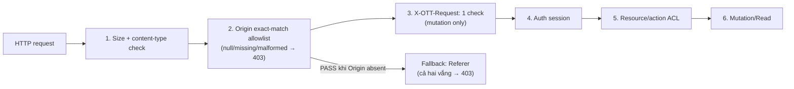

# FRS-D02 — Auth, Session & Access: Implementation Plan

| Thuộc tính | Giá trị |
|---|---|
| **TASK_ID** | D-02 |
| **FRS** | [FRS-D02-AUTH-SESSION-ACCESS.md](FRS-D02-AUTH-SESSION-ACCESS.md) |
| **Owner chính** | Đức (auth/CSRF module); Long (wiring/integration); Nam/Sơn (callers) |
| **Trạng thái** | NOT STARTED |
| **Deadline** | 00:00 12/10/2026 UTC+7 (~36h) |

> **CHỜ DUYỆT.** Không sửa application code, không commit/push/deploy.

---

## 1. Objective / Security Outcome

Người dùng chỉ đọc/điều khiển resource được phép. Phiên bị thu hồi không tiếp tục nhận dữ liệu. Website ngoài không gửi lệnh bằng cookie người chơi. Chặn automation tạo nhiều account/phòng/nước.

**Người dùng hợp lệ thấy gì:**
- Login/logout/recovery hoạt động bình thường
- Phiên mới sau đổi password; các tab khác báo session expired
- Rate limit 429 chỉ hiện khi thực sự lạm dụng; có `retryAfterMs`

**Tấn công bị chặn:**
- Cross-site mutation (403 khi thiếu `X-OTT-Request` hoặc origin sai)
- Token giả/expired/revoked → 401 FATAL_SESSION
- Multi-account/shared-IP spam → 429; counters hữu hạn

---

## 2. AC / DoD

| TASK_ID | Acceptance Criteria |
|---|---|
| D-02.01 | Token giả, malformed cookie, expired session bị chặn; production cookie flags đúng (HttpOnly/SameSite=Lax/Secure); clientId không impersonate Guest |
| D-02.02 | Hai phiên + stream thật: đổi password → token mới, tất cả token cũ mất quyền; recovery concurrent chỉ 1 success; rollback/unknown không cấp token giả |
| D-02.03 | Allowed origin → 200; cross-site/null/missing/malformed origin + simple content-type + thiếu/sai header → 403; login/logout/Guest/upload đều covered; GET/OPTIONS không mutation |
| D-02.04 | Positive/negative từng actor và resource; đổi ID/role/side/invite không vượt quyền; room password không cấp Referee |
| D-02.05 | Revoke/expiry đóng stream; race fan-out/commit không bypass; reconnect/restart không hồi quyền; cleanup evidence |
| D-02.06 | Multi-principal/IP, spoof forwarded header, buckets đầy/TTL, hash concurrency trong safe envelope |
| D-02.07 | 403/INVALID không logout; FATAL_SESSION dừng action; principal switch không dùng private cache cũ |
| D-02.08 | Multi-account/auto-click/room/move/stream floods chặn sớm; counters/leases/buffers hữu hạn |
| D-02.09 | Legitimate + spam cùng lúc: gameplay đạt SLO L07; không sai/mất/double ACK; giới hạn rõ |

**DoD:** D-02.01…09 có evidence: candidate/env/expected/actual/artifact/verdict. Không mock revocation thay stream thật. Đức không tự ký independent PASS code mình viết.

---

## 3. Risk và Control

| Risk | Control hiện có (từ source) | Control còn thiếu | Owner fix |
|---|---|---|---|
| R01 Session giả | `AuthService.authenticate()`: opaque token → hashToken → DB; expiry/revocation check | SSE stream không re-check revocation sau khi mở | Long (stream cleanup hook) |
| R03 CSRF | `cors.ts`: allowlist có nhưng `origin=undefined → pass` (cần sửa) | `X-OTT-Request: 1` middleware; strict null rejection | Đức (module); Long (wiring) |
| R03 Brute-force | `AuthThrottle`: `username\|IP` key; MAX_BUCKETS=50.000; TTL=10 phút | Chỉ bao phủ login/recovery; register/Guest không throttled riêng | Đức (mở rộng throttle) |
| R13 Multi-account | `MAX_GUEST_SESSIONS=10.000`; in-memory + DB count | Không có room/queue/SSE/upload quota theo principal | Long (tích hợp caps) |
| R13 Auto-click phòng | Chưa có | Room lease cap; burst/cooldown | Long (room manager) |
| R02 ACL vượt quyền | Route-level auth check ad-hoc | Không có unified ACL matrix; một số route chưa kiểm tra resource ownership | Đức policy; Long per-route |

### CSRF flow (controls Đức thiết kế, Long wiring)



---

## 4. Ownership

| Phạm vi | Owner sửa code | Ghi chú |
|---|---|---|
| `apps/server/src/modules/auth/csrf.middleware.ts` (mới) | **Đức** | Module độc lập; Long đăng ký vào app.ts |
| `apps/server/src/modules/auth/abuse.limiter.ts` (mới) | **Đức** | Limiter policy ngoài auth throttle |
| `apps/server/src/modules/auth/auth.throttle.ts` | **Đức** | Mở rộng scope nếu cần |
| `apps/server/src/modules/auth/auth.service.ts` | **Đức** | Chỉ sửa phần auth/session/revocation |
| `apps/server/src/app.ts` | **Long** | Đức cung cấp interface; Long đăng ký middleware đúng thứ tự |
| `apps/server/src/plugins/cors.ts` | **Long** | Sửa `origin=undefined → reject`; strict allowlist |
| `apps/web/src/services/http/httpClient.ts` | **Long** | Gắn `X-OTT-Request: 1` vào mutation; update callers |
| Room/queue admission caps | **Long** | Theo policy Đức |
| Bot page callers | **Nam** | Kiểm tra mọi caller kể cả logout |
| Shared UI callers (router, page ngoài Bot) | **Sơn** | Kiểm tra header trên mọi mutation |

---

## 5. Waves

### D02-W1 — CSRF Module + Auth Throttle Extension
*T+0 → T+6h*

**Mục tiêu:** `csrf.middleware.ts` sẵn sàng để Long integrate; throttle mở rộng bao phủ register/Guest; fixtures D-02.03 sẵn.

**Đức làm:**
- `csrf.middleware.ts`: origin exact-match (allowlist từ env); null/missing/malformed → 403; `X-OTT-Request: 1` check trên mutation
- Referer fallback khi Origin vắng (cả hai vắng → 403)
- Bổ sung test fixtures `allowed / cross-site / null / missing-header / simple-content-type`
- Cập nhật `auth.throttle.ts` nếu scope cần mở rộng

**Output:** Module file + fixture spec (không chạy vì chưa có Long integrate)

**Exit gate:** Code review internal; machine-checkable contract (TypeScript type/schema) documented; chờ Long wiring → D02-W2

**Trạng thái:** DONE

---

### D02-W2 — Integration + ACL Matrix + Session Revocation
*T+6h → T+14h (chờ Long LD-01 wiring)*

**Mục tiêu:** CSRF chạy được trên candidate Long; ACL matrix documented; session revocation fixtures.

**Đức làm:**
- Fixtures D-02.01 (token giả/expired); D-02.02 (rotation/recovery concurrent); D-02.03 full (khi Long wired)
- ACL matrix: từng actor × resource × action → allowed/denied
- D-02.05 revocation: subscribe/notify hooks đã có trong `auth.service.ts` — test stream close

**Long làm (LD-01):**
- `cors.ts`: reject `origin=undefined`; exact-match allowlist
- `app.ts`: đăng ký CSRF middleware đúng thứ tự
- `httpClient.ts`: gắn `X-OTT-Request: 1` mutation

**Exit gate:** D-02.03 fixtures PASS trên candidate Long; D-02.01 token negative PASS

**Trạng thái:** DONE

---

### D02-W3 — Abuse Controls + Mixed Attack Regression
*T+14h → T+22h (chờ Long LD-03 budgets)*

**Mục tiêu:** Room/SSE/upload quota tích hợp; mixed workload test trong safe envelope.

**Đức làm:**
- `abuse.limiter.ts`: principal/action/IP bucket; per-room/per-upload quota spec
- D-02.06 fixtures: multi-principal chung IP, spoof forwarded header, bucket đầy/TTL
- D-02.08 fixtures: room/move/stream floods; counters không tăng vô hạn
- D-02.09 protocol: lock legitimate rates trước; measure offered/admitted/rejected

**Long làm (LD-03):**
- Room/queue lease cap; SSE backpressure; NORMAL/PRESSURE/RECOVERY
- Wiring `abuse.limiter.ts` spec vào admission pipeline

**Nam làm:**
- Preflight quota riêng; không để candidate tests chiếm Bot runtime

**Exit gate:** D-02.08 counters hữu hạn PASS; D-02.09 gameplay SLO trong measured envelope

**Trạng thái:** DONE — 10/10 unit tests PASS (`tests/unit/abuse-limiter.unit.test.ts`). Evidence: offered=120, admitted=10 (max), rejected=110; OOM guard PASS (200k keys → size ≤ MAX_BUCKETS). LD-03 wiring contract trong `abuse.limiter.ts` cuối file cho Long.

---

### D02-W4 — Final Retest + Sign-off input
*T+28h → T+34h*

**Mục tiêu:** Retest tất cả fixes trên final candidate; ghi verdict cho D-07.

**Exit gate:** D-02.01…09 tất cả PASS/FAIL/NOT RUN/BLOCKED rõ verdict + reviewer

**Trạng thái:** NOT STARTED

---

## 6. Output từng Wave

| Wave | Artifact |
|---|---|
| D02-W1 | `csrf.middleware.ts`; `abuse.limiter.ts` (policy); fixture spec D-02.03; throttle extension |
| D02-W2 | Fixtures D-02.01, D-02.02, D-02.03 PASS logs; ACL matrix doc; stream revocation evidence |
| D02-W3 | Fixtures D-02.06, D-02.08, D-02.09; counter trace; metrics p95/p99; SLO report |
| D02-W4 | Retest log; verdict table D-02.01–09; findings list với owner/severity/retest |

---

## 7. Files / Owner / Dependency

| File | Owner | Dependency |
|---|---|---|
| `auth/csrf.middleware.ts` (mới) | Đức | D01-W2 policy handoff |
| `auth/abuse.limiter.ts` (mới) | Đức | L07 budgets baseline từ Long |
| `auth/auth.throttle.ts` | Đức | Hiện có |
| `auth/auth.service.ts` | Đức | Hiện có; chỉ sửa session |
| `plugins/cors.ts` | Long | Nhận interface từ Đức |
| `app.ts` (middleware registration) | Long | Sau khi `csrf.middleware.ts` DONE |
| `web/services/http/httpClient.ts` | Long | Đức spec header |
| Room/queue caps | Long | LD-03 |
| Bot page mutation callers | Nam | Sau Long client update |
| Shared UI mutation | Sơn | Sau Long client update |

---

## 8. Test / Evidence / Exit Gate

### Fixture matrix (ai-regression-testing pattern)

```
D-02.03-POS:  POST /auth/login, Origin: https://frontend.example.com, X-OTT-Request: 1 → 200
D-02.03-NEG1: POST /auth/login, Origin: https://evil.com → 403
D-02.03-NEG2: POST /auth/login, Origin: null → 403
D-02.03-NEG3: POST /auth/login, no Origin header → 403 (or Referer fallback check)
D-02.03-NEG4: POST /auth/login, allowed Origin, no X-OTT-Request → 403
D-02.03-NEG5: POST /auth/login, Content-Type: text/plain, allowed Origin → 400/403
D-02.01-NEG1: POST /room/create, forged token → 401 FATAL_SESSION
D-02.02-CONC: two concurrent /auth/recover requests → only 1 success
D-02.05-REVK: logout → SSE stream closes; reconnect re-auth fails with old token
D-02.08-SPAM: 100 POST /room/create from same principal → capped at quota; not infinite
```

### Evidence format (per test)
```
Test ID: D-02.03-NEG1
Candidate: <diff hash từ Long>
Environment: local test; DB test đã xác minh; không production
Command: curl -X POST ... -H "Origin: https://evil.com"
Expected: HTTP 403, body INVALID
Actual: [ghi khi chạy]
Verdict: NOT RUN (chờ Long wiring)
Reviewer: [không được là Đức cho code Đức viết]
```

---

## 9. Trạng thái

| Item | Trạng thái | Blocker |
|---|---|---|
| D02-W1 CSRF module | DONE | Không |
| D02-W2 Integration | DONE | Không |
| D02-W3 Abuse controls | DONE | Không |
| D02-W4 Retest | NOT STARTED | D02-W1/W2/W3 |
| D-02.01–09 AC | NOT RUN | — |

---

## 10. Mandatory Gates và Residual Risks

**Release blockers:**
- CSRF bypass còn mở → P0, chặn nghiệm thu
- Session revocation không đóng SSE → P1
- Counters/leases không bounded → P1

**Residual risks được chấp nhận:**
- Không implement CAPTCHA/device fingerprint theo policy
- Shared-IP: một attacker không bị permanent lock toàn bộ IP
- Không hứa chống volumetric DDoS
- Mixed attack SLO chỉ valid trong measured envelope đã đo, không extrapolate 10k CCU

**Không được:**
- Dùng `origin=undefined → pass` làm "tương thích" — đây là bug
- Mock revocation thay evidence stream thật
- Đức tự ký independent PASS cho csrf.middleware.ts

---

## 11. Dependency / Critical Path trong 36 giờ

```
T+0h  Đức bắt đầu D02-W1 (CSRF module) — song song D01-W1
T+6h  Long nhận csrf interface → bắt đầu LD-01 wiring
T+8h  CP-1: Long deliver integrated candidate → Đức chạy D-02.03 fixtures
T+14h Long deliver LD-03 budgets → Đức bắt đầu D02-W3 abuse
T+22h Đức nộp D02-W3 mixed workload report
T+28h Long/Nam fix findings → Đức retest D02-W4
T+34h Verdict table input cho D-07
```

**Blocker nếu Long chậm:** D-02.02 (rotation), D-02.03 (CSRF), D-02.05 (stream revoke), D-02.08–09 (abuse) đều NOT RUN → chặn D-07 sign-off.
