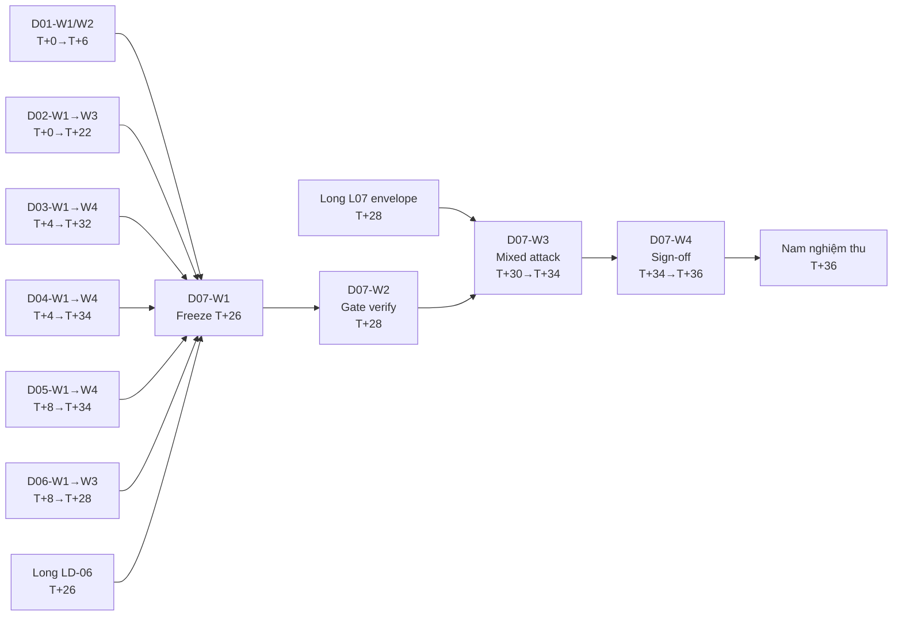

# FRS-D07 — Security Acceptance: Implementation Plan

| Thuộc tính | Giá trị |
|---|---|
| **TASK_ID** | D-06 |
| **FRS** | [FRS-D07-SECURITY-ACCEPTANCE.md](FRS-D07-SECURITY-ACCEPTANCE.md) |
| **Owner chính** | Đức (điều phối/attack matrix/sign-off); Nam (nghiệm thu cuối); Long (candidate/evidence bàn giao) |
| **Trạng thái** | NOT STARTED |
| **Deadline** | 00:00 12/10/2026 UTC+7 (~36h) |

> **CHỜ DUYỆT.** Không sửa application code, không commit/push/deploy.
> Cần final candidate từ Long (LD-06) trước khi D-06.01 Freeze. Code Đức viết cần reviewer khác.

---

## 1. Objective / Security Outcome

Nghiệm thu đúng candidate/capability đã chạy. Một report hoặc build xanh không chứng minh toàn hệ thống an toàn. Hết giờ không tự biến task thiếu evidence thành DONE.

**D-07 không generate controls mới** — D-07 aggregate evidence từ D-01 đến D-06 và chạy mixed attack protocol để xác nhận correctness/privacy/SLO trên đúng final candidate.

**Người dùng hợp lệ thấy gì:**
- Sau sign-off: gameplay/auth/history/SSE hoạt động đúng SLO
- Không có regress từ security fixes

**Output sign-off:**
- Matrix D-01…D-06: không orphan risk; verdict rõ
- Mixed attack report: counters/SLO/outcome đúng trong safe envelope
- Finding list: tất cả P0/P1 có owner/fix/retest
- Residual risk list: impact/mitigation/owner/Nam acknowledged

---

## 2. AC / DoD

| TASK_ID | Acceptance Criteria |
|---|---|
| D-06.01 | D01…D06 không orphan risk/control/test; environment/candidate/config xác định; Freeze checklist DONE |
| D-06.02 | Đủ runtime/browser/API/SSE/DB checks theo capability; thiếu check → NOT RUN/BLOCKED, không PASS |
| D-06.03 | Legitimate+hostile workloads đạt correctness/privacy/SLO trong safe envelope; counters và limits rõ |
| D-06.04 | Owner/severity/repro/fix candidate/retest đầy đủ; không unresolved release blocker |
| D-06.05 | Reviewer thực tế khác Đức cho code Đức viết; scope/coverage/limitations/residual risks rõ |
| D-06.06 | Nam nhận matrix, reports, finding list, tested runbook và next actions; release authorization riêng |

**DoD:** D-06.01…06 có evidence đúng final candidate; thay code/config/asset ảnh hưởng control → retest phần liên quan. Focused tests/build không thay real runtime/load gates. Scope còn blocker → không DONE; không tự cắt scope hoặc deploy để đóng gate.

---

## 3. Coverage và Mandatory Evidence Checklist

| Nhóm | Minimum evidence | KHÔNG được thay bằng |
|---|---|---|
| D01 policy | Assets/actors/boundaries; R01…R14 nối control/owner/test | Checklist chung không có attack path |
| D02 auth/abuse | HTTP/SSE/browser: rotation/recovery/ACL/CSRF/revoke, multi-account/shared-IP/spam, finite resources | Chỉ unit mock hoặc UI ẩn nút |
| D03 Online | Pinned runtime + real consumer + hostile fixtures + kill/reclaim + Linux/provider gate | AST rejection/direct probe/local cap thay provider proof |
| D04 Offline | Real opaque iframe/Worker, adversarial bridge/capabilities, cold offline, restore/privacy | Warm tab, fake Worker hoặc kit presence |
| D05 anti-cheat | Race/replay/crash boundaries + canary public projection | Happy-path single client hoặc build |
| D06 operations | Secrets/cache/artifact/retention/backup access và incident rehearsal | Bản hướng dẫn chưa chạy theo hoặc logs chứa secrets |

---

## 4. Mixed Attack Protocol

| Bước | Thực hiện | Điều kiện |
|---|---|---|
| 1 | Xác minh local/test target, DB disposable, candidate/config/runtime và generator | Không dùng production; không credentials trong report |
| 2 | Lock legitimate/attack rates, principals/IPs, match/stream mix, durations và safety stop | Report baseline/safe envelope từ Long; các giá trị hữu hạn |
| 3 | Baseline legitimate gameplay rồi cộng thêm room/account/command/history/SSE/preflight spam | Spam có action hợp lệ và trái phép; ID cũ/mới; multi-account/shared-IP |
| 4 | Đo offered/admitted/rejected/committed, p95/p99, CPU/RSS/lag/DB/queues/streams | Human ACK p95 ≤300 ms, p99 ≤1 s trong measured profile |
| 5 | Inject slow client/listener fault/runtime fault/DB delay; dừng nguồn spam | Fault isolation, bounded pressure/recovery/cleanup |
| 6 | So board/version/outcomes và canary scan; retest sau fix | Zero lost/double ACKed move; no unauthorized state change; no private leakage |

**Lưu ý:** Rejection không tính là served CCU. Mốc 1k/5k/10k chỉ PASS khi generator và environment thực sự đạt. Không hạ security/quota/durability để đạt số tải.

---

## 5. Ownership

| Phạm vi | Owner |
|---|---|
| D-06.01 Freeze/matrix aggregate | **Đức** điều phối; Long/Nam/Sơn confirm evidence |
| D-06.02 Mandatory gate status | **Đức** compile từ D-01…D-06 IMPL PLANs |
| D-06.03 Mixed attack harness + execution | **Đức** (harness design + execution) |
| D-06.03 Safe envelope baseline | **Long** (cung cấp từ L07 metrics) |
| D-06.04 Finding triage/owner assignment | **Đức** triage; owners (Long/Nam/Sơn) sửa |
| D-06.05 Review coordination | **Đức** điều phối; reviewer khác ký |
| D-06.06 Nam nghiệm thu | **Nam** (final acceptance) |
| Production release authorization | **Tách riêng** — không trong scope D-07 |

---

## 6. Waves

### D07-W1 — Freeze candidate + matrix aggregate
*T+26h → T+30h — BLOCKED chờ Long LD-06*

**Mục tiêu:** D-06.01 — freeze environment/candidate; aggregate D-01…D-06 verdict.

**Điều kiện mở:** Long bàn giao LD-06 (integrated candidate + baseline metrics). Tất cả D-01…D-06 IMPL PLANs có verdict (PASS/FAIL/NOT RUN/BLOCKED).

**Đức làm:**
- Compile matrix: `risk → control → owner → test → evidence → verdict` từ D-01…D-06
- Identify orphan risks (không có control), orphan tests (không nối risk), unresolved P0/P1
- Freeze: ghi candidate hash, environment (OS/Node/DB/runtime versions), config snapshot

**Long làm (LD-06):**
- Bàn giao integrated candidate
- Bàn giao baseline/load metrics (L07 safe envelope)
- Bàn giao tested runbook

**Output:**
- `tests/security/mixed-attack-protocol.ts`: harness design
- Freeze checklist: candidate/env/config documented
- D-06.01 matrix (consolidated)

**Exit gate:** D-06.01 AC: không orphan risk; environment xác định; Long LD-06 bàn giao DONE

**Effort:** Đức 3h compile; chờ Long LD-06 T+26h

**Trạng thái:** BLOCKED (chờ Long LD-06)

---

### D07-W2 — Mandatory gate verification
*T+28h → T+32h*

**Mục tiêu:** D-06.02 — verify tất cả mandatory checks đã có evidence hoặc BLOCKED rõ.

**Đức làm:**
- Cross-check D-03.ON-01…09, D-03.OFF-01…09, D-04.01…08, D-05.01…06 verdicts
- Ghi mỗi check: PASS/FAIL/NOT RUN/BLOCKED với lý do
- Identify missing evidence → classify: acceptable-BLOCKED, unacceptable-gap

**Missing evidence policy:**
| Situation | Verdict |
|---|---|
| Provider gate (D-03.ON-09): authorization chưa có | BLOCKED — acceptable; ghi rõ |
| Browser evidence (D-04.OFF): no browser env | BLOCKED — ghi rõ; là residual risk |
| Test chưa chạy vì candidate chưa bàn giao | NOT RUN — unacceptable nếu candidate đã có |
| Test chạy nhưng FAIL | FAIL — là release blocker nếu P0/P1 |

**Output:** D-06.02 gate status table; acceptable vs unacceptable gaps

**Exit gate:** Không unacceptable gap còn mở mà không có owner/timeline

**Effort:** Đức 2h

**Trạng thái:** NOT STARTED (phụ thuộc D07-W1)

---

### D07-W3 — Mixed attack regression
*T+30h → T+34h — BLOCKED chờ L07 safe envelope*

**Mục tiêu:** D-06.03 — chạy mixed attack protocol; xác nhận correctness/privacy/SLO.

**Điều kiện mở:** Long bàn giao L07 safe envelope baseline + disposable DB + candidate running.

**Đức làm:**
- `tests/security/mixed-attack-protocol.ts`: generator cho legitimate + spam workload
- Chạy mixed protocol (6 bước từ FRS-D07)
- Đo: offered/admitted/rejected, p95/p99 ACK, gameplay integrity, canary scan
- Safety stop nếu đạt pre-defined resource threshold

**Workload profile (từ Long L07 baseline — không tự đoán):**
```
legitimate: N concurrent gameplays (từ L07)
spam: M multi-account room/command/history/SSE requests
safety stop: CPU > 80% hoặc RSS > threshold L07
duration: cố định, có timer
```

**Output:** Mixed attack report; counter traces; p95/p99; canary scan result; gameplay correctness log

**Exit gate:** D-06.03 — human ACK p95 ≤300 ms trong measured profile; zero lost/double ACK; no canary leak; gameplay SLO

**Effort:** Đức 3h; chờ Long L07 T+28h

**Trạng thái:** BLOCKED (chờ Long L07 + disposable DB)

---

### D07-W4 — Finding resolution + review + Nam sign-off
*T+34h → T+36h*

**Mục tiêu:** D-06.04, D-06.05, D-06.06 — resolve findings, review, Nam nghiệm thu.

**Đức làm:**
- Compile finding list: `FINDING-ID | risk | severity | repro | owner | fix candidate | retest verdict`
- Ensure không P0/P1 unresolved
- Prepare scoped sign-off document với residual risks

**Review requirement (D-06.05):**
- Code Đức viết (csrf.middleware.ts, abuse.limiter.ts, fixtures): reviewer khác ký
- Review Bot của Nam: Đức có thể review
- Reviewer ghi rõ: đọc report hay tự chạy lại test

**Nam làm (D-06.06):**
- Nhận matrix, reports, finding list, runbook, residual risks
- Ký nghiệm thu hoặc request retest/clarification
- Production release authorization riêng — không trong scope D-07

**Output:**
- Finding list (all P0/P1 resolved/accepted)
- Scoped sign-off document với residual risks
- Nam acknowledgment

**Exit gate:** D-06.04: không unresolved P0/P1; D-06.05: reviewer xác nhận; D-06.06: Nam nghiệm thu

**Effort:** Đức 2h; chờ owners fix T+33h

**Trạng thái:** NOT STARTED (phụ thuộc W1/W2/W3)

---

## 7. Output từng Wave

| Wave | Artifact |
|---|---|
| D07-W1 | Freeze checklist; D-06.01 matrix; `mixed-attack-protocol.ts` design |
| D07-W2 | D-06.02 gate status table; acceptable/unacceptable gap list |
| D07-W3 | Mixed attack report (counters/p95/p99/canary); workload profile; safety stop log |
| D07-W4 | Finding list (all resolved); scoped sign-off; Nam acknowledgment; residual risk table |

---

## 8. Files / Owner / Dependency

| File | Owner | Dependency |
|---|---|---|
| `tests/security/mixed-attack-protocol.ts` (mới) | Đức | L07 safe envelope từ Long |
| D-06.01 matrix (consolidated) | Đức | D-01…D-06 IMPL PLANs verdicts |
| Sign-off document | Đức (draft); reviewer khác (ký) | D07-W2 gate table |
| Finding list | Đức | D-01…D-06 findings |
| Runbook (tested) | Long (draft + test); Đức (rehearsal) | LD-06/LD-07 |
| Production release authorization | Tách riêng | Không trong scope này |

---

## 9. Test / Evidence / Exit Gate

### Mixed attack evidence format

```
D-06.03 Mixed Attack Report
Date: <timestamp>
Candidate: <Long LD-06 diff/commit hash>
Environment: local Node <version>; DB disposable <ID>; runtime <wasmtime SHA/cpython SHA>
Workload profile (from L07): legitimate=<N>, spam=<M>, duration=<T>s, safety_stop=CPU>80%

Results:
  offered_requests: <N>
  admitted: <N>
  rejected: <N>  ← không tính là served
  committed_moves: <N>
  lost_moves: 0  ← MUST be 0
  double_acked: 0  ← MUST be 0
  p95_ack_ms: <X>  ← MUST be ≤300
  p99_ack_ms: <Y>  ← MUST be ≤1000
  peak_cpu_pct: <Z>
  peak_rss_mb: <W>
  canary_scan: ZERO_MATCH  ← or FAIL with details
  gameplay_correct: YES/NO  ← board state verified

Verdict: D-06.03 PASS/FAIL
Reviewer: [không Đức nếu code Đức trong test]
```

### Finding format (D-06.04)

```
FINDING-ID: D-06-F<n>
Source FRS: D-0X, TASK_ID D-0X.<n>
Risk: R<n>
Severity: P0/P1/P2/P3 + lý do
Repro: <steps từ fixture>
Expected: <behavior>
Actual: <observed>
Impact: <attack path nếu không fix>
Owner: <Long/Nam/Sơn>
Fix candidate: <diff hash>
Retest verdict: NOT RUN / PASS / FAIL
Retest reviewer: <reviewer>
```

### Residual risk format (D-06.05, D-06.06)

```
RESIDUAL-<n>: <Tên rủi ro>
Impact: <tấn công có thể xảy ra>
Mitigation hiện tại: <control đang có>
Gap: <điều kiện để exploit>
Owner: <ai theo dõi>
Nam acknowledged: YES/NO
```

---

## 10. Trạng thái

| Item | Trạng thái | Blocker |
|---|---|---|
| D07-W1 Freeze + matrix | BLOCKED | Long LD-06 candidate |
| D07-W2 Gate verification | NOT STARTED | D07-W1 |
| D07-W3 Mixed attack | BLOCKED | Long L07 safe envelope + disposable DB |
| D07-W4 Sign-off | NOT STARTED | W1/W2/W3 |
| D-06.01…06 AC | NOT RUN | — |

---

## 11. Mandatory Gates và Residual Risks

**Release blockers (chặn D-06.06):**
- Bất kỳ P0/P1 mở chưa có fix + retest → chặn sign-off
- Isolation/privacy/correctness violation dù severity thấp → chặn
- Mandatory evidence NOT RUN mà không có lý do BLOCKED được chấp nhận → chặn
- Code Đức viết chưa có reviewer khác → chặn

**Residual risks pre-accepted (từ FRS scope):**
| Risk | Mitigation | Nam acknowledged |
|---|---|---|
| Provider gate D-03.ON-09: authorization chưa có | Ghi BLOCKED; local gate PASS | TBD |
| Browser evidence D-04.OFF: phụ thuộc device | Ghi device/version; nếu không có browser → BLOCKED | TBD |
| Volumetric DDoS layer 3/4 | Ngoài scope application controls | TBD |
| Mixed attack SLO chỉ valid trong measured envelope | Không extrapolate sang scale lớn hơn | TBD |
| CAPTCHA/device fingerprint | Không implement theo policy | TBD |
| Long restart hoặc restart server reset `occupied` flag | Known gap trong D-03; ghi finding | TBD |

---

## 12. Dependency / Critical Path trong 36 giờ



**Critical path tuyến:**
```
D02-W1 (CSRF module, T+0) → Long LD-01 (T+6) → D02-W2 fixtures (T+8)
  → Long LD-03 (T+14) → D02-W3 abuse (T+14)
  → Long LD-04 (T+14) → D05-W2 tamper (T+14)
  → Long L-05 (T+18) → D05-W3 crash/canary (T+18)
  → Long LD-06 (T+26) → D07-W1 Freeze (T+26)
  → D07-W2 gate verify (T+28)
  → Long L07 + D07-W3 mixed attack (T+30)
  → D07-W4 sign-off (T+34)
  → Nam nghiệm thu (T+36)
```

**Checkpoint nhận candidate cho D-07:**
| CP | Thời điểm | Cần từ | Chặn nếu thiếu |
|---|---|---|---|
| CP-1 | T+8h | Long LD-01 (CSRF wiring) | D02-W2 fixtures NOT RUN |
| CP-2 | T+14h | Long LD-03/04; Nam N-01/N-04 | D02-W3, D05-W2 BLOCKED |
| CP-3 | T+18h | Long L-05; Nam N-05 | D05-W3, D06-W2 BLOCKED |
| CP-4 | T+26h | Long LD-06 (integrated final) | D07-W1 BLOCKED |
| CP-5 | T+28h | Long L07 safe envelope + disposable DB | D07-W3 BLOCKED |
| CP-6 | T+34h | All owners: P0/P1 fixed + retest | D07-W4 BLOCKED |
