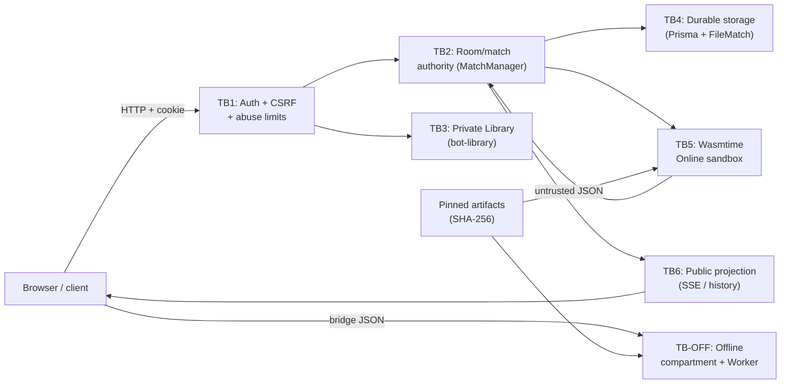

# OTTv2 Security Threat Matrix & Boundaries

*Generated per FRS-D01 (D01-W1)*

## 1. Threat Actors
- **Outsider:** Unauthenticated users attempting DDoS, credential stuffing, or network-level attacks.
- **Guest:** Authenticated via ephemeral sessions, attempting to bypass limits or squat resources.
- **Player:** Registered user playing a match, attempting to cheat, stall, or tamper with state.
- **Host:** Match creator, attempting to kick users unfairly or modify settings post-start.
- **Referee:** Privileged observer, attempting to exploit spectator mode for unfair advantage.
- **Spectator:** Read-only observer, attempting to leak private data or cause SSE fan-out OOM.
- **Bot:** Python code executing in sandbox, attempting to escape, leak data, or exhaust resources.
- **Website ngoài:** Third-party sites attempting CSRF or Clickjacking.
- **Artifact bị thay:** Compromised static assets or WebAssembly modules.

## 2. Trust Boundaries & Data Flow

## 3. Risk Matrix (R01-R14)

| Risk ID | Attack path | Severity | Control | Owner | Test | Trạng thái |
|---|---|---|---|---|---|---|
| R01 | Session giả / phiên hết hạn / revoked | P1 | Opaque token + DB revocation | Đức (auth); Long (stream) | D-02.01 | READY |
| R02 | Cross-room ACL; tự nhận referee/host | P1 | Object ACL server-side; role từ DB | Đức policy; Long/Nam | D-02.04 | READY |
| R03 | CSRF; brute-force login/recovery | P1 | Origin allowlist + `X-OTT-Request`; throttle | Đức | D-02.03, D-02.06 | READY |
| R04 | Python thoát sandbox: network/secrets/fs | P0 | Wasmtime WASI caps (`network:false` v.v.) | Nam (runtime); Đức | D-03.ON-02 | READY |
| R05 | Offline Python đọc DOM/storage/gọi network | P1 | Opaque iframe + CSP + bridge schema | Nam (compartment); Đức | D-03.OFF-02 | READY |
| R06 | Loop/OOM/output flood/upload spam | P1 | Manifest quotas + watchdog + bounded API | Nam; Đức + Long | D-03.ON-03, D-02.08 | READY |
| R07 | Sửa board/seed/side/clock/winner | P1 | Server authority; versioned checkpoint | Long; Nam | D-04.01, D-04.02 | READY |
| R08 | Duplicate/stale commands; race Stop/Resume | P1 | Idempotency + serialized lane + epoch fence | Long | D-04.03, D-04.05 | READY |
| R09 | Source/memory/log lọt SSE/snapshot/replay | P1 | DTO allowlist; owner ACL; redaction | Long + Nam; Đức | D-04.08 | READY |
| R10 | Markup/script injection qua tên/log/error | P2 | Safe rendering; bounded input; CSP | Sơn UI; Nam; Đức | D-01.R10 | READY |
| R11 | Asset bị thay; secrets trong bundle/log/cache | P1 | SHA-256 pin; secret hygiene; cache isolation | Nam/Long/Sơn | D-05.01, D-05.04 | READY |
| R12 | Export/delete trái quyền; restart hỏi quyền cũ | P1 | Ownership guards; revocation-aware recovery | Long + Nam; Đức | D-05.05 | READY |
| R13 | Auto-click/multi-account phòng/nước/stream | P1 | Layered rate/concurrency/resource caps | Đức; Long; Nam | D-02.08, D-02.09 | READY |
| R14 | SQL/command injection qua field/URL/filename | P1 | Strict schemas; parameterized queries | Owner từng module | D-01.R14 | READY |

## 4. Kiểm tra Coverage (D-01.05)
- **Tất cả các actors** (Outsider, Guest, Player, Host, Referee, Spectator, Bot, Website ngoài, Artifact bị thay) đã được bao phủ bởi ít nhất một Risk ID (ví dụ R01, R03 cho outsider/guest; R07, R08 cho player/host; R04, R05 cho Bot; R10, R11 cho external/artifacts).
- **Trạng thái Gate:** Mở chặn cho phép các Wave tiếp theo (D01-W2, D02, D03, v.v.) triển khai dựa trên matrix này.
