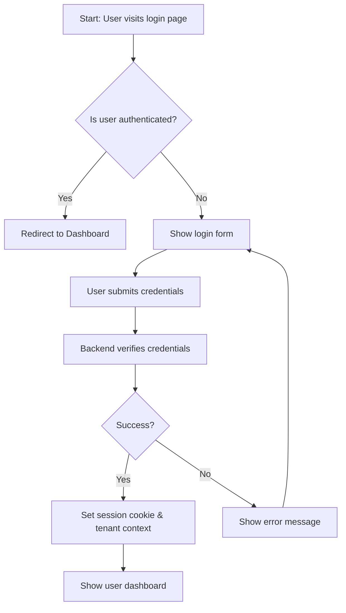

# Wireframe – P09: Account Bootstrap & Authentication

**Description**: This flow outlines the authentication entry point (page P09). It includes tenant binding after successful login and ensures role-based redirection. Security considerations: passwords never logged, session cookie HttpOnly, server-side role enforcement.
