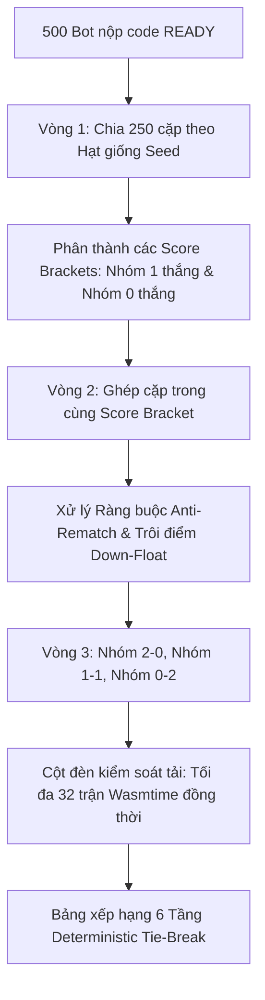

# HƯỚNG DẪN KIỂM THỬ ĐẤU TRƯỜNG 500 BOT PYTHON (BOT_VS_BOT)
**Dự án:** OTT v2 — Robot Lab Platform  
**Chế độ thi đấu:** `BOT_VS_BOT` (Nộp code thuật toán đấu cờ tự động)  
**Quy mô giả lập:** 500 Bot trí tuệ nhân tạo (750 trận đấu qua 3 vòng Thụy Sĩ)  
**Tác giả:** Sơn (`son-tournament`)  
**Ngày cập nhật:** 24/10/2026

---

## 1. Bản chất & Luồng hoạt động của chế độ BOT_VS_BOT

Khác với chế độ `HUMAN_ONLINE` (nơi hai người chơi cầm chuột kéo thả quân cờ trên bàn cờ), chế độ **`BOT_VS_BOT`** là một đấu trường trí tuệ nhân tạo thuần túy:

### 1.1. Người chơi nộp code như thế nào?
1. **Chuẩn ABI `@ottv2/bot-sdk`:**
   Mỗi người chơi/lập trình viên viết một file mã nguồn Python (dung lượng tối đa `botSourceMaxBytes = 64KB`), hiện thực hàm bắt buộc:
   ```python
   def choose_move(view: GameView, budget: TurnBudget) -> Move:
       # view: Chứa dữ liệu bàn cờ 9x9, vị trí các quân R (Rock), P (Paper), S (Scissors), ô đích Goal, chỉ số phụ
       # budget: Thời gian còn lại (botRuntimeTimeoutMs = 1000ms), giới hạn RAM (botMemoryLimitMb = 64MB)
       return {"from": {"row": 7, "col": 3}, "to": {"row": 6, "col": 3}}
   ```
2. **Cổng kiểm thử Sandbox (Preflight Verification P16):**
   - Khi nộp code, server đưa code vào môi trường cách ly nghiêm ngặt **Wasmtime Supervisor + CPython WASI**.
   - Server chạy thử 1 nước đi mẫu để kiểm tra tính tương thích ABI, cú pháp, và mức độ tiêu thụ bộ nhớ/CPU.
   - Nếu code hợp lệ: Hệ thống cấp biên lai chứng nhận **`BotReadinessReceipt`** với `outcome: "ACCEPTED"`, trạng thái chuyển sang **`READY`**, và băm SHA-256 mã nguồn để ghim phiên bản (`pinnedBotRevisionId`).
   - Nếu code lỗi (vòng lặp vô tận, cú pháp sai, hoặc gọi các thư viện bị cấm như `os`, `subprocess`, `socket`): Bị đánh dấu `INCOMPATIBLE` và từ chối.
3. **Cổng khóa điều kiện khởi tranh (`evaluateReadiness`):**
   - Giải đấu `BOT_VS_BOT` **tuyệt đối không thể chuyển sang trạng thái `RUNNING`** nếu vẫn còn thí sinh ở trạng thái `NOT_SUBMITTED`, `PENDING` hoặc `INCOMPATIBLE`.
   - Toàn bộ 500 bot bắt buộc phải đạt trạng thái `READY` trước thời điểm `botDeadlineAt`.

### 1.2. Trận đấu diễn ra thế nào?
- Khi trọng tài/hệ thống bấm Khởi tranh, động cơ thi đấu (Match Engine) trên backend tự động triệu hồi 2 tiến trình sandbox cho 2 bot.
- Từng lượt đi của 2 bot được server thu thập, xác thực luật cờ, và phát sóng trực tiếp (SSE) tới người xem hoặc khán giả qua giao diện bàn cờ Robot Lab.
- Không có bất kỳ thao tác kéo thả cờ thủ công nào từ phía người chơi.

---

## 2. Cơ chế Xếp cặp & Bảng đấu cho 500 Bot (Swiss Score Adjacent)

Khi số lượng thí sinh lên tới **500 bot**, việc chia bảng đấu hoặc đấu vòng tròn (Round Robin) là bất khả thi (đấu vòng tròn cần tới $\frac{500 \times 499}{2} = 124.750$ trận đấu!).  
Do đó, hệ thống áp dụng thể thức **Đấu trường liên tục (`ARENA_CONTINUOUS`)** kết hợp thuật toán **Thụy Sĩ lân cận điểm (`SWISS_SCORE_ADJACENT`)**:



### 2.1. Phân nhóm điểm (Score Brackets) qua từng vòng
- **Vòng 1 (Khởi động):**
  - Tất cả 500 bot xuất phát cùng mốc 1000 điểm và 1000 Elo.
  - Xếp hạt giống từ 1 đến 500 dựa trên điểm đánh giá ban đầu. Chia nửa danh sách: Bot 1 đấu Bot 251, Bot 2 đấu Bot 252,... tạo thành 250 cặp đấu đồng thời.
- **Vòng 2 (Phân cực):**
  - Sau vòng 1, xuất hiện 2 nhóm điểm rõ rệt:
    * **Nhóm 1 Thắng (250 bot):** Điểm tăng lên ~1041đ, Elo tăng lên ~1016.
    * **Nhóm 0 Thắng (250 bot):** Điểm giữ mức ~992đ, Elo giảm xuống ~984.
  - Thuật toán `SWISS_SCORE_ADJACENT` chỉ cho phép các bot trong nhóm 1-0 đấu với nhau, và bot nhóm 0-1 đấu với nhau.
- **Vòng 3 trở đi:**
  - Tiếp tục chia nhỏ thành các rổ điểm: Nhóm 2-0 (125 bot), Nhóm 1-1 (250 bot), Nhóm 0-2 (125 bot).

### 2.2. Xử lý số lẻ & Trôi điểm (Down-float & Bye)
- Khi một nhóm điểm có số lẻ (ví dụ 125 bot ở nhóm 2-0): Con bot có điểm Elo thấp nhất trong nhóm sẽ được "trôi xuống" (Down-float) để ghép với con bot có Elo cao nhất của nhóm 1-1.
- Nếu cả giải đấu có tổng số bot là số lẻ (ví dụ 499 bot): Con bot chưa từng được miễn đấu ở nhóm điểm đáy sẽ nhận vé **Bye** (miễn đấu) và tự động nhận `byeScorePoints = 10` điểm.

### 2.3. Ràng buộc chống gặp lại (Anti-rematch Guard)
- **`maxPairMeetings: 2`**: Hai con bot bất kỳ chỉ được phép đối đầu tối đa 2 lần trong toàn bộ giải đấu để tránh hiện tượng cày điểm lẫn nhau.
- **`rematchCooldownMinutes: 5`**: Sau khi một trận kết thúc, 2 bot đó phải trải qua thời gian làm nguội ít nhất 5 phút (hoặc sau 1 vòng đấu khác) mới được phép tái đấu.

### 2.4. Kiểm soát tải đồng thời (Concurrency Throttling)
- 500 bot tương đương 250 trận đấu đồng loạt. Nếu khởi chạy 250 sandbox Wasmtime cùng lúc sẽ dẫn tới cạn kiệt CPU/RAM server.
- Hệ thống áp dụng tham số `maxConcurrentMatches: 32`:
  * 32 trận đấu đầu tiên được phân bổ Worker thực thi ngay.
  * 218 trận còn lại nằm trong hàng đợi `QUEUED`.
  * Ngay khi một trận đấu kết thúc và ghi điểm vào Sổ cái `TournamentScoreLedgerRecord`, Worker sẽ bốc trận tiếp theo trong hàng đợi ra chạy ngay lập tức.

---

## 3. Thuật toán Xếp hạng Bảng điểm (6-Level Deterministic Tie-Break)

Bảng xếp hạng 500 bot được tính toán tức thì bằng thuật toán chuẩn hóa bất biến xác định qua 6 tầng phân hạng:

$$\text{Hạng 1} \longrightarrow \text{Hạng 500}$$

| Tầng | Tiêu chí phân hạng | Ý nghĩa nghiệp vụ |
| :---: | :--- | :--- |
| **1** | **Điểm giải đấu (`tournamentScore`)** | Điểm số tích lũy qua từng trận theo công thức `ELO_WEIGHTED_V1` (Thắng bot mạnh được cộng nhiều điểm hơn). |
| **2** | **Chỉ số Elo động (`tournamentElo`)** | Chỉ số Elo tính toán theo FIDE với $K = 32$. Bot thắng liên tiếp đối thủ hạt giống cao sẽ có Elo vượt trội. |
| **3** | **Tổng số trận thắng (`wins`)** | Ưu tiên bot có nhiều trận thắng trực tiếp hơn nếu bằng cả Điểm và Elo. |
| **4** | **Tổng số trận thua (`losses`)** | Ưu tiên bot ít trận thua hơn (hiệu suất thi đấu tốt hơn). |
| **5** | **Thứ tự hoàn thành (`lastFinishedSequence`)** | Bot nào chạm mốc điểm số sớm hơn trên Sổ cái sẽ được xếp trên (khuyến khích giải thuật tối ưu tốc độ). |
| **6** | **Mã định danh duy nhất (`personKey`)** | So sánh từ điển chuỗi `BOT-xxx` (`localeCompare`). Đảm bảo 100% không bao giờ bị nhảy thứ hạng giữa các lần làm mới. |

---

## 4. Dữ liệu đã Giả lập Thành công trong Hệ thống

Hệ thống đã chạy thành công script giả lập giải đấu **`tour-bot-500`** với các chỉ số thực tế trong cơ sở dữ liệu:

- **Mã giải đấu:** `BOT-ARENA-500` (ID: `tour-bot-500`)
- **Tên giải:** Đại Chiến 500 Chiến Binh Bot Python (BOT_VS_BOT)
- **Tổng số Bot tham gia:** 500 Bot (`BOT-001` đến `BOT-500`)
- **Tình trạng Bot:** 100% đạt chuẩn `READY` (đã nộp code, băm SHA-256 preflight)
- **Đơn vị tham gia:** Phân bổ đều qua 8 viện trường lớn:
  * `VNU_DHQG` (Đại học Quốc gia Hà Nội)
  * `HUST_BK` (Đại học Bách Khoa Hà Nội)
  * `UIT_CNTT` (ĐH Công nghệ Thông tin - ĐHQG TP.HCM)
  * `FPT_TECH` (Đại học FPT)
  * `PTIT_BCVT` (Học viện CNBC Viễn thông)
  * `HCMUS_KHTN` (ĐH Khoa học Tự nhiên - ĐHQG TP.HCM)
  * `DUT_BKDN` (Đại học Bách Khoa Đà Nẵng)
  * `NEU_KTQD` (Đại học Kinh tế Quốc dân)
- **Số trận đấu đã hoàn tất:** **750 trận đấu** (3 vòng Thụy Sĩ đầy đủ)
- **Vụ phán quyết hòa đang chờ Trọng tài (P05):** 1 trận đấu giữa 2 bot dẫn đầu (`Top 1` vs `Top 2`) sau 100 nước đi hòa chỉ số vật chất, độ cơ động và khoảng cách đích.

---

## 5. Hướng dẫn Thao tác Kiểm thử trên Giao diện Web

Bạn có thể mở trình duyệt và kiểm tra trực tiếp tại các đường link sau:

### Bước 1: Xem Bảng xếp hạng 500 Bot (P04)
👉 **URL:** [http://localhost:3000/admin/tournaments/tour-bot-500](http://localhost:3000/admin/tournaments/tour-bot-500)
- Kiểm tra danh sách bảng xếp hạng hiển thị đủ 500 bot kèm Huy chương Vàng (#1), Bạc (#2), Đồng (#3).
- Xem điểm số, Elo, số trận Thắng/Thua, và thứ hạng được xếp theo đúng 6 tầng tiêu chí.

### Bước 2: Xem Danh sách Hồ sơ 500 Thí sinh & Bot (P03)
👉 **URL:** [http://localhost:3000/admin/tournaments/tour-bot-500/roster](http://localhost:3000/admin/tournaments/tour-bot-500/roster)
- Kiểm tra toàn bộ 500 hồ sơ bot đều mang nhãn **Sẵn sàng (READY)** và có mã băm phiên bản revision.

### Bước 3: Đóng vai Trọng tài Phán quyết Hòa (P05)
👉 **URL:** [http://localhost:3000/admin/tournaments/tour-bot-500/adjudications](http://localhost:3000/admin/tournaments/tour-bot-500/adjudications)
- Bạn sẽ thấy 1 trận đấu giữa 2 con bot hàng đầu đang ở trạng thái **Đang chờ phán quyết (WAITING)**.
- Bấm vào trận đấu để xem bàn cờ 9x9 Robot Lab bị đóng băng cùng bảng chỉ số so sánh (Khoảng cách đích, Vật chất Rock/Paper/Scissors, Độ cơ động).
- Bấm nút **"Phán quyết Bên Xanh Thắng"** hoặc **"Phán quyết Bên Đỏ Thắng"** để ghi nhận kết quả vào Sổ cái.

### Bước 4: Chạy lại giả lập bất kỳ lúc nào bằng 1 lệnh duy nhất:
```bash
npm run simulate:500-bots
```
Lệnh trên sẽ tự động xóa sạch dữ liệu cũ, tái tạo lại 500 bot và 750 trận đấu Thụy Sĩ trong vòng chưa đầy 3 giây!
