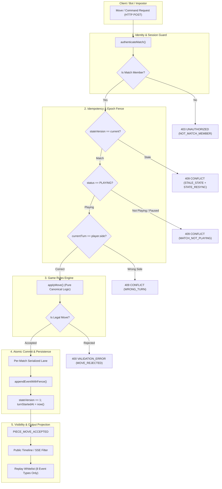

# Anti-Cheat & Privacy Architecture Specification (D05-W1)

| Thuộc tính | Giá trị |
|---|---|
| **TASK_ID** | D-04 (Wave: D05-W1) |
| **Owner** | Đức (Thiết kế test / Fixtures / Canary Spec); Long (Authority / Data / SSE); Nam (Bot Controller) |
| **Phạm vi** | Tampered Payloads, StateVersion Fencing, Idempotent Execution, Privacy Canary Scanning |
| **Trạng thái** | DONE (Fixtures & Canaries sẵn sàng; chờ Long LD-04 và disposable DB để chạy W2) |

---

## 1. Authority Commit & Anti-Cheat Pipeline (Architecture Diagram)

Hệ thống bảo đảm mọi hành động thay đổi trạng thái bàn cờ và quyền trận đấu phải đi qua một chuỗi hàng rào kiểm soát nghiêm ngặt trước khi ghi nhận vào bộ nhớ bền vững (durable persistence):

---

## 2. Danh mục Tamper Vectors (D-04.01 … D-04.07)

| Mã Fixture | Hạng mục kiểm thử | Kịch bản tấn công | Mã lỗi kỳ vọng | Invariant bắt buộc |
|---|---|---|---|---|
| **D-04.01-T1** | Side Tampering | BLUE gửi move khi đang là lượt của RED | 409 `WRONG_TURN` | Bàn cờ, số nước đi không đổi |
| **D-04.01-T2** | Membership Tampering | Impostor / Spectator gửi move | 403 `NOT_MATCH_MEMBER` | Không sinh event, không đổi state |
| **D-04.01-T3** | StateVersion Tampering | Gửi move với stateVersion cũ | 409 `STALE_STATE` | Không ghi nhận nước đi trùng |
| **D-04.01-T4** | Illegal Move Coordinates | Gửi nước đi nhảy cóc không hợp lệ | 400 `MOVE_REJECTED` | `PIECE_MOVE_REJECTED` emit, board giữ nguyên |
| **D-04.02-T1** | Seed Tampering | Client gửi seed tự chọn trong rematch | 200 `SEED_IGNORED` | Server tự sinh seed độc lập |
| **D-04.02-T2** | Refresh Reroll | F5/refresh trang khi countdown | 200 `STATE_PERSISTED` | Vị trí quân cờ giữ nguyên 100% |
| **D-04.03-T1** | Duplicate Command | Resend cùng một sequence move | 409 `STALE_STATE` | Không double-ACK, không sinh move thứ 2 |
| **D-04.04-T1** | Move vs Referee Pause | Gửi move khi trạng thái PAUSED | 409 `MATCH_NOT_PLAYING` | Đồng hồ đóng băng, nước đi bị chặn |
| **D-04.04-T2** | Move vs Terminal | Gửi move khi trận đã FINISHED | 409 `MATCH_FINISHED` | Kết quả người thắng không đổi |
| **D-04.05-T1** | Epoch/Revision Race | Late output từ trận trước bay vào rematch | 409 `STALE_MATCH_GENERATION` | Nước đi trễ bị drop sạch sẽ |
| **D-04.06-T1** | Referee Revocation | Trọng tài cũ gửi lệnh sau khi bị thay thế | 403 `NOT_ACTIVE_REFEREE` | Trận đấu không bị tạm dừng trái phép |
| **D-04.06-T2** | Guest as Referee | Guest session cố gắng điều khiển trọng tài | 403 `GUEST_REFEREE_FORBIDDEN` | Guest tuyệt đối không có quyền referee |
| **D-04.07-T1** | Crash Settlement | Server crash giữa commit | 200 `CHECKPOINT_RESTORED` | State khôi phục đúng điểm commit cuối |

---

## 3. Quy trình quét rò rỉ Privacy Canary (D-04.08)

Các chuỗi Canary sentinels:
- `CANARY_SOURCE_2026`: `# CANARY_SOURCE_TEST_2026_SENTINEL` (cài vào code Python của bot)
- `CANARY_MEMORY_2026`: `CANARY_MEMORY_TEST_2026_SENTINEL` (cài vào JSON memory)
- `CANARY_LOG_2026`: `CANARY_LOG_TEST_2026_SENTINEL` (cài vào log thực thi)
- `CANARY_SESSION_2026`: `CANARY_SESSION_TEST_2026_SENTINEL` (cài vào cookie/token)

### Các bề mặt quét bắt buộc (Scan Surfaces):
1. **Public APIs:** `/rooms/:id`, `/matches/:id`.
2. **SSE Streams:** `/rooms/events`, `/matches/:id/events` (dành cho spectator và đối thủ).
3. **Replay & Audit:** `/history/:id/replay` (kiểm tra whitelist chỉ phát 8 public event types).
4. **Diagnostics:** `/metrics`, `/diagnostics/r3/provider`.
5. **Fastify Error Handlers:** Trường `details` trong response JSON của `AppError`.

**Tiêu chí nghiệm thu (Exit Gate):**
- Kết quả quét tự động đạt **ZERO MATCHES** trên toàn bộ các bề mặt công khai.
- Chỉ chủ sở hữu (Owner) khi xác thực vào `/bot-library/:id` mới có quyền đọc được `CANARY_SOURCE_2026`.

---

## 4. Handoff Criteria sang Wave D05-W2
1. **Long (LD-04):** Bàn giao candidate match routes kèm serialized lane và cung cấp disposable DB riêng (tuyệt đối không dùng default `DATABASE_URL`).
2. **Kích hoạt D05-W2:** Thực thi bộ kịch bản từ `ANTI_CHEAT_FIXTURES` trên API endpoint thực tế và ghi nhận mã phản hồi cùng tính toàn vẹn của state.
