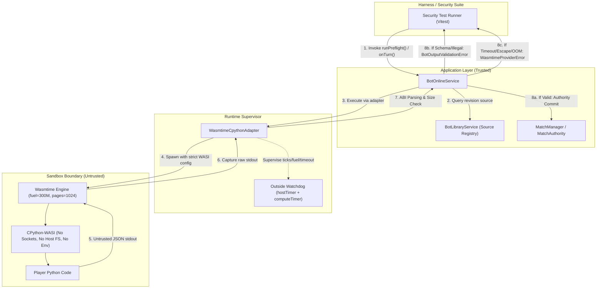

# Bot Sandbox Fixture Runner & Consumer Path Specification (D03-W1)

| Thuộc tính | Giá trị |
|---|---|
| **TASK_ID** | D-03.ON (Wave: D03-W1) |
| **Owner** | Đức (Thiết kế test / Fixtures); Nam (Handoff tiêu chuẩn runtime); Long (Admission/Authority) |
| **Phạm vi** | Đặc tả Application Consumer Path, Bộ Fixtures D-03.ON-01…07, Quy trình kiểm thử hộp đen Sandbox |
| **Trạng thái** | DONE (Fixtures & Spec sẵn sàng; chờ Nam N-01/N-04 candidate để chạy W2) |

---

## 1. Consumer Path Architecture & Diagram

Theo quy tắc bất di bất dịch của FRS-D03, **tuyệt đối không kiểm thử bằng native Python subprocess hoặc direct probe CLI**. Mọi kịch bản kiểm thử sandbox phải đi xuyên suốt qua **Application Consumer thật**:

### Chi tiết các bước thực thi luồng Application Consumer:
1. **Preflight Path (`runPreflight`):**
   `Test Runner` → `BotOnlineService.runPreflight(botId, roomId, abortSignal)` → `BotLibraryService.getRevision()` → `WasmtimeCpythonAdapter.runPreflight(source, signal)` → CPython-WASI execution → Parse output JSON → Kiểm tra tính hợp lệ của move ban đầu.
2. **Turn Path (`runTurn`):**
   `Test Runner` → `BotOnlineService.onTurn(roomId, match, side, abortSignal)` → Lấy state hiện tại của bàn cờ và committed memory từ lượt trước → `WasmtimeCpythonAdapter.runTurn(...)` → CPython-WASI execution → Validate legal moves theo canonical game rules → Gửi commit sang `MatchManager.move(...)`.

---

## 2. Danh mục Fixtures đã thiết kế (`tests/security/bot-sandbox-fixtures.ts`)

| Mã Fixture | Nhóm kiểm thử | Loại | Mục tiêu | Kết quả kỳ vọng |
|---|---|---|---|---|
| **D-03.ON-01-POS** | Positive Control | Control | Mã Python hợp lệ trả về legal move và memory | `ALLOW` (Move được commit hợp lệ) |
| **D-03.ON-02-NET** | Network Isolation | Hostile | Python import `socket` và connect ra ngoài (`8.8.8.8:53`) | `DENY` (`WasmtimeProviderError`, cấm mở socket) |
| **D-03.ON-02-SEC** | Secrets Isolation | Hostile | Python truy cập `os.environ` để tìm secret/canary | `DENY` (`BotOutputValidationError`, `os.environ` rỗng hoặc bị chặn) |
| **D-03.ON-02-FS** | Filesystem Traversal | Hostile | Python đọc `/etc/passwd` hoặc ghi file cục bộ | `DENY` (`WasmtimeProviderError`, `filesystem: false`) |
| **D-03.ON-03-LOOP** | Infinite Loop / Hang | Hostile | `while True: pass` để vắt kiệt CPU | `DENY` (Timeout sau đúng 500ms, watchdog kill) |
| **D-03.ON-03-OOM** | Memory Exhaustion | Hostile | Cấp phát mảng byte > 80 MiB (vượt trần 64 MiB linear memory) | `DENY` (`MemoryError` bên trong WASM, process exit an toàn) |
| **D-03.ON-04-NAN** | Malformed Output | Hostile | Trả về JSON chứa `NaN` / `Infinity` | `DENY` (`BotOutputValidationError`, không commit lên board) |
| **D-03.ON-04-ILLEGAL** | Illegal Move Cheat | Hostile | Trả về tọa độ ngoài `legalMoves` (ví dụ `"a1" -> "i9"`) | `DENY` (`BotOutputValidationError`, state không đổi) |
| **D-03.ON-05-LEAK** | State Isolation | Hostile | Ghi global state để kiểm tra cross-invocation leakage | `ALLOW/ISOLATED` (Mỗi invocation là một WASM instance mới) |
| **D-03.ON-06-CANCEL** | Abort Race / Cancel | Hostile | `AbortSignal` kích hoạt khi script đang sleep | `DENY` (`RuntimeCancelledError`, không late commit) |
| **D-03.ON-07-HASH** | Binary Pin Integrity | Hostile | Inject SHA-256 binary sai lệch | `DENY` (`WasmtimeProviderError`, fail-closed, không fallback) |

---

## 3. Quy chuẩn Sentinel & An toàn dữ liệu
- **Canary Strings:** Tuyệt đối không dùng canary chứa secret thật, API token hoặc key production. Các sentinel string được quy chuẩn dạng:
  - `CANARY_NETWORK_TEST_2026`
  - `CANARY_ENV_LEAK_2026`
  - `CANARY_FS_LEAK_2026`
  - `CANARY_CROSS_INVOCATION_2026`
- **Fail-closed Invariant:** Bất kỳ lỗi khởi tạo runtime nào cũng phải dẫn tới trạng thái từ chối an toàn, không kích hoạt cơ chế fallback chạy Python cục bộ bằng Node `child_process.spawn("python3", ...)`.

---

## 4. Handoff Criteria sang Wave D03-W2
1. **Nam (N-01 / N-04):** Bàn giao runtime candidate kèm file binary Wasmtime Linux/Windows và CPython-WASI đã được verify checksum SHA-256.
2. **Kích hoạt D03-W2:** Khi nhận candidate từ Nam, test runner sẽ nạp các fixtures từ `BOT_SANDBOX_FIXTURES` và thực thi tuần tự qua `BotOnlineService` để thu thập `computeMs`, `rssPeakMb`, và `cleanupMs`.
