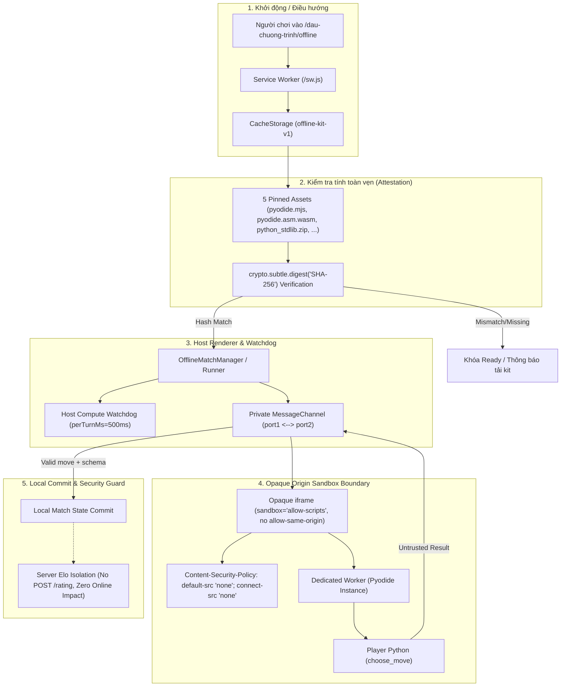

# Offline Sandbox Runner & Consumer Path Specification (D04-W1)

| Thuộc tính | Giá trị |
|---|---|
| **TASK_ID** | D-03.OFF (Wave: D04-W1) |
| **Owner** | Đức (Thiết kế probe / Fixtures); Nam (Compartment / Worker / Kit / Cache); Long (Server Elo Guard) |
| **Phạm vi** | Consumer Path Architecture, Pyodide Opaque Compartment, Bridge MessageChannel Security, Canary Design |
| **Trạng thái** | DONE (Sẵn sàng cho Nam N-05 candidate để chạy D04-W2 trong browser thật) |

---

## 1. Consumer Path Architecture & Cold Offline Mapping

Trong chế độ Bot Offline, toàn bộ mã nguồn Python của người chơi được thực thi hoàn toàn ở phía client (trình duyệt) thông qua **Pyodide WebAssembly**, nằm trong một **opaque-origin iframe sandbox kết hợp Web Worker cô lập**. 

### Mermaid Diagram: Cold Offline Consumer Path

---

## 2. Thiết kế Canary Sentinels & Anti-Leak Verification

Để đảm bảo việc phát hiện rò rỉ dữ liệu là khách quan, chính xác và không phụ thuộc vào code analysis tĩnh (AST parsing), các probe sử dụng các chuỗi **Canary Sentinels** được định nghĩa trước:

| Canary Identifier | Chuỗi Canary (Test Data) | Mục đích kiểm thử | Vị trí cài cắm (Setup) |
|---|---|---|---|
| `CANARY_DOM` | `CANARY_DOM_OFFLINE_2026` | Ngăn Bot đọc cây DOM cha của ứng dụng | Cài vào `document.body.dataset.canary` của trang chủ |
| `CANARY_COOKIE` | `CANARY_COOKIE_OFFLINE_2026` | Ngăn Bot đọc cookie phiên đăng nhập | Cài vào `document.cookie = "session_canary=..."` |
| `CANARY_STORAGE` | `CANARY_STORAGE_OFFLINE_2026` | Ngăn Bot đọc `localStorage` / `IndexedDB` | Cài vào `localStorage.setItem("canary_key", ...)` |
| `CANARY_BRIDGE` | `CANARY_BRIDGE_OFFLINE_2026` | Ngăn giả mạo gói tin qua window postMessage | Gửi trực tiếp qua `window.postMessage()` |

### Nguyên tắc xác minh:
1. **Opaque Origin Proof:** Iframe sandbox được cấu hình `sandbox="allow-scripts"` (tuyệt đối **không** có `allow-same-origin`). Trình duyệt tự động gán origin là `null`. Mọi nỗ lực truy cập `parent.document`, `document.cookie`, `localStorage` từ bên trong frame đều lập tức ném ra lỗi `DOMException: SecurityError`.
2. **CSP Engine Enforcement:** Thẻ meta CSP bên trong `srcdoc` kích hoạt:
   `default-src 'none'; connect-src 'none'; form-action 'none';`
   → Chặn đứng mọi lệnh `fetch()`, `XMLHttpRequest`, `WebSocket`, `EventSource`.
3. **Sentinels Absent:** Kết quả move và memory trả về qua `port1` được quét chuỗi tự động; nếu phát hiện bất kỳ chuỗi `CANARY_*` nào, bài test lập tức đánh giá **FAIL**.

---

## 3. Bridge Attack Vectors & Cơ chế phòng chống

### Vector 1: Forged `window.postMessage()`
- **Kịch bản:** Kẻ tấn công hoặc script độc hại trên trang chính gọi `window.postMessage({ kind: 'run', ... }, '*')`.
- **Phòng chống:** `FRAME_BOOTSTRAP` chỉ đăng ký một listener tạm thời cho `OTT_OFFLINE_INIT` để nhận `MessagePort`, sau đó lập tức gọi `window.removeEventListener('message', init)`. Mọi giao tiếp sau đó chuyển sang `Private MessageChannel` (port khép kín).

### Vector 2: State Machine Phase Manipulation
- **Kịch bản:** Gửi gói tin `{ kind: 'booted' }` hoặc `{ kind: 'result' }` khi runtime chưa xong phase `FRAME`.
- **Phòng chống:** `offlineCompartment.ts` duy trì biến trạng thái `phase` (`FRAME` → `RUNTIME` → `COMPUTE`). Nhận payload sai phase kích hoạt `fail("RUNTIME_ISOLATION_FAILED")` ngay lập tức.

### Vector 3: Stale Invocation & Late Result Commit
- **Kịch bản:** Bot bị timeout (sau 500ms), nhưng Worker vẫn tiếp tục tính toán và trả về nước đi sau 2 giây.
- **Phòng chống:** Khi hết giờ, `computeTimer` kích hoạt `cleanup()`: gọi `worker.terminate()`, đóng `channel.port1.close()`, gỡ iframe khỏi DOM và đặt `settled = true`. Mọi message trễ đều bị drop, không cho phép late commit.

### Vector 4: Local Result Không Sinh Elo Online (D-03.OFF-09)
- **Kịch bản:** Người chơi thắng Bot Offline và cố gắng gửi kết quả này về server để tăng điểm xếp hạng.
- **Phòng chống:** Toàn bộ `offlineMatchManager` chỉ giải quyết trạng thái trong bộ nhớ cục bộ, không tồn tại bất kỳ endpoint hoặc network call nào tới server liên quan đến trận Offline.

---

## 4. Handoff Criteria sang Wave D04-W2
1. **Nam (N-05):** Cung cấp candidate module `offlineCompartment.ts` và kit cache sẵn sàng.
2. **Kích hoạt D04-W2:** Thực thi kịch bản kiểm thử trong browser thật (Playwright Chrome/Firefox), nạp các probe từ `OFFLINE_PROBES` và thu thập console log, memory trace, và isolation proofs.
